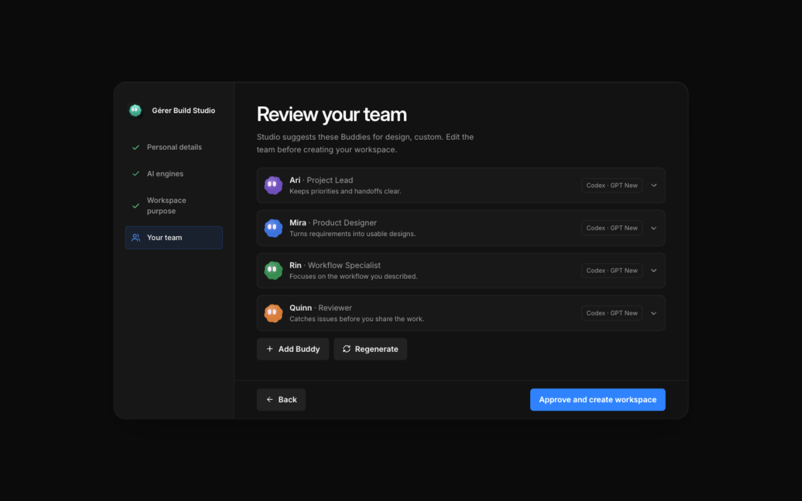
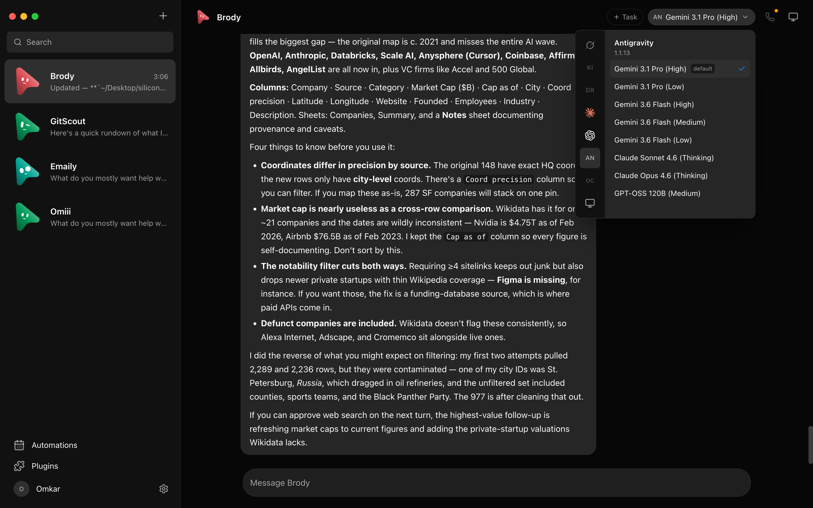

# Gérer Build Studio

**v0.1 Alpha · Internal testing**

Gérer Build Studio is a desktop workspace for working with AI Buddies. Give each Buddy a role, bring specialists together in rooms, and keep chats, project files, tasks, and scheduled work in one place.


## Install the internal alpha

The alpha installer is for **Apple silicon Macs**. Get the DMG from the internal launch handoff, open it, and drag **Gerer Build Studio** to Applications. Follow any installation instructions supplied with your internal build. The Windows packaging command is available for development. A Windows install requires a separate smoke test.

Application updates are paused during the alpha. To install a newer build, quit Studio and replace the application in Applications. Studio keeps its workspace data separately. Back up important workspace data before replacing test builds.

## Set up your workspace

1. Select **Get started** and save your display name. Email is optional.
2. Review the AI engines Studio detects. Follow the setup instructions for your engine and select **Recheck engines**. The status cards show installation, sign-in, and any subscription information the engine makes available.
3. Choose how you want to use Studio. Pick Development, Design, Research, Finance, or describe a custom goal.
4. Review and edit your suggested Buddies. You can change their names, roles, responsibilities, and models, and add or remove people before approving the workspace.
5. Start the guided tour or go straight to your new workspace. To reopen it, select **Restart Studio tour** in **Settings → System**.



You can explore Studio without an engine. Assign a model and connect its engine before asking a Buddy to run a task.

## Work in Studio

| Area | What you can do |
| --- | --- |
| Buddies and chat | Give each Buddy a role and an AI model. Use ↑ and ↓ in the composer to recall submitted prompts and return to your draft. |
| Rooms | Work with several Buddies in one conversation. Type `@` to call on a Buddy by name. |
| Projects | Register a local project folder or clone a repository. Type `#` to reference a project. Type `/` or `./` to choose a registered project file or folder. |
| Tasks | Capture and assign work, track its status, and open the conversation behind a task. |
| Studio Preview | Open URLs and supported project files, including Markdown with images. Use the desktop browser controls to navigate and check layouts at different viewport sizes. |
| Schedules | Send a prompt to a Buddy or room at a set time. Each schedule shows its time zone and next run. Studio needs to be running to start scheduled work. |
| Apps and permissions | Check the app catalog for supported integrations and setup steps. Review approval requests when a Buddy needs to act on your behalf. |
| Settings | Edit your profile, review models and permissions, and restart the tour. |



Read more in the [user guide](docs/guide/README.md).

## Develop locally

Install **Node.js 24 or newer**, **pnpm 10**, and Git. macOS packaging also needs the Xcode Command Line Tools for the speech helper.

```sh
pnpm install --frozen-lockfile
pnpm dev:desktop
```

To develop the web interface, start the local service and Vite in separate terminals.

```sh
pnpm dev:server
pnpm dev
```

Run the checks and production build before packaging.

```sh
pnpm typecheck
pnpm test
pnpm build
```

Use `pnpm package` on macOS to build the Apple silicon DMG and ZIP. Use `pnpm package:win` in a Windows build environment for the x64 installer and ZIP. See the [release instructions](docs/dev/RELEASING.md) for signing and verification.

## Data and feedback

Studio stores workspace data locally. When a Buddy uses an AI engine, Studio sends the prompt and relevant context to that engine under the provider’s policy. Optional usage analytics are off by default.

Share alpha feedback with the Build Studio Launch team. Include the Studio version, your operating system, what you expected, and the steps that reproduce the issue. Remove secrets and private project content from logs or screenshots.

[License](LICENSE)
