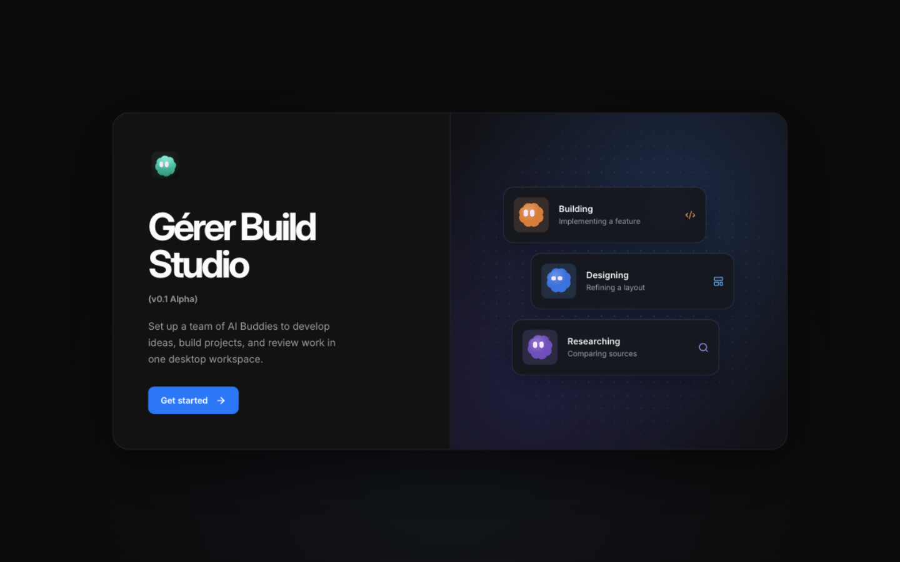
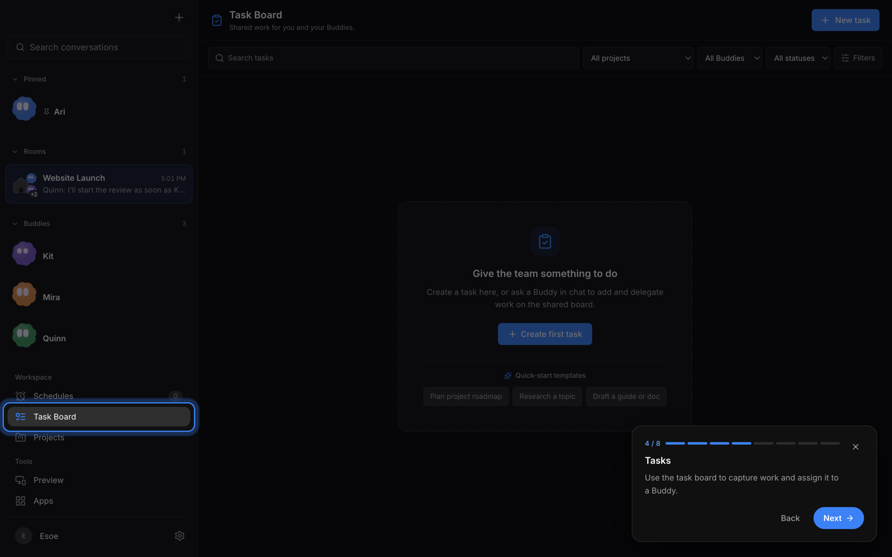
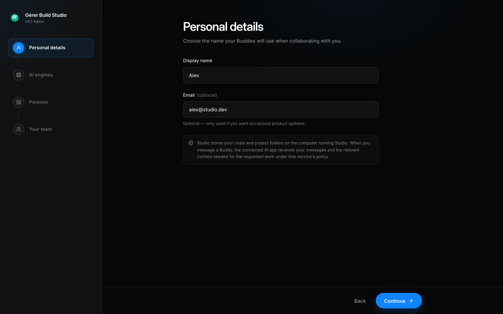
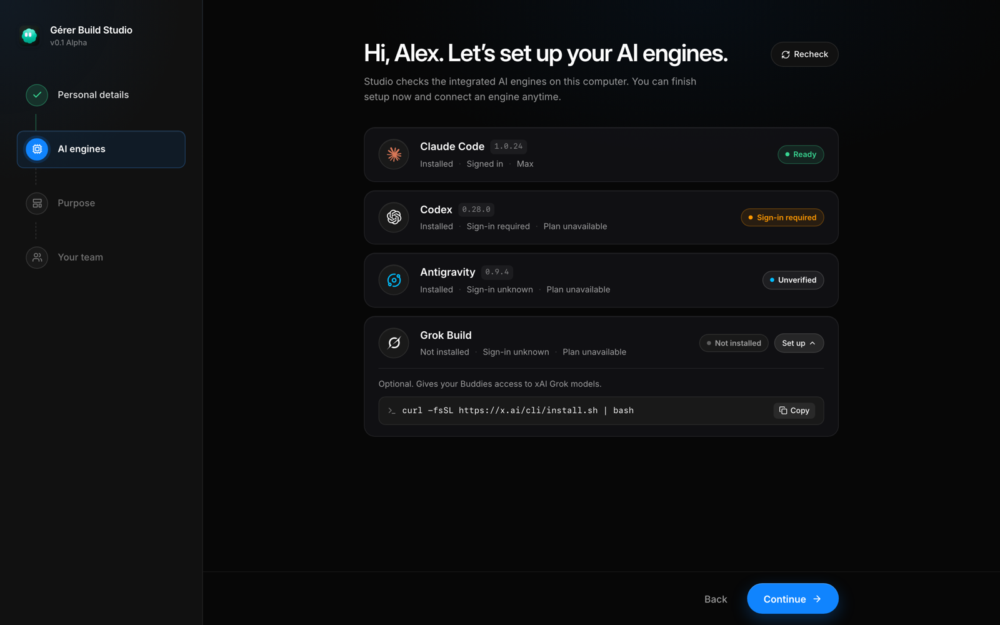
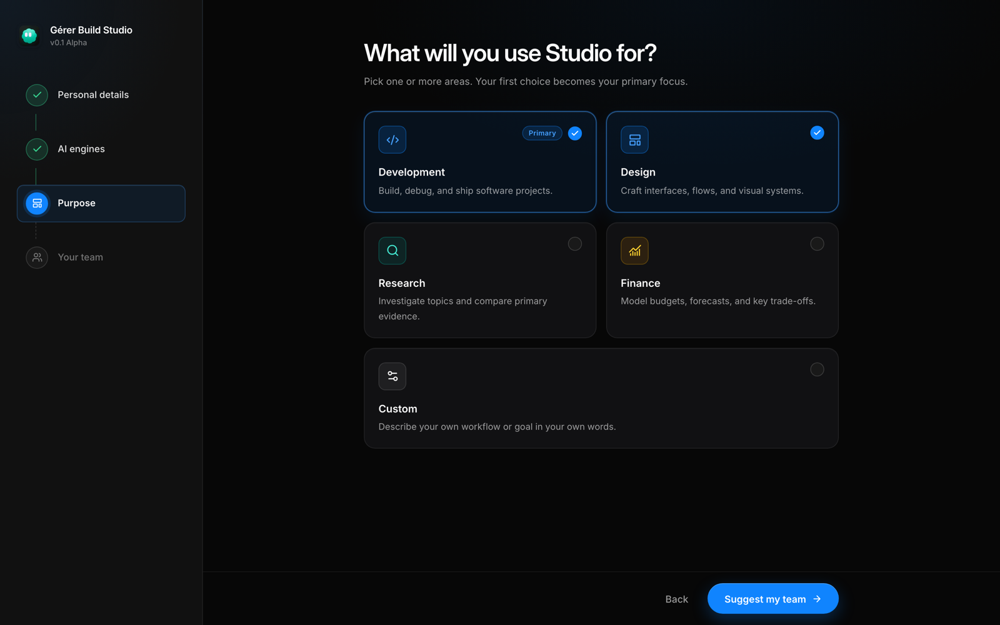
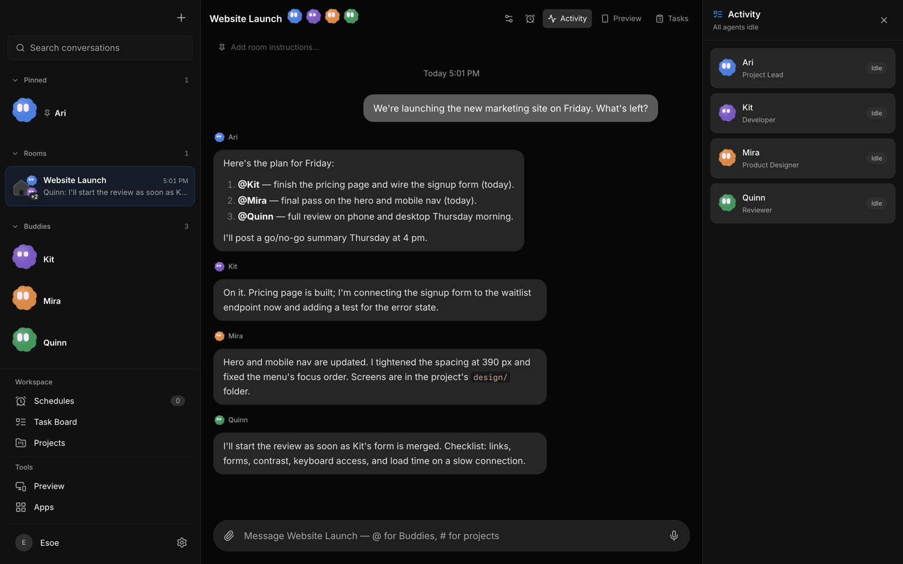
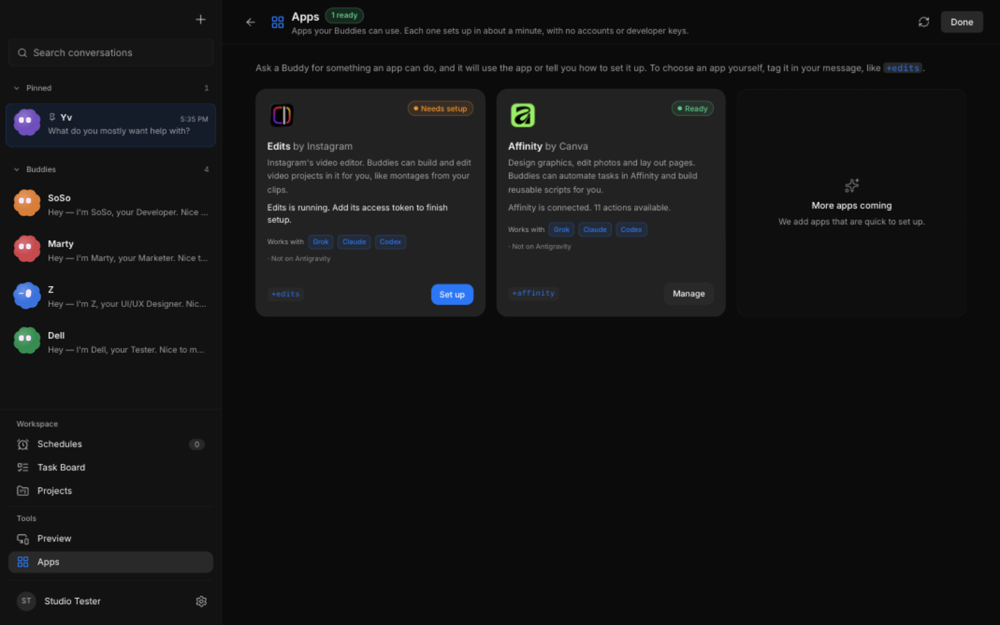

# Gérer Build Studio

**v0.1 Alpha · Internal testing · Installer 0.1.17**

Gérer Build Studio is a desktop workspace for working with AI Buddies. Give each Buddy a role, bring specialists together in rooms, and keep chats, project files, tasks, and scheduled work in one place.



## Install the internal alpha

The alpha installer is for **Apple silicon Macs**. Get the DMG from the internal launch handoff, open it, and drag **Gerer Build Studio** to Applications. This build uses an Apple Development signature and macOS Gatekeeper can block it. Follow the installation instructions supplied with your internal build. The Windows packaging command is available for development. A Windows install requires a separate smoke test.

Application updates are paused during the alpha. To install a newer build, quit Studio and replace the application in Applications. Studio keeps its workspace data separately. Back up important workspace data before replacing test builds.

## Set up your workspace

1. Select **Get started** and save your display name. Email is optional.
2. Review the AI engines Studio detects. Follow the setup instructions for your engine and select **Recheck**. Each card shows installation, sign-in, and any subscription information the engine makes available.
3. Choose how you want to use Studio. Pick Development, Design, Research, or Finance. **Custom** becomes available when an AI engine is ready. Describe your goal and Studio asks a ready engine that supports text generation to suggest three to six Buddies. If the request fails, select **Retry** or start with a built-in proposal.
4. Review and edit your suggested Buddies. Each one comes with detailed instructions covering its role, how it works, and the rules it follows. You can change their names, roles, instructions, and models, and add or remove Buddies before approving the workspace.
5. Start the guided tour or go straight to your new workspace. To reopen it, select **Restart Studio tour** in **Settings → System**.



Studio remembers where you were. When you reopen it, it returns to the chat, room, or screen you last had open.

| Personal details | AI engines |
| --- | --- |
|  |  |
| **Purpose** | **Your team** |
|  |  |

You can explore Studio without an engine. Assign a model and connect its engine before asking a Buddy to run a task.

## Work in Studio

| Area | What you can do |
| --- | --- |
| Buddies and chat | Give each Buddy a role and an AI model. Use ↑ and ↓ in the composer to recall submitted prompts and return to your draft. |
| Rooms | Work with several Buddies in one conversation. Type `@` to call on a Buddy by name. |
| Projects | Register a local project folder or clone a repository. Type `#` to reference a project. Type `/` or `./` to choose a registered project file or folder. |
| Tasks | Capture and assign work, track its status, and open the conversation behind a task. |
| Studio Preview | Open URLs and supported project files, including Markdown with images. Use the desktop browser controls to navigate and check layouts at different viewport sizes. |
| Schedules | Send a prompt to a Buddy or room at a set time. Each schedule shows its time zone and next run. Studio needs to be running to start scheduled work. |
| Apps and permissions | Connect Edits or Affinity, check which models can use them, and review approval requests from Buddies. |
| Settings | Edit your profile, review models and permissions, and restart the tour. |



### Buddies, rooms, and tasks

Give each Buddy a role, working instructions, and a model. Use a direct chat for a single owner or a room when others need to see the request and contribute. In a room, use `@Buddy` to direct the request. For example, ask a design Buddy to review a mockup, then call on a developer to make the changes in the same room.

Use the **Task Board** to assign work, follow its status, and reopen the conversation that explains what needs to be done. Studio remembers your last screen, so you can reopen the app and continue from the same room, chat, or workspace tool.

### Projects and Studio Preview

Open **Projects** to register a local folder or clone a repository. Mention a project with `#` and choose a file or folder with `/` or `./` in the composer. The picker uses the same folder and file colors as Preview, with additional icons for video, archives, and Affinity documents. For example, attach the landing page and mention the design Buddy when you want feedback on a specific file.

Use **Quick Preview** beside a chat or open **Preview** under **Tools** for the full workspace. Enter a web address, including a local development URL, or pick a supported file from a registered project. Websites and HTML support device sizes, desktop browser navigation, and side-by-side comparison in **Canvas**. Markdown, PDFs, and supported images open in a full-size reader. You can share a desktop screenshot of the visible area or the full page back to a chat or room. [Studio Preview guide](docs/guide/preview.md)

### Integrated desktop apps

Open **Tools → Apps** in the left sidebar. The Apps page shows the available integrations, their live connection status, and a message explaining what to do next. **Works with** lists the models in your workspace that support app tools. Assign one of those models to the Buddy doing the work. Use **Check app status again** after opening an app or changing its automation settings.



| App | What a Buddy can do | How to connect |
| --- | --- | --- |
| **Edits** (`+edits`) | Assemble clips into a montage, edit short videos, and work with captions. | Open Edits and go to **Settings → Automation**. Turn on **Enable Automation Server** and copy the **Access token**. In Studio, open **Apps → Edits → Set up**, paste the token, select **Test connection**, then **Save**. |
| **Affinity** (`+affinity`) | Work on graphics, photos, and page layouts, and create reusable Affinity scripts. | In Affinity, open **Settings → Model Context Protocol** and enable Affinity MCP. Quit and reopen Affinity, then leave it open. In Studio, open the Affinity card and select **Test connection**. This integration uses Affinity's own permissions. |

**Ready** means Studio reached the app and can list the actions it offers. **Needs setup** means the connection needs attention, such as a new Edits token. **Not running** means Studio could not reach the app's automation server. **Unavailable** means the check encountered another error. **Set up** and **Manage** show the connection instructions. If the app displays a different local port, update **Advanced → Address** and test again.

Once the app is ready, describe the work in a chat or room. Type `+` to pick an app, or tag it directly. A Buddy can select a suitable ready app from the request and ask you to choose when several fit. A tag makes the choice explicit.

> `+edits` Make a 20-second montage from the launch clips in my Movies folder. Put the product shot first and leave the project open for review.
>
> `+affinity` Create a new page layout for the launch flyer and render a preview for review.

Studio talks to these apps through their local automation endpoints. Edits can import media from your **Movies** folder. If clips are elsewhere, a Buddy can ask permission to copy them into a folder under Movies. Affinity controls scripting and file access in its own settings. With file access enabled, Affinity's automation can access files on the **Desktop**. Keep the Edits token private. **Manage → Disconnect** removes the saved token from Studio. To stop Affinity access, turn off Affinity MCP in Affinity's settings.

### Permissions and AI usage

Approval cards show the action a Buddy wants to take. Review the requested scope before deciding. A Buddy’s settings list its saved tool approvals under **Always allowed**, where you can remove them. In **App settings → System**, you can turn off **Auto-approve permission cards** or change its idle delay. Questions still wait for your answer.

Usage rings show the limits and refresh information available from each engine. In a Buddy's settings, **When usage runs out** controls whether Studio stops, queues the request to continue later, or tries a configured backup. The main and backup stay saved and can switch in either direction. Each request can switch automatically once. When both models hit a supported usage limit, Studio can queue one retry and check both models when it resumes. [Usage and limits](docs/guide/usage-and-limits.md) · [Backup models](docs/guide/backup-model.md)

### Schedules and recurring work

Open **Schedules** to set up a one-time task, daily or weekday work, selected days of the week, or a repeating hourly interval. You can also use the clock in a chat or room header or choose **Send later…** beside the composer. Pick the Buddy or room, write the prompt, and check the saved time zone and the next run. Studio must be running at execution time. The catch-up window lets a recent missed run start when Studio comes back. Use **Pause all schedules** to hold automatic runs and retries. [Schedules guide](docs/guide/schedules.md)

Read more in the [user guide](docs/guide/README.md).

## Develop locally

Install **Node.js 24 or newer**, **pnpm 10**, and Git. macOS packaging also needs the Xcode Command Line Tools for the speech helper.

```sh
pnpm install --frozen-lockfile
pnpm dev:desktop
```

`pnpm dev:desktop` starts everything with one command: the local Studio server (port 8899), the Vite client (port 5199), and the Electron window. Client edits reload instantly. Quit the window or press Ctrl+C to stop everything it started.

To work in a browser instead of the desktop window, run the server and client together without Electron:

```sh
pnpm dev:web
```

Then open `http://127.0.0.1:5199`. If a Studio server is already running on port 8899, both commands reuse it.

Run the checks and production build before packaging.

```sh
pnpm typecheck
pnpm test
pnpm build
```

Use `pnpm package` on macOS to build the Apple silicon DMG and ZIP. Use `pnpm package:win` in a Windows build environment for the x64 installer and ZIP. See the [release instructions](docs/dev/RELEASING.md) for signing and verification.

## Data and feedback

Studio stores workspace data locally. When a Buddy uses an AI engine, Studio sends the prompt and relevant context to that engine under the provider’s policy. Optional usage analytics are off by default.

Share alpha feedback with the Build Studio Launch team. Include the Studio version, your operating system, what you expected, and the steps that reproduce the issue. Remove secrets and private project content from logs or screenshots.

[License](LICENSE)
