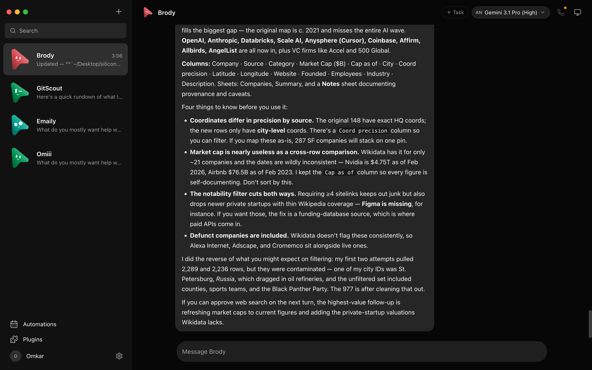
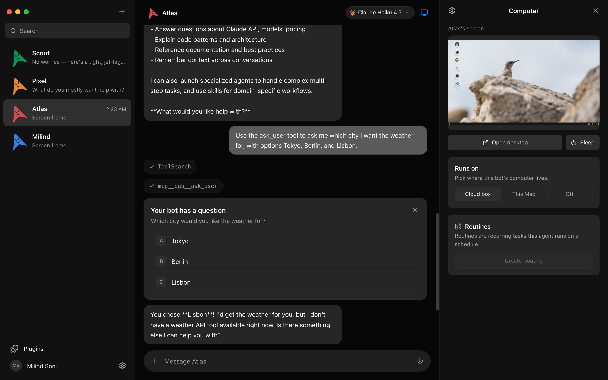
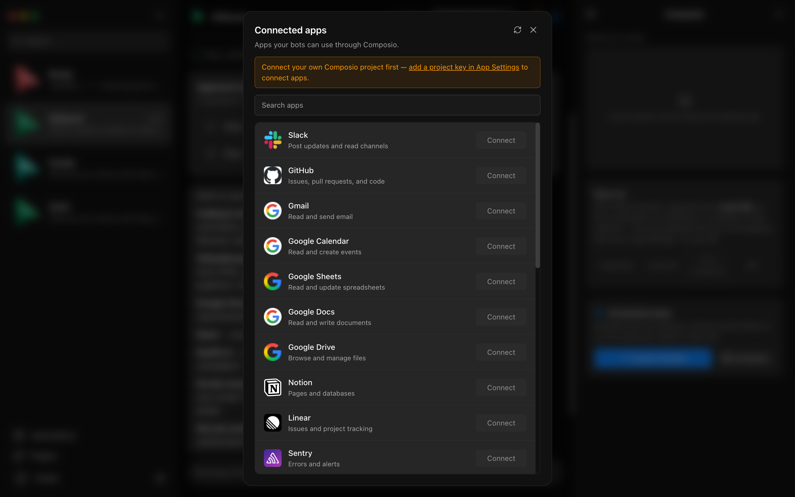
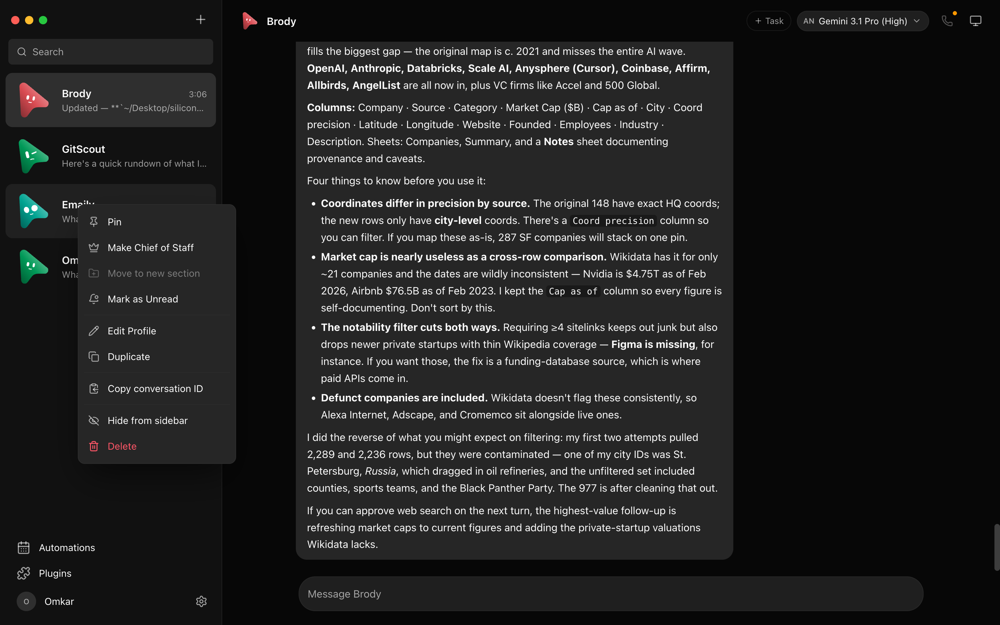
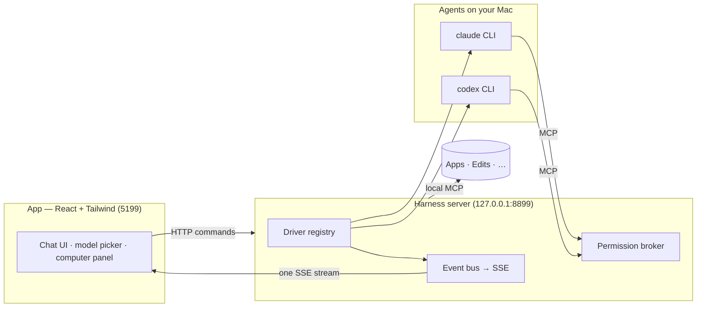

> ⚠️ **No affiliation with any cryptocurrency.** Gerer Build Studio has no token. Any coin using the Gerer Build Studio, Maus, or SupaMaus name is not created, endorsed, or affiliated with this project or its maintainer. I have received no tokens, payment, or allocation from anyone, and I will not be endorsing any token.

<div align="center">

# Gerer Build Studio

**Your own team of AI bots, in a chat app.**

<sub>An open-source version of **Grok Bot** — bring-your-own-agent, local-first, on the models you already have.</sub>

Every bot in the sidebar is a real agent — Claude or Codex running locally under the hood — with its own
personality, its own model, access to this computer, and its own connected apps.
Talk to them like contacts. Watch them work. Approve what matters.


<br>

<a href="https://github.com/myebstudios/GererBuildStudio/releases/latest">
  
</a>

<sub>macOS (Apple silicon) .dmg · Windows installer · [all releases](https://github.com/myebstudios/GererBuildStudio/releases)</sub>

<br>
<br>



</div>

---

## Why

One assistant in one box is the wrong shape for agents. Gerer Build Studio is an open-source take on **Grok Bot** —
it keeps the idea (AI as a *messaging app*: a roster of bots you chat with, each with its own personality,
memory of its thread, model, computer, and apps) and rebuilds it open, local-first, and on the agents you
already have:

- **Bring your own agents.** Bots run on the `claude`, `codex`, and `grok` CLIs installed on your Mac — your
  existing logins and subscriptions, no new accounts, no proxy in the middle.
- **Local first.** One small harness server on `127.0.0.1` owns every agent process. Transcripts, keys, and
  events live in `~/.gerer-build-studio`, not a cloud.
- **Agents with hands.** Each bot can drive your own Mac and use curated apps such as Edits, set up in a
  minute from the Apps screen.

## Features

<table>
<tr>
<td width="50%" valign="top">

### 🧠 Pick a brain per bot

A model picker with a provider rail — Claude and Codex models side by side, defaults marked, unavailable
providers dimmed with the reason. The app refreshes model lists from each installed CLI or configured API
when the picker opens and once a minute while the UI is open. Retired selections are flagged before the next
turn. The computer-backed provider has no verified model-list endpoint, so it shows a provider alias with an
unverified-catalog notice. Switch a bot's model mid-conversation.


</td>
<td width="50%" valign="top">

### 🖥️ Every bot gets a computer

Open the Computer panel and the bot's cloud desktop spins up on its own — live screen preview while it
works, "Open desktop" to take over in your browser, or point the bot at *this Mac* instead.



</td>
</tr>
<tr>
<td width="50%" valign="top">

### 🙋 Bots ask before they act

Shell commands, file edits, and questions surface as inline cards — Allow / Deny / answer in chat. A
permission broker turns every risky action into a decision you make, for cloud and local computers alike.


</td>
<td width="50%" valign="top">

### 🔌 Connected apps

A curated set of apps with simple setup, starting with Edits for video editing. Each app shows whether
it's ready and which models can use it. Tag one with `+edits` to choose it for a task.



</td>
</tr>
<tr>
<td width="50%" valign="top">

### 🗂 Manage bots like chats

Right-click any bot: pin, mark unread, edit profile, duplicate, copy conversation ID, hide, delete. It's a
messaging app — your agents behave like contacts.



</td>
<td width="50%" valign="top">

### 🔑 Keys once, everything lights up

Paste credentials in App Settings — they persist locally and the provider fleet hot-reloads instantly.
Secrets are write-only: the UI only ever sees "configured" flags.


</td>
</tr>
</table>

**Also in the box:** streaming replies with tool-run activity chips · native macOS dictation from the
composer mic (on-device Apple speech recognition — desktop app) · SupaMaus cursor mascots with role-aware
expressions · screenshots of the bot's work folded into the transcript · a local Projects screen for adding
existing folders, creating new workspaces, and cloning GitHub repositories to a chosen path · stable
`#project` references that give agents trusted workspace context from chats, room bulletins, and bot descriptions ·
a shared task board where users and agents coordinate structured project work.

### Share work through the Task Board

Task Board is a live four-column Kanban workspace for both the user and every agent: **Todo**, **Doing**,
**Review**, and **Done**. Tasks can carry a registered project, agent assignment, type, priority, tags,
due date, description, acceptance criteria, and an attributed activity trail. Search and filters compose
across project, agent, status, type, priority, tag, and overdue state.

Agents receive task tools during normal turns. They can list or create work, atomically claim an unassigned
task, keep its status current, or delegate it to another visible bot. Every update is revision-checked, so
two agents cannot silently claim or overwrite the same task; a conflict returns the latest record to the
losing agent and refreshes the UI. Completed agent work should move to **Review** for user verification.

Task assignment records intent—it does not launch a bot in the background. A user-initiated turn is still
required for an agent to act. Runtime tasks are stored locally in `~/.gbs/tasks.json`; they are
separate from the repository-maintenance workflow in `docs/dev/fixes/`.

Agents have full parity with the UI: `list_tasks`, `create_task`, `claim_task`, `update_task`,
`delegate_task`, and `delete_task` cover everything a user can do from the board, all revision-checked and
attributed to the calling bot. These tools (and peer-to-peer `ask_bot`) are only offered to bots on a driver
that can actually mount them: Claude, Codex, and the ACP-based Grok/Gemini drivers today. The default
Antigravity (`agy`) driver doesn't get them yet — that CLI has no mechanism to register a per-turn MCP
server, so there's nothing to wire in until it does.

### Refer to projects and bots

Every registered project gets a stable handle shown on its Projects card. Type `#` in a message, room
bulletin, or bot description to search for it. For example, `Review the tests in #gerer-build-studio` gives the
agent that project's canonical folder and uses it as the turn's working directory when it is the only
project referenced. Unknown hashtags remain plain text, and multiple project references provide paths
without choosing an ambiguous working directory.

Rooms also support `@bot` routing, so the two can be combined: `@Scout audit #gerer-build-studio` brings Scout into
the room with the registered project as context.

Room activity stays visible in a dedicated right-side workstream. It groups live agent turns, tool and
command titles, elapsed time, approval waits, failures, and recent outcomes by agent; responders waiting
behind the current speaker show their queue position. On compact windows the same workstream opens as a
dismissible drawer so it does not squeeze the conversation.

## How it works

Two processes. The app holds no transports of its own — it sends typed commands over HTTP and folds one SSE
event stream into state. The harness server owns every agent process and normalizes each provider's native
protocol into one canonical runtime event stream (logged per-thread as NDJSON).



| Layer | Where | What it does |
|---|---|---|
| Drivers | `server/drivers/` | One per provider: Claude, Codex, and Grok Build over their local CLIs (stream-JSON / JSON-RPC / ACP), plus a cloud-computer agent. Unknown drivers degrade to "unavailable", never crash the fleet. |
| Harness | `server/harness/` | Registry (configs → live instances) and the fan-in event bus every client folds. |
| API | `server/index.ts` | Bots, turns, approvals, model catalog, computer lifecycle, connectors, config — HTTP + SSE. |
| App | `src/` | The chat shell. Server-backed store, one reducer, zero client-side transports. |
| Desktop | `electron/` | macOS + Windows shells: dictation helper (SFSpeechRecognizer, macOS only), local screen capture, CUA bridge (macOS only). |
| Projects | `electron/projects.mjs`, `server/projects.ts`, `src/state/projects.tsx` | Desktop-only local folder registry, stable `#project` handles, trusted turn context, directory creation, and shell-free GitHub cloning. |
| Task Board | `server/tasks.ts`, `src/components/TaskBoardScreen.tsx` | Atomic local task persistence, revision-safe claims and updates, live Kanban UI, filters, assignment, and agent task tools. |

## Quick start

**Easiest:** [download the latest release](https://github.com/myebstudios/GererBuildStudio/releases/latest) — the .dmg on macOS (drag it
to Applications) or the setup .exe on Windows. The harness server is embedded — no setup.

**From source:**

```sh
git clone https://github.com/myebstudios/GererBuildStudio && cd GererBuildStudio
pnpm install

pnpm dev:server    # harness server → 127.0.0.1:8899
pnpm dev           # app → http://127.0.0.1:5199
pnpm dev:desktop   # or the Electron shell
```

Requirements: **macOS or Windows**, **Node 24+**, **pnpm**, and at least one agent CLI — [`claude`](https://claude.com/claude-code),
[`codex`](https://github.com/openai/codex), or [`grok`](https://x.ai/cli) — installed and logged in. They appear
in the model picker automatically.

Optional, pasted once in **App Settings** (gear in the sidebar footer):

| Key | Unlocks |
|---|---|
| xAI API key (`xai-…`) | The direct Grok API driver |

Apps (such as Edits) need no keys here: set them up from the **Apps** screen.

```sh
pnpm typecheck     # app + server
pnpm build         # typecheck + production build
pnpm package:win   # Windows installer + zip → release/
```

## Status

Early but real — the loop works end to end: message → agent → streamed reply → tools → approvals →
computer use. Rough edges to expect: routines (scheduled tasks) are a placeholder, sidebar sections aren't
built yet, and the Linux shell hasn't been attempted (macOS and Windows both run end to end; the harness
itself is portable Node).

Contributions welcome — the driver SPI in [`server/contracts.ts`](server/contracts.ts) is deliberately
small; adding a provider is one file in [`server/drivers/`](server/drivers/) plus a one-line registration.

## Privacy

Everything runs on your machine. Chats, bots, tasks, and API keys live in `~/.gbs` (keys in a
file only your user account can read), and the harness server only listens on `127.0.0.1` and
only accepts requests from the app itself. Set `GBS_HOST` if you really do want it reachable
from your network.

Release builds send no analytics. In a build made with `VITE_POSTHOG_TOKEN` set, you can enable
Usage Analytics in Settings → System & Updates. It is off by default. When enabled, it sends
anonymous usage events and clicks to that PostHog project. It never records typed text or your email.

## License

[MIT](LICENSE) © 2026 Milind Soni, Esoe B. Fildine, and contributors. Gerer Build Studio is a fork of
[OpenMausBot](https://github.com/milind-soni/OpenMausBot).

Gerer Build Studio is an independent, open-source project inspired by Grok Bot. It is
not affiliated with, endorsed by, or associated with xAI; "Grok" is a trademark
of its respective owner.
