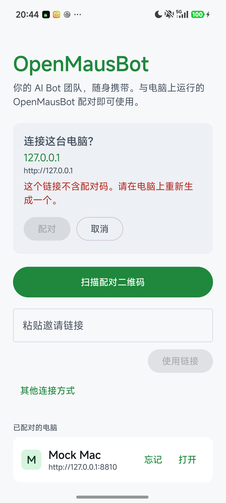
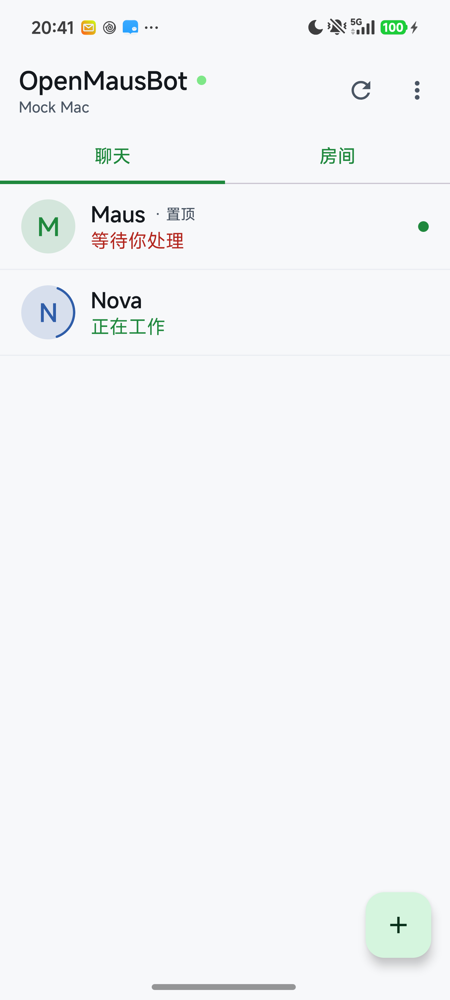
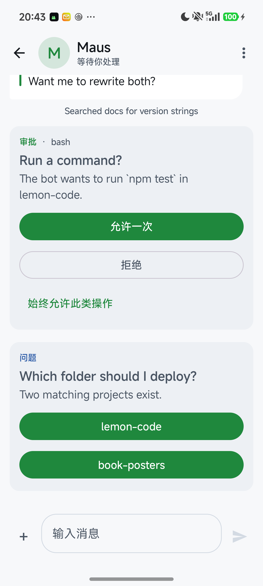
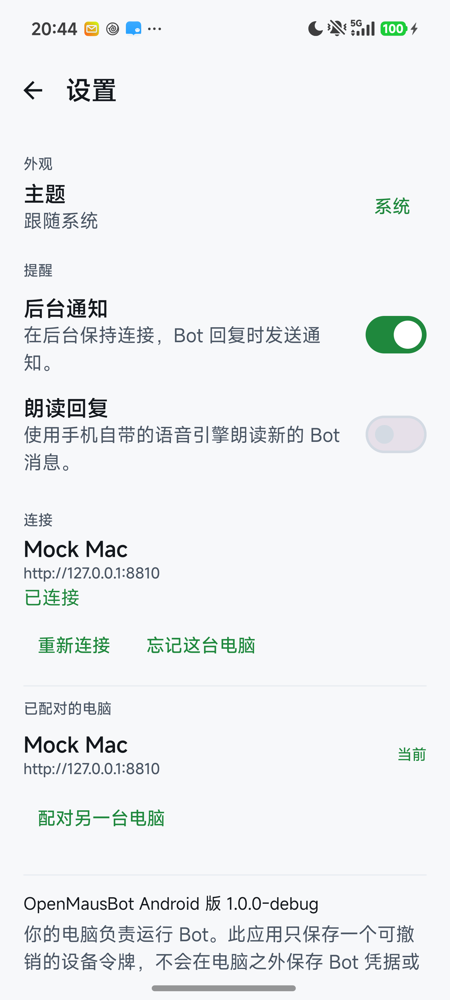

# MausBot Android

OpenMausBot 的原生 Android 客户端：在手机上查看电脑上各个 bot 的运行状态、读它们的回复、批准它们要执行的操作、随时打断或补一句要求。

> 这是一个独立开发的社区客户端，不是 OpenMausBot 官方客户端，也不代表上游项目。
> An independent community client for OpenMausBot. Not affiliated with or endorsed by the upstream project.

**English** — A native Android client for OpenMausBot's companion protocol. Pair by QR code or link, watch bot runs, read streaming replies with Markdown, approve tool calls and answer questions, switch models per bot, and keep the session alive in the background. Kotlin + Jetpack Compose, no WebView, Apache-2.0. Upstream: [milind-soni/OpenMausBot](https://github.com/milind-soni/OpenMausBot).

Kotlin + Jetpack Compose，单 Activity，无 WebView，不依赖任何第三方后端。最低 Android 8.0（API 26），targetSdk 36。界面文案为简体中文；Bot 的回复内容由电脑上的模型生成，仍按原始语言显示。






## 架构：手机连的是 companion，不是 harness

上游 OpenMausBot 的 `server/index.ts` **不监听任何给手机用的端口**；手机端（含官方 iOS 客户端）说的是 `companion` 这个 sidecar 的 HTTP + SSE 协议。本项目完整实现的是这个协议，而不是去猜 harness 的内部接口：

```
┌──────────────┐   harness 内部    ┌──────────────────┐   HTTP + SSE    ┌─────────────────┐
│ bot 进程 /    │ ◄──────────────► │ companion sidecar │ ◄─────────────► │ Android 客户端   │
│ server/index │                  │（配对、鉴权、转发） │   Bearer token  │（本项目）        │
└──────────────┘                  └──────────────────┘                 └─────────────────┘
```

- 配对完成后手机只持有一个**可撤销的设备 token**（`Authorization: Bearer …`），bot 凭据、会话内容、模型 key 全部留在电脑上。
- 协议细节（路由、事件种类、审批卡片的回答语义）见 [`docs/companion-protocol.md`](docs/companion-protocol.md)。

## 已实现

- **配对**：扫二维码、粘贴 `openmausbot://pair?...` 链接（也是 App 的 deep link）、手动填地址 + 6 位配对码；可保存多台电脑并切换。
- **Bot 列表**：置顶、未读点、运行中状态（Working / Waiting on you）、颜色与首字母头像、分组（Rooms）。
- **聊天**：分页加载历史、乐观发送（pending / failed 标记）、SSE 实时增量、Markdown 渲染（标题、列表、引用、表格、围栏代码块、行内样式、链接）、附件与图片、停止按钮。
- **审批卡片**：Allow once / Deny / Always allow、多选题与自由回答，回执状态（Allowed / Denied / Answered / Expired）就地更新；回答只针对当前这张卡片展示过的 `requestId`。
- **模型切换**：从 `/api/instances` 读取可用模型，按 bot 单独设置。
- **通知与朗读**：`LiveService` 前台服务保持 SSE 连接，后台收到回复时发通知（可关）；可选离线 TTS 朗读，默认关闭。
- **其他**：深色 / 浅色 / 跟随系统、新建 bot、重命名、隐藏、pin、免打扰、房间群发、图片上传、忘记电脑。

## 构建

需要 **JDK 21**。AGP 8.13.2 / Gradle 8.13 不接受本机默认的 JDK 26，会报 `Unsupported class file major version`。

```bash
export JAVA_HOME="$HOME/.local/jdk/jdk-21.0.13+9/Contents/Home"
export PATH="$JAVA_HOME/bin:$PATH"
./gradlew assembleDebug
```

产物：`app/build/outputs/apk/debug/app-debug.apk`。

`local.properties` 里的 `sdk.dir` 指向本机 Android SDK，路径因机器而异，不要提交。release 构建目前**未配置签名**，需要自己在 `app/build.gradle` 里加 signingConfig 才能出可安装的 release 包。

## 安装与配对

```bash
adb install -r app/build/outputs/apk/debug/app-debug.apk
```

1. 在电脑端 OpenMausBot 里打开 companion 的配对界面，得到二维码 / 链接 / 6 位码。
2. 手机打开 App，扫码或粘贴链接；手动方式需要填电脑地址、端口和配对码。
3. 确认卡片上显示的电脑名无误后点 **Pair**，之后所有请求都带这台电脑的设备 token。

debug 包的 applicationId 是 `org.openmausbot.android.debug`，可以和正式包共存。

## 本地联调（不需要真 harness）

仓库自带一个协议等价的 mock companion，用于在真机/模拟器上跑通全部界面：

```bash
python3 tools/mock-companion.py          # 监听 0.0.0.0:8810，配对码 123456
adb reverse tcp:8810 tcp:8810            # 手机经 USB 访问电脑
```

配对时地址填 `http://127.0.0.1:8810`，配对码 `123456`。mock 里预置了 bot（含审批卡片、问题卡片、Markdown 表格与代码块）和一个房间。

`usesCleartextTraffic` 已开启，便于局域网 HTTP 直连；如果 companion 配了 TLS，直接填 `https://` 地址即可。

## 验证状态

已在小米 15 Pro（Android 16）真机上、对着上述 mock 逐屏跑过并截图：

- 配对（deep link → 确认卡片 → Pair）→ 首页列表、状态、未读点
- 聊天页 Markdown / 表格 / 代码块 / 工具活动行
- 审批「Allow once」→ 卡片变为 **Allowed**，服务端收到 `POST /api/threads/{id}/respond`
- 问题卡片选 `lemon-code` → 卡片变为 **Answered: lemon-code**
- 发送消息 → `202`、用户气泡、流式回复落地
- Rooms、Settings 渲染，模型列表接口连通

**没有验证过的部分**：与真实 OpenMausBot harness 的联调。上游依赖安装在本机网络下始终未完成（988 个包只下到 3.6 MB），因此所有端到端测试都是对协议等价的 mock 做的；图片上传、后台通知、TTS 只做了代码路径与构建验证，没有逐项截图。接真 harness 时如果字段有出入，先看 `docs/companion-protocol.md` 对齐。

## 安全说明

- 设备 token 存在 App 私有 SharedPreferences，`android:allowBackup="false"`，不会进云备份。
- App 只保存 token 与界面偏好；聊天记录从电脑拉取，不落盘。
- 审批卡片只回答服务端下发的那个 `requestId`；「Always allow」发给服务端的也是 `{threadId, requestId}`，不会在本地凭空生成长期授权。
- 忘记电脑会删除本地 token；要彻底撤销请在电脑端 companion 里吊销该设备。

## 目录

```
app/src/main/java/org/openmausbot/android/
  data/      ApiClient（HTTP + SSE）、Repo（单一状态源）、配对链接解析、本地存储、模型
  ui/        Compose 界面：配对、首页、聊天、审批卡片、Markdown、bot 面板、设置
  service/   LiveService（前台 dataSync，保活 SSE）
  notify/    Notifier
  speech/    离线 TTS
tools/       mock-companion.py（协议等价的服务端夹具）
docs/        协议说明与截图
gradle/      Gradle wrapper（无需本机安装 Gradle）
```
