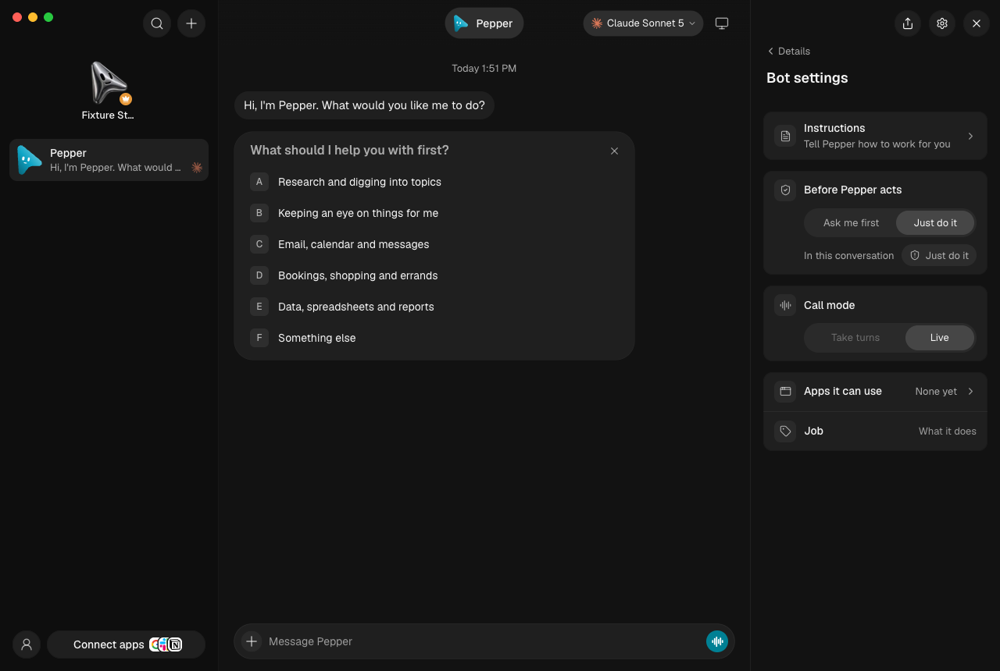
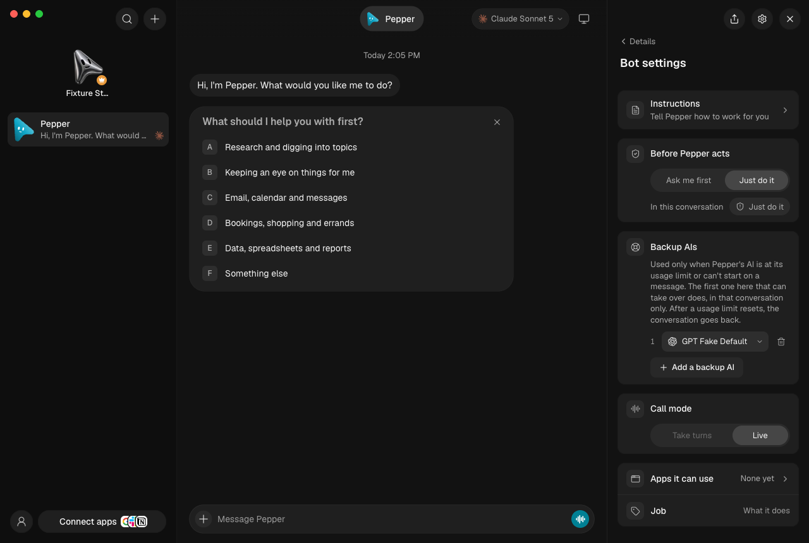
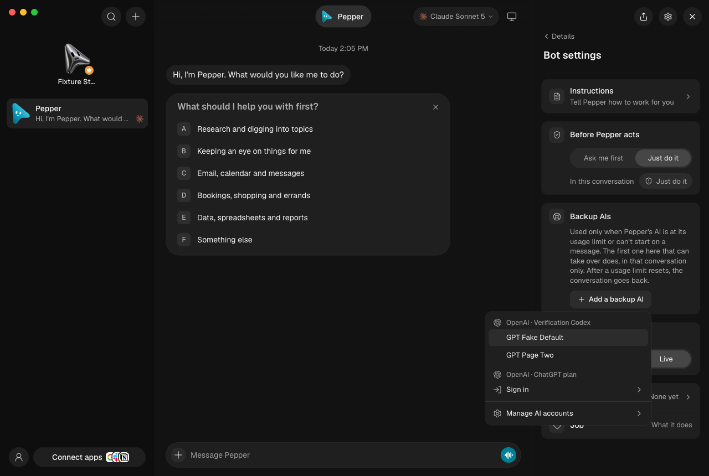
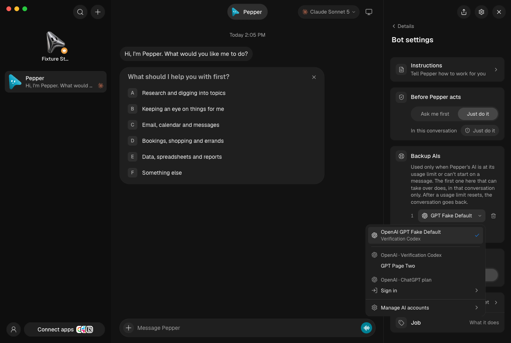
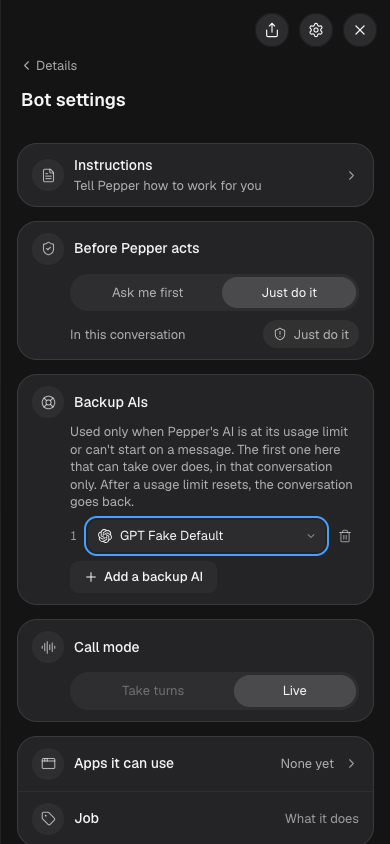
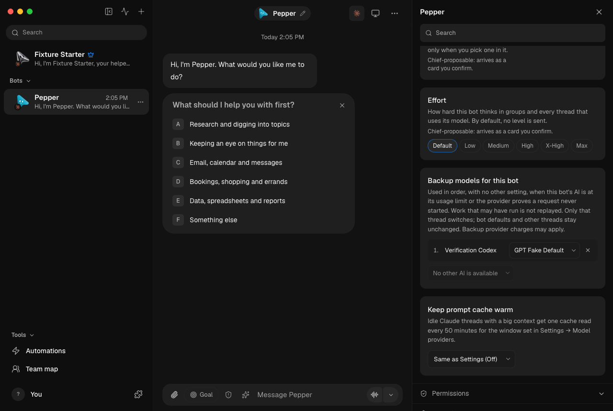

# Automatic recovery

A bot's own backups (Model → Backup models for this bot in Advanced, Bot
settings → Backup AIs in Simple) are used in order with no switch: choosing one
turns it on for that bot. Settings → General → Automatic recovery is off by
default; turned on with one backup engine/model, it covers every bot that has
no backups of its own. The same lists also feed the usage-limit takeover
(`server/host/limit-takeover.ts`), which never needed the switch: at a usage
limit a conversation moves to the first of them that can take over (for one
model's own limit, that AI's default model goes first) and goes back once the
limit resets. When an ACP engine fails during startup, before sending
the prompt or receiving any tool, permission, file or assistant activity, the
driver can report a recoverable failure **only after its process has stopped**.
Claude can also report a refused sign-in before any model or tool activity.
Only its structured synthetic `authentication_failed` API-error frame followed
by an error result with no new cost qualifies. The driver waits for its process
tree to stop before reporting that refusal. Recovery skips
other models on the same engine instance, since they share the failed sign-in.
OMB tries the backup in the same thread with the canonical conversation.
The thread keeps the backup selection; bot defaults and sibling threads do not
change. A visible activity line explains the switch.

Direct bot threads, Chief and direct coordinated work use this path. Channels
and drivers without the startup-proof contract do not. Credential-card
continuations are excluded. This is not recovery from an accepted prompt that
has gone silent: even without output, the engine might have performed actions.
Other authentication failures, quota, invalid-model, safety and approval
failures do not qualify. Neither do a failed backup, Stop, or newer queued input.

Existing approval, organisation-model and spend-limit gates run again. An
engine switch requiring a new Full/Custom grant is refused, not downgraded or
auto-approved. The backup must retain the source engine's tools/attachments
and use the same pinned working folder; legacy unpinned threads and remote
runner changes require a manual choice. Backup provider charges may apply.

## Repeatable checks

```sh
pnpm exec vitest run server/automatic-recovery.test.ts server/automatic-recovery.e2e.test.ts server/drivers/acp/acp.test.ts server/drivers/retry.test.ts server/turn-dispatch-guard.test.ts server/config.test.ts src/components/AutomaticRecoverySettings.test.ts src/state/store.test.ts
pnpm exec vitest run server/drivers/claude-auth-recovery.test.ts server/drivers/claude.test.ts
pnpm exec vitest run server/direct-coordination.e2e.test.ts server/guarded-messages-api.test.ts server/acp-recovery.e2e.test.ts --maxWorkers=2
pnpm typecheck
pnpm lint
pnpm i18n:check
```

The recovery integration suite launches `launchVerificationServer` in a
temporary home, then configures only fake ACP and Claude engines there. It
checks one backup dispatch, a bot's own list with Automatic recovery on and
off, no dispatch to the app-wide backup while it is off, retained history, one
user message, unchanged permissions/defaults/siblings, bounded failure, no
replay after prompt/output, Stop/new-message precedence and settings validation. A signed-out fake Claude
recovers through fake Codex with one user message and unchanged bot defaults
and permissions. Driver checks refuse recovery after activity or failed cleanup.
A coordinated specialist
recovers through the real agents proxy and returns one result and one final
Chief reply. Each fixture prints a
retained `.log.automatic-recovery.json` evidence path, then removes its own
temporary data and processes. No live app, provider account or user data is
used. Driver tests also cover failed cleanup and pre-prompt file/tool activity.

Settings tests cover the real component's controls, drafts, validation and
save errors. These are not an Electron visual walkthrough or proof of a real
provider's availability, model quality, or a general cure for idle timeouts.

## Simple mode

Simple's Bot settings (the gear on the bot panel) shows the same list as
**Backup AIs**: Add and change open the Simple model menu without the bot's own
AI or ones already listed, the bin removes one, and the list keeps its order (up
to five). There is no switch; the card says when a backup is used.

```sh
pnpm exec vitest run src/components/bot-panel/BackupAis.dom.test.ts src/components/BotSettingsDialog.simple.test.ts src/components/bot-settings/ModelSection.test.ts
```

The pictures come from `control-omb ui launch --engine codex` (fake Claude and
fake Codex in a disposable home): adding Codex in Simple saved
`fallback: [{ instanceId: "codex", model: "gpt-fake-default" }]` on the bot and
left `automaticRecovery` at `{ enabled: false }`.

| Before | After |
| --- | --- |
|  |  |

| Adding | Changing | At 390px |
| --- | --- | --- |
|  |  |  |

Advanced shows the same list under Model, with words that no longer depend on
the switch: 
