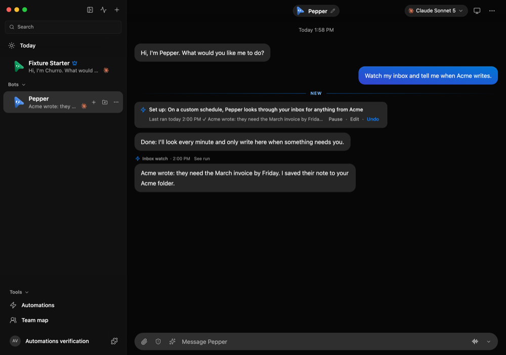
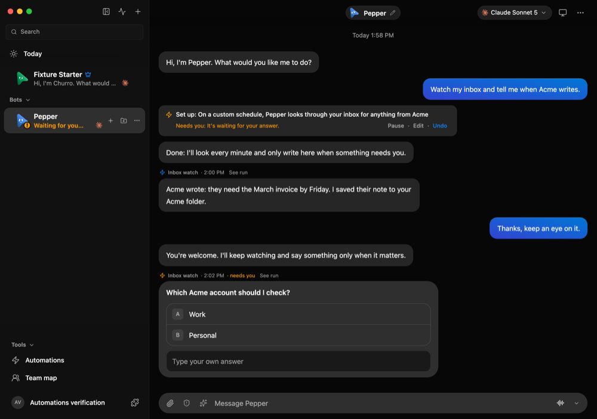
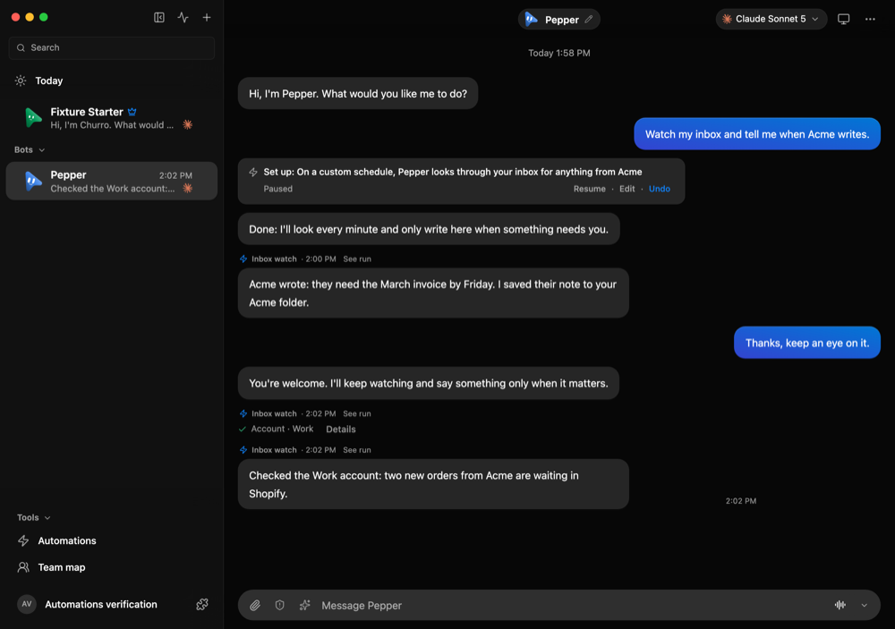
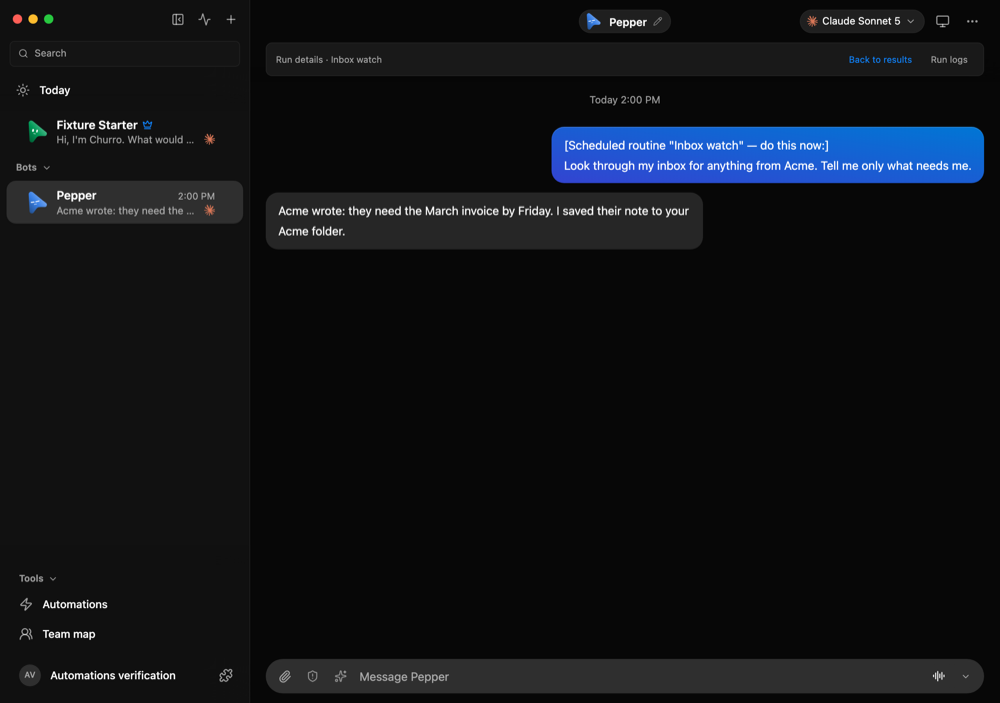

# Automations report into the bot's chat

A run of a schedule, a Run now, a startup run, a webhook or an app event still
works in its own hidden conversation with a fresh session. What it leaves in
the chat it reports to (the bot's main chat unless the routine chose another):

- **A result**: its last reply, once, as a normal bot message with a small
  caption naming the automation and its time, and **See run** for the full run.
- **Nothing**, when its last line is `NOTHING NEW`: no message, no unread dot,
  no notification. The trigger card, Automations and Today say "Nothing new"
  or leave it out.
- **A question**: a last line `NEEDS INPUT: …` becomes the question in that
  message, marked "needs you" and notified as a question. The person answers in
  that chat by typing or with Reply, and the chat's session has the report as
  `[Your automation "Name" asked at …:]`. A 👍 or 👎 on it is an answer too:
  it reaches the bot in that chat with the report in hand.
- **A copy of a card** the run waits on (a question, an approval, a proposal).
  Answering the copy, or giving it a 👍 or 👎, answers the run in its own
  conversation; both cards then show the same answer.
- **One line naming a sign-in, connection or credential** the run waits on
  ("I need you to sign in to example.com."), marked "needs you" until that card
  is settled; **See run** opens it. A sign-in can also be finished from the
  bot's Computer panel, which shows the same request.
- **One line when a run fails**, once per run of failures, with what to fix.

A file the run linked in its reply opens from the chat it reported to, as it
would in the run's own conversation; other messages there still open only
that chat's own files.

Only a run working in a conversation of its own is told that only its last
reply leaves it (`NOTHING NEW`, `NEEDS INPUT:`). A "when my limit resets"
continuation works in the person's own chat and is not.

On a Cloud home, every run of a webhook or app-event automation reports into
one "<name> · Results" chat of its own, and a routine someone other than the
owner wrote keeps its own results chat, so no outside words reach the owner's
other chats or a lent Mac.

## The concurrency rule

A run never shares an engine session or a thread with the person. Nothing is
written into a chat while a turn runs or settles there: the line is held, and
written when the server next releases what was queued behind that turn, ahead
of that queue. Held lines go out in the order their runs finished, and survive
a restart. A run writes one line, whatever events repeat. The scheduler's
overlap rule is unchanged: a schedule starts no second run while one is
running or waiting. A person's turn in a run's own conversation, while the run
waits on a teammate, is never taken for the run's result or failure.

## Automated checks

```sh
pnpm exec vitest run server/automation-reports.test.ts server/automation-reports.e2e.test.ts \
  server/routine-results.e2e.test.ts server/triggers.e2e.test.ts server/routines.test.ts \
  server/today.test.ts server/recent-work.test.ts src/components/ChatView.automation.test.ts src/lib/automations.test.ts
pnpm exec vitest run server/cloud-routine-level.e2e.test.ts server/cloud-lending-memory.e2e.test.ts server/card-answerers.e2e.test.ts
```

The end-to-end file runs the real server and Claude driver with the scripted
fake engine (`FAKE_CLAUDE_ROOM_PLAN`), reaching the permission broker the way
the CLI's proxy does: quiet and reporting runs, a report held behind the
person's running turn, a question copied into the chat and answered there, by a reply or a 👍,
a `NEEDS INPUT` answer (typed or a 👍) reaching the bot with the report in its context, a
webhook run, failures said once, Chief escalations, and a person's turn in a
waiting run's conversation.
On a shared workspace, only someone who may answer in the chat a run reports
to can answer the copy of its card there (`server/card-answerers.e2e.test.ts`).

## In the real renderer

Run the launcher directly so Ctrl-C reaches it:

```sh
node --experimental-strip-types scripts/verify-automation-reports.ts
```

It starts a disposable fake-engine server, mounts the real app through Vite,
prints one JSON line with `previewUrl` and then one line per step. Pepper is
asked in chat to watch the inbox; the scripted engine sets up an automation
that runs every minute, and the launcher follows five runs:

1. Run 1 finds nothing: the chat gets nothing, the trigger card says
   "Nothing new".
2. Run 2 reports: one Pepper message captioned **Inbox watch**.
3. Run 3 finds nothing.
4. Run 4 asks "Which Acme account should I check?". The question card appears
   in Pepper's chat with the caption and "needs you". Answer it there: the
   launcher waits for that answer, then the run reports what it found.
5. Run 5 finds nothing; the launcher pauses the automation.

Write in the chat between runs: a report never lands inside your turn. Use
**See run** on a report for the run's full conversation and **Back to
results** to return. On Ctrl-C the launcher writes
`<logPath>.automation-reports.json` (the chat, the runs with their report
states, the bots) and removes only its temporary data.

A run on 21 October 2026, on the code in this change, had runs at five
consecutive minutes (13:59 to 14:03 IST): runs 1, 3 and 5 found nothing and
left nothing, runs 2 and 4 reported, and run 4's question was answered in the
chat 1.8 seconds after it appeared:








