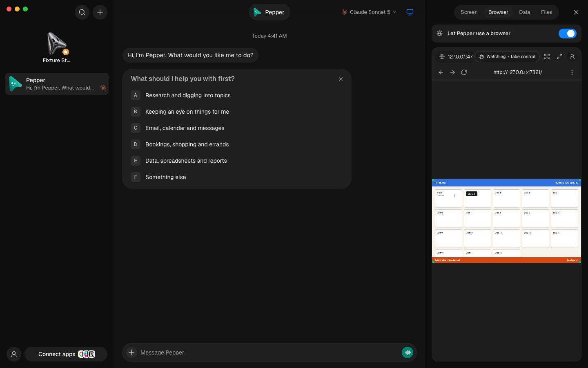
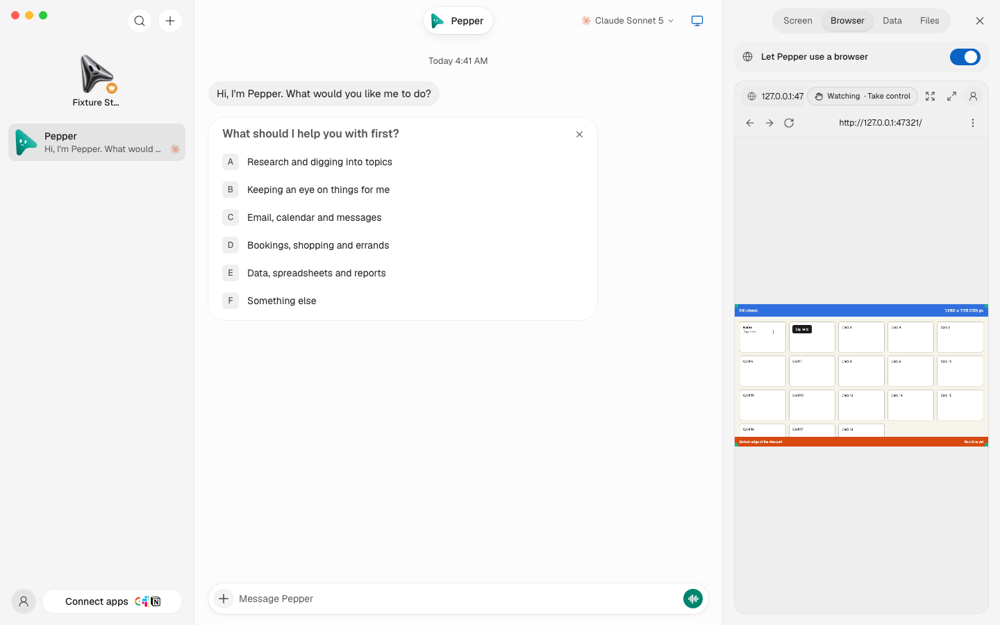
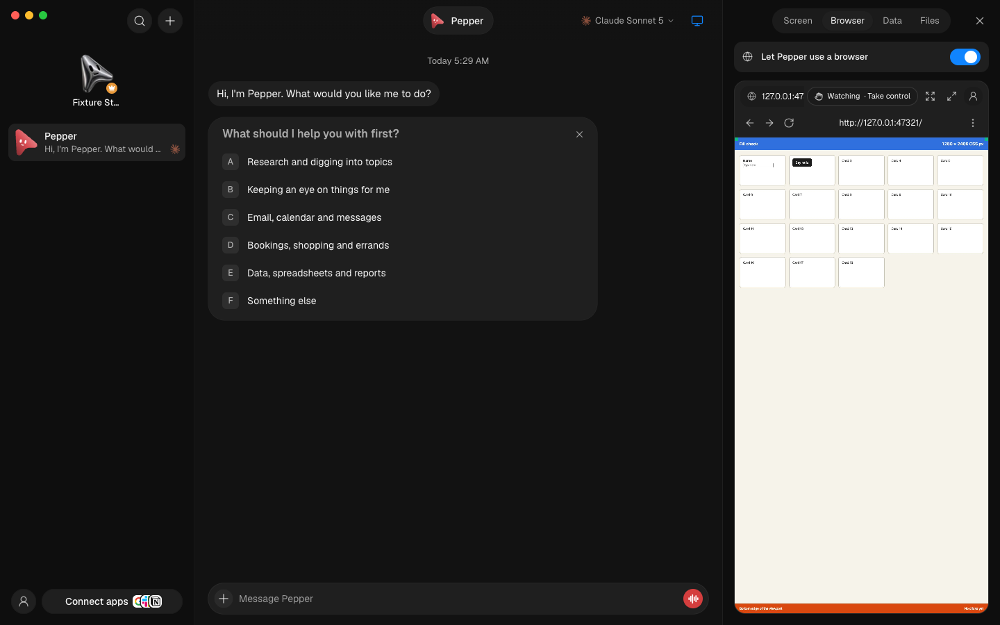
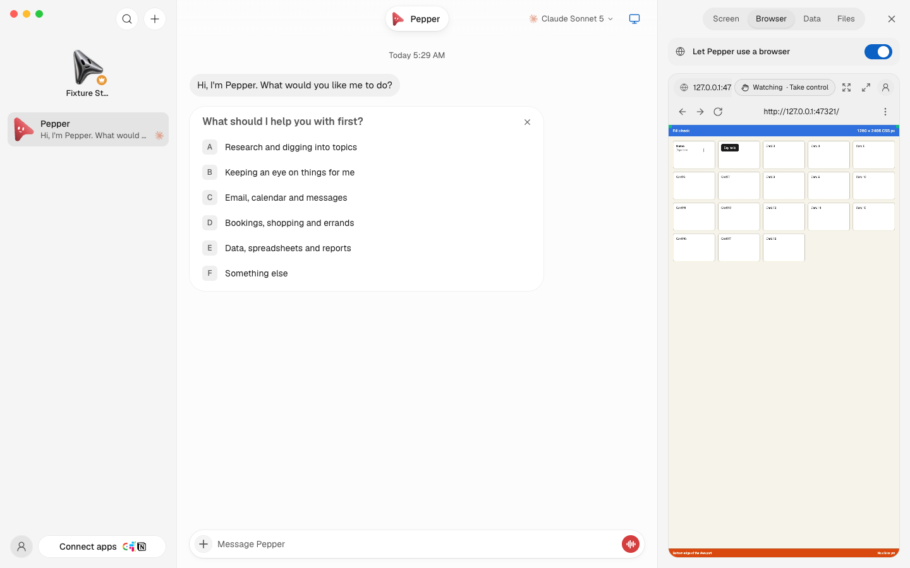
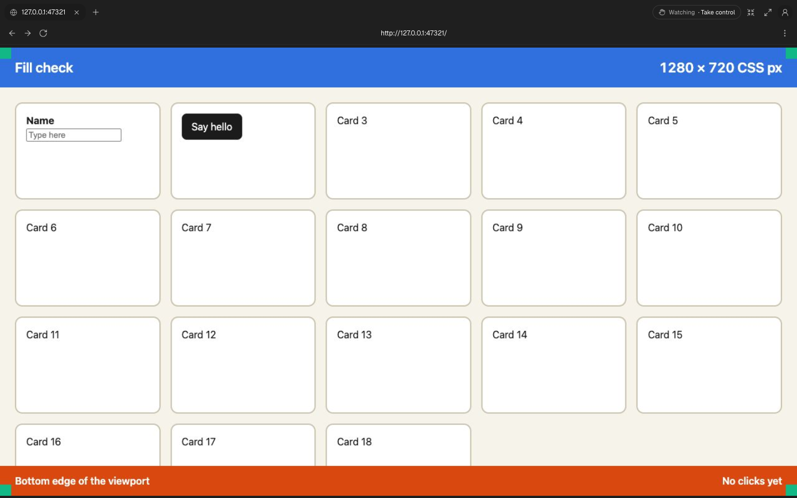
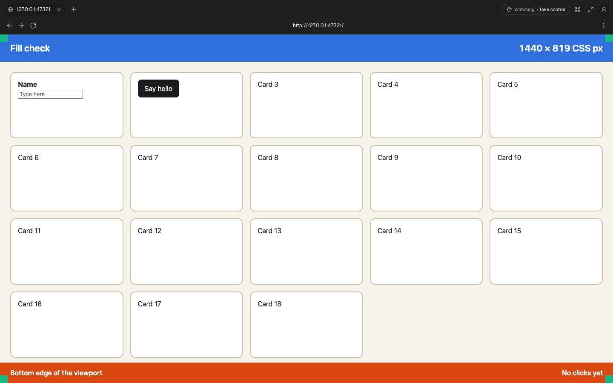
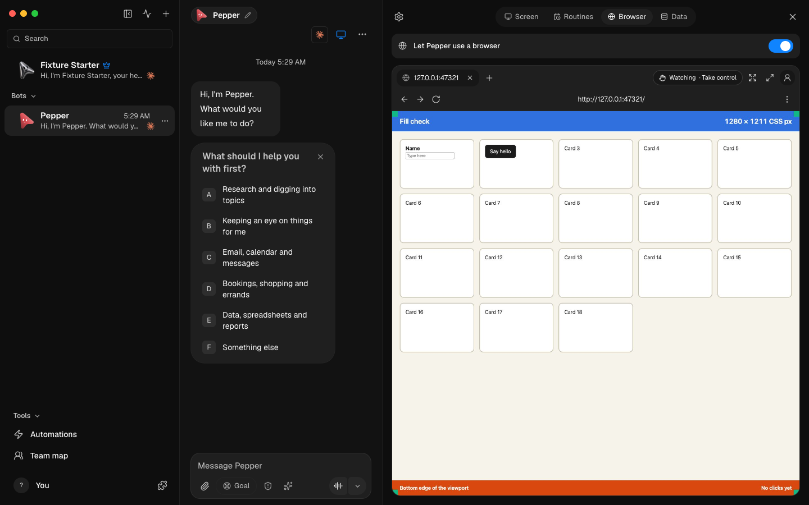
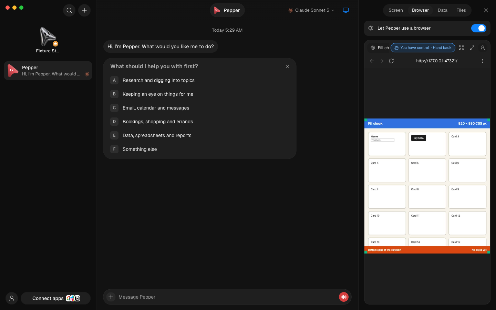

# Live browser and profiles

Use installed native engine and Chrome binaries explicitly; the fixture never
uses the operator's browser profiles, OMB home, provider logins, or API keys.

```sh
OMB_VERIFY_BROWSER_BINARY=/absolute/path/to/agent-browser \
OMB_VERIFY_BROWSER_CHROME=/absolute/path/to/chrome-headless-shell \
node --experimental-strip-types scripts/verify-browser-live.ts
```

The launcher uses `launchVerificationServer` with a temporary home and fake
model CLI, creates Pepper, and prints the backend, preview, and local test-page
URLs. Open **only** the printed preview URL. Ctrl-C closes its native browsers,
UI and harness, then removes its temporary data; the server log remains.

1. The panel contains two browser-chrome rows and a live blank page. There is
   no “coming next” card. While the bot has the browser, nothing is sent until
   you interact or press **Take control**; hovering never takes it.
2. Enter the printed test-page URL and press Enter. That first interaction
   takes the browser from the bot (a pill over the top of the page reads
   “You’re using the browser”, at every panel width), then navigates; it is
   sent exactly once. If the bot is mid-action, “Waiting for Pepper to
   finish…” shows first; when the bot's action finishes first, clicks and keys
   made while waiting are dropped, not replayed on a page that may have moved
   (the pill says “Pepper was busy, so that wasn’t sent. Try again.”), while
   an address you entered still opens. Toolbar buttons wait out the take, so
   a repeated click runs once.
   In the name field, type `AdaX`, press Backspace, then Enter. The streamed
   page must show `Hello, Ada`. Check arrows and Delete, Tab into the notes
   field and enter multiple lines, then open the dialog and close it with
   Escape. These must affect the remote page, not only the surrounding UI.
   Shift+Escape returns focus to the address field without sending Escape to
   the page; keyboard-only users must still be able to reach the toolbar.
   Tabbing through the panel passes over the live page without taking it;
   only clicking or typing in the page sends Tab there.
3. Stop for 8 seconds: control returns to the bot and the pill disappears.
   A Cmd shortcut such as Cmd+C must not delay that. Keep **Type or paste
   text…** open past 8 seconds: control stays yours until it closes. Press
   **Take control**, then wait a minute: it stays yours until **Hand back**,
   which returns it at once. Leave it untouched for 5 minutes: control goes
   back to the bot by itself, kept or not. Close the panel while you hold it:
   the bot gets it back 2 minutes later, unless you open the panel again
   first, on any device, which carries on with your hold. **Type a password or code…** shows a masked
   field; its text reaches the selected page field and appears in no log,
   response or other view.
   Holding a mouse button or key down must never hand back. Reconnect the
   view, then leave it connected for at least 30 seconds on the same static
   image. It must not stall waiting for an ACK. The page remains intact and
   the bot keeps it; click into the page and confirm editing and Enter still
   work after reconnecting.
4. The single profile button opens the switcher, handing the browser back at
   once if you were using it, so the switcher unlocks. Create a shared profile,
   switch to it (a clean browser), then back to Own browser. The previous page
   remains. Rename a shared profile without changing its identity. Confirmed
   deletion clears its bot references without deleting another profile's data.
5. Open the panel in a second window signed in as you, then take control in
   the first: the second shows the page and says the bot is paused for you,
   and its **Hand back** returns the browser at once. Interacting in the second
   moves your hold there; the first takes no more input. Open it as a
   different person (another member's session): that view gets no page frames
   and no input, and its hand-back or disconnect never ends your hold. Hide the app's
   window or tab while a panel only watches: its view must leave (the browser
   stops streaming and may idle-close) and reconnect on its own when the app
   shows again. A panel holding the browser keeps its view while hidden.
6. Test narrow (390 px) and desktop widths, fullscreen, tabs, overflow typing,
   and explicit browser restart. No horizontal document overflow or permanent
   settings panels should appear. Profile changes are disabled during control.
   The page fills the panel: it is never narrower than 1280 CSS pixels, so
   sites keep their desktop layout, and its height follows the panel's shape
   up to twice its width; only a taller panel shows bands above and below.
   Resizing the panel resizes the page once the bot's running action ends, and
   with no view open the page is 1280x720 again at the bot's next action.
   Click the same test-page controls at each size: input must land where the
   image shows them. Bands must not click the page; a drag begun on the image
   can finish there.
7. Reconnect while a restart is still finishing, or change profiles before an
   earlier command finishes. A late response must not disconnect the new view,
   change its error state, or acknowledge an old frame as the new viewer.
8. Sign-in requests: script Pepper's turn to call `request_sign_in` for the
   test page (the e2e below does this with the fake engine). One **Sign in
   needed** card and one notification arrive. **Open** selects the Browser tab
   already in your control; the page stays the bot's, or opens the site when
   the bot left it blank, and the banner above it offers Done and Cancel. Idle
   time never hands it back while the request is open. **Done** on the card
   (or from a second window) hands the browser back and resumes Pepper with
   “the person finished signing in”; **Cancel** resumes it with “declined”.
9. Saved logins: on the same card choose **Save a login** and save a test
   account (fake values) for the test page's site. Pepper resumes and calls
   `fill_login`; the page's username and password boxes fill, the form is
   submitted, the tool result names only what was filled and where the page
   went, and **Settings → Logins** lists the login by site without its
   password. Open the same page under a subdomain: `fill_login` fills it
   too. Under another site, or plain http on a non-local address, it refuses
   and types nothing. Call `fill_login` with `submit: false`, then ask Pepper
   to `eval` the password box's value: the browser refuses eval on that page
   for a minute, and the password is cleared from the box after it. A
   snapshot shows `••••••`.
10. 1Password (only with a test account and a test vault, never a real one):
   connect a service account limited to one vault holding a test Login item
   for the test page's site. Its row appears read-only, marked From
   1Password; `fill_login` fills it like a saved login. Pick another bot for
   the vault under 1Password in Settings → Logins: Pepper no longer lists or
   fills it. Unit tests use a fake SDK and reach no network.

11. Page dialogs: give the test page a button that calls `confirm()`, take control and press it. The question shows over
   the page within a second, with Dismiss and Accept, only in the view that holds the browser. Answering lets the click
   finish, and typing goes on. Answer after more than 30 seconds: the click still finishes, with no restart. A page
   that hangs (`while (true) {}`) is restarted for you after about 35 seconds. The panel reconnects, and sign-ins
   are kept.

### A narrow panel filled

Run `node --experimental-strip-types scripts/control-omb.ts ui launch --entry threads`, turn on
`features.browser`, allow the test page's loopback port in `browserEngine.egress.allow`, open the
bot's screen and its Browser tab in Simple mode, and open the test page. The page must reach every
edge of the panel at 1280 CSS pixels wide; Maximize shows it at the window's own size; a preset
from the menu (new engine) still shows bands on purpose.

| | Midnight | Daylight |
| --- | --- | --- |
| Before: 1280x720 with bands |  |  |
| After: 1280x2406, the panel's shape |  |  |

| Maximized, before | Maximized, after | A wider Advanced panel | Tablet preset (new engine) |
| --- | --- | --- | --- |
|  |  |  |  |

`scripts/testing/browser-fill.e2e.test.ts` runs the agent-browser side against the pinned engine and
`server/browser/viewers/viewers.e2e.test.ts` the new engine's (`OMB_CDP_CHROME`).

Focused automated coverage:

```sh
pnpm exec vitest run server/browser-engine.test.ts server/browser-runtime.test.ts server/browser-page-size.test.ts \
  server/harness-mcp-proxy.test.ts server/browser-live.test.ts server/browser-dialogs.test.ts \
  server/browser-live-routes.test.ts server/browser-codex-path.integration.test.ts \
  src/lib/browser-stream-v1.test.ts src/lib/browser-stream-client.test.ts src/lib/browser-control.test.ts \
  src/lib/browser-profiles.test.ts src/components/BrowserProfilesManager.test.ts \
  src/components/browser/StreamSurface.test.ts server/routes/browser-viewers.test.ts \
  src/components/BrowserPanel.test.ts src/components/SignInRequestCard.test.ts \
  server/sign-in-request.e2e.test.ts server/login-fill.test.ts server/login-store.test.ts \
  server/totp.test.ts server/routes/logins.test.ts src/components/LoginsSettings.test.ts \
  server/saved-login.e2e.test.ts server/onepassword.test.ts scripts/prepare-duckdb.test.mjs
```

Those tests cover native transport lifecycle, owner/session scoping, gate races,
stale list/stream events, native key routing, bounded input/backpressure,
revoked capabilities, and exact saved-state cleanup. Native workflow testing
is still required: a green mocked
frame test alone does not prove browser input or restoration works.

## One-minute idle and reconnect regression

With an installed Playwright module, the same isolated launcher can run an
automatic native acceptance pass, close its browsers and exit:

```sh
OMB_VERIFY_BROWSER_BINARY=/absolute/path/to/agent-browser \
OMB_VERIFY_BROWSER_CHROME=/absolute/path/to/chrome-headless-shell \
OMB_VERIFY_PLAYWRIGHT=/absolute/path/to/playwright/index.mjs \
node --experimental-strip-types scripts/verify-browser-live.ts --recovery
```

This leaves a native document and unsaved form idle for 65 seconds using the
production runtime timeout, verifies the document identity did not change,
then submits the form through the next agent tool call. In parallel it mounts
the real Browser panel against the isolated server, interrupts its live
EventSource, and verifies automatic reconnect, retained navigation, no replayed
commands, and watch-only control. The interruption is injected; Chrome and the
replacement server stream are real. Narrow/desktop overflow is checked and a
preview screenshot is retained beside the fixture log.

The runtime regression also models a browser descendant that must outlive its
MCP parent, including an MCP parent that ignores EOF. Run those tests on Windows
as well: native macOS acceptance alone does not prove Windows process behavior.

### Lifecycle references

- [agent-browser's MCP loop](https://github.com/vercel-labs/agent-browser/blob/v0.37.0/cli/src/mcp.rs)
  exits on stdin EOF; idle transport retirement must not kill the profile's daemon.
- [agent-browser daemon startup](https://github.com/vercel-labs/agent-browser/blob/v0.37.0/cli/src/connection.rs)
  detaches the daemon. Losing the MCP transport does not prove an accepted
  browser action stopped; interruption still requires an explicit restart.
- [Pi author's browser tools](https://github.com/badlogic/agent-tools/blob/main/browser-tools/browser-nav.js)
  disconnect the automation client instead of closing Chrome after navigation.
- [OpenClaw's CDP connection](https://github.com/openclaw/openclaw/blob/main/extensions/browser/src/browser/cdp-websocket.ts)
  bounds connection retries before commands have side effects. OMB similarly
  retries observation only, never clicks, text, navigation or submissions.

No upstream implementation was copied; OMB already ships agent-browser and
keeps its existing license notices and profile/control boundaries.

Verified 2026-09-19 on macOS arm64 with agent-browser 0.37.0 and the packaged
Chrome Headless Shell: 214 focused checks, typecheck and scoped lint passed.
Two isolated native acceptance runs preserved document identity and the unsaved
form across 65 seconds of idle time, then completed the next tool action. The
real preview recovered its injected stream failure without replaying actions
or restoring a human lease. Windows native acceptance remains outstanding.
Final fixture evidence: `server-1789811974163-38144.log` and
`server-1789811974163-38144-browser.png` in the launcher's printed
`openmausbot-verification-evidence` directory.

## Real Codex chat-to-action acceptance (opt-in)

This uses real model quota. Supply the installed CLI, sign-in file and model
explicitly; the recipe copies only that sign-in into a disposable home. It
does not import personal chats, provider settings, skills or browser profiles.
Never point its requests at the user's running app.

```sh
OMB_VERIFY_CODEX_CLI=/absolute/path/to/codex \
OMB_VERIFY_CODEX_AUTH=/absolute/path/to/auth.json \
OMB_VERIFY_CODEX_MODEL=your-supported-model \
node --experimental-strip-types scripts/verify-codex-surface-live.ts
```

Open the printed preview, select Ziggy, and send ordinary requests without tool
names: open the printed test page, fill the name, click Say hello and verify
the greeting. Confirm the actual screenshot, not just the model's answer.
Use the composer to select **Approve for me**, then ask it to change the name
and open/read the dialog. Routine tool actions should not produce repeated
approval cards; provider review may still ask about other actions.

Ask for Chrome on an unconfigured cloud computer. It must inspect real choices
and report the blocker, not act on a host and claim that it is a VM. The
composer and panel must keep the real destination highlighted during sends.

Ctrl-C closes the exact fixture and removes the copied sign-in and browser
data. VM/cloud transport and turn-bound switching are separately covered by
`server/group-local-vm.e2e.test.ts`, `server/vps-routing.test.ts` and
`server/index.test.ts` with
isolated providers. These are not evidence of real cloud provisioning.
