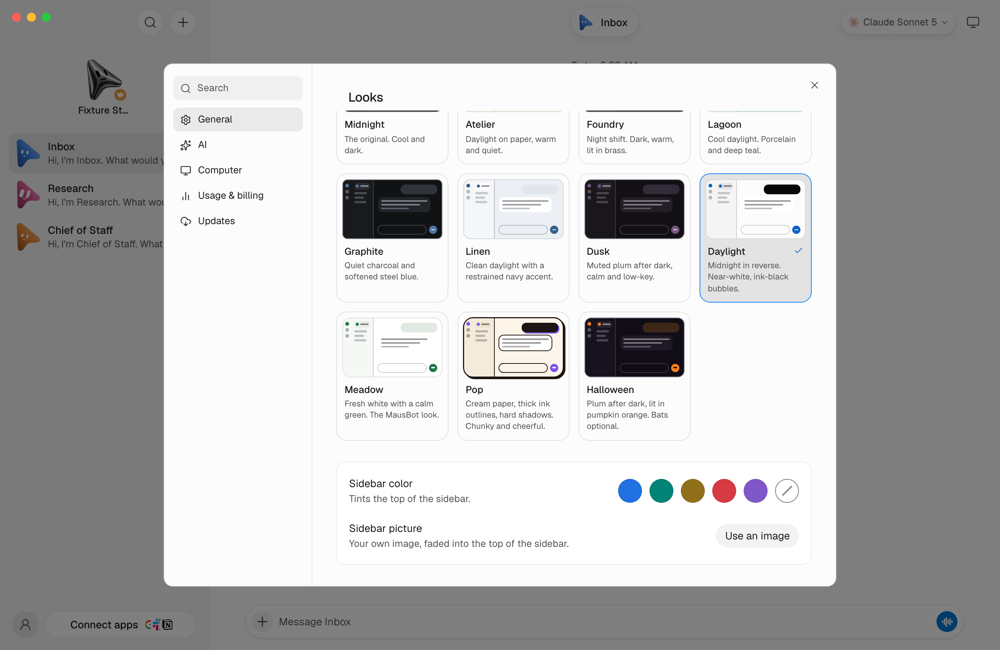
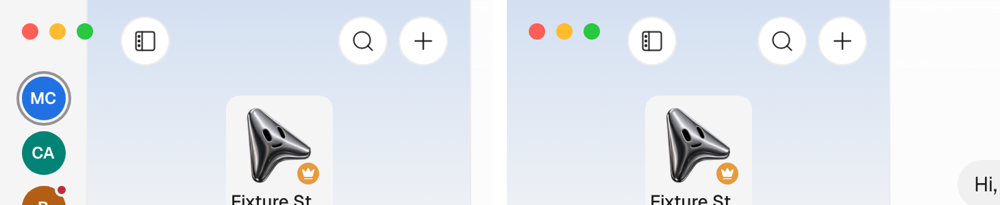

# The rail of Clouds and its ＋

Once a person has two places or more in all (This computer counts while it is
a place; their Clouds, their teams' Clouds, servers they connected by hand), a
narrow rail of circles at the window's left edge switches between them, and ＋
buys another Cloud or adds a server of their own. With one place there is no
rail, and the window looks as before.

The rail is the window's own chrome, not a page's: this app's page `/rail` in a
view of its own at the left edge (electron/chrome-rail.mjs), beside whichever
place's page the window shows, at every width and on every place, whatever that
server runs. The page beside it moves over by the rail's width (the app's
preload, at any zoom). The rail's sheets cover the window while open. Its
circles are small and named on hover; the place on screen wears a ring. Beside
the rail the sidebar's switcher and the profile menu's Switch to… step aside.
The person can hide the rail; the page then has the whole window, and those two
come back.
Nothing here needs a real MausBot Cloud account, a payment or the Electron app.

## Contract

- The desktop session may list every Cloud of the person's (`clouds`, at most
  20, contract v1 `CloudEntry`). An older Admin sends none, and the session's
  `cloud` and `teams` say everything exactly as before.
- Each Cloud the person owns besides My Cloud is a saved place of its own,
  named and coloured by the Admin, opened like a team's Cloud: the window pairs
  it through the Admin's `pairing` with that Cloud's id and takes only a grant
  for its own address. My Cloud stays the one home.
- The person hides the rail and shows it again with a button at the left of the
  sidebar's top row, right after the macOS traffic lights (on the same spot
  either way: the app's preload tells the page how far it moved, in
  `--rail-beside`), or with the "Show your computers" switch in Settings
  (Simple: General → Appearance; Advanced: Appearance). Both are there only
  while the window has a rail. The choice is this desktop's (`railHidden` in
  desktop-prefs.json), never a server's or a place's.
- The page beside the rail offers that button through `window.ogb.rail`
  (`state`, `setHidden`, `onState`; its main frame only, and a server's page
  only from the person's click), and learns only whether there is a rail and
  whether it is hidden. Main hides the rail only beside a document that offered
  the button: after the page navigates, reloads, crashes or shows an error page,
  a hidden rail waits 5 seconds for the new document to offer it and comes back
  if none does (an older Cloud or server of the person's own), without changing
  the choice. It comes back too while the page stops responding.
- The rail's list carries names, colours and states, never an address, and goes
  only to the rail's own page. No place's page reads it, not even this
  computer's or a Cloud's; a page learns only that the rail stands beside it. A
  circle opens only a place main listed, by its id, through main's own switch,
  and only from the person's click.
- Buying another Cloud sends the plan, a name and a swatch to the Admin, which
  answers with a checkout this app opens in the browser; the sheet then follows
  the payment and the setup. An Admin that sells one Cloud per account (no
  `clouds`, `canAdd` false, or no such route) is the calm "One Cloud per
  account for now".
- The place on screen tints the top of its sidebar in its colour, faintly
  (`.place-tint`, stronger in dark skins, a thin line with reduced
  transparency, none with forced colours); no colour, no tint. Every place
  starts plain. Settings → Appearance changes it with the same six swatches,
  the plain one named None: a Cloud's on the Admin
  (`PATCH /api/cloud/desktop/clouds/:id`, its owner or its team's admins; a
  member sees it locked), This computer's and a server's connected by hand in
  this app (`environments.json`: This computer's as `localColor`, beside the
  saved places, whether or not the app is signed in). An Admin without that
  route changes nothing and says so.
- The window's own rail changes the colour of every place it lists, whatever
  that place's server runs (an older server's page has no such setting): a
  right-click on a circle, or on its row past eight, opens that place's menu
  with the six swatches. The same rules decide where it is kept
  (`workspaces:recolor`, the rail's own page only, an id main listed); a
  signed-in server not connected here is changed on the Admin. This computer's
  circle wears its colour and has the same menu.
- A workspace may also have a banner picture, kept on its own server beside its
  other pictures (`GET`, `PUT` and `DELETE /api/workspace/banner`; changing it
  is an admin's, seeing it anyone's signed in there). On this computer that is
  its own server, and the desktop app's page is its owner. The app shrinks it
  to 1600 px across at most and draws it afresh as WebP or JPEG under 400 KB;
  the server checks it again (kind, size, still, readable) and keeps none of
  its metadata. It shows faded into the top of the sidebar, in front of the
  colour's tint, which shows when there is no picture or it won't load. A
  browser shows the picture, which is on the server, and no colour.
- The person's own servers and computers that signed in with their account come
  in the same list (`managed: false`, on a server, with or without an address).
  They are never a Cloud of theirs to pair with or lend to: the rail shows them
  with a server mark, offline with when they were last seen, one already
  connected here as that saved place, one reachable but not connected with its
  pairing steps, and one only reachable on its own network with nothing to
  open.

## Automated fixtures

```sh
node --test electron/cloud-list.node-test.mjs electron/cloud-account-clouds.node-test.mjs electron/cloud-rail.node-test.mjs electron/chrome-rail.node-test.mjs electron/home-window.node-test.mjs electron/place-look.node-test.mjs electron/desktop-prefs.node-test.mjs
pnpm exec vitest run src/components/PlacesRail.test.ts src/components/ChromeRail.test.ts src/components/ChromeRailToggle.test.ts src/components/Sidebar.header.test.ts src/components/cloud-buy/AddCloudFlow.test.ts src/components/PlaceLookCard.test.ts
pnpm exec vitest run server/workspace-banner.test.ts server/routes/workspace-banner.test.ts server/workspace-banner.e2e.test.ts src/lib/place-banner.test.ts src/components/PlacePicture.test.ts
```

The account tests answer as a loopback Admin, with and without `clouds`. The
rail tests load the production preload and check which page gets the list,
which ids open, and that a circle, ＋, checkout and a colour change act only
from a click. The colour tests check who may change a place's colour and where
it is kept, from its own page and from the rail's menu, that nothing is saved
when the Admin refuses, and that the tint follows at once. The banner tests
run pictures a real encoder made, carrying EXIF, ICC, XMP and text, through
the server's checks, and a real Team Cloud where its Super admin sets the
banner, a member sees it but can't change it, and a signed-out request gets
nothing. The hiding tests run the rail beside a page that offers the button in
time, one that doesn't, one that hangs, crashes or fails to load, and main's
own wiring of the choice.

## Rendered workflow

```sh
node --experimental-strip-types scripts/verify-cloud-rail.ts --shots .omb-scratch/verify-evidence/cloud-rail
```

It starts a disposable fake-engine server with three bots and the real app in
a Vite preview (`scripts/testing/rail-preview.tsx`), answering the desktop
bridge a hosted Cloud's page gets: six places, one being set up, one that needs
its owner, eleven for the list past eight. A headless Chrome in a throwaway
profile photographs the rail in Advanced and Simple mode (with the place's
tint), the list past eight, ＋'s two choices, the steps for a server of one's
own, the plans, the name and colour of a new Cloud and its setup, the person's
signed-in servers and the steps to connect one, the colour in Settings and in
a circle's own menu for an admin and for a team member, and a banner picture
(drawn by the script and kept through the fixture server's own route) in the
sidebar and in Settings, each in the Daylight and Midnight skins. The
`computer` views are this computer's own page on a desktop with no Cloud
instead: the sidebar plain, in a colour and with a picture, the Appearance card
in Advanced and Simple mode, and its circle and menu with the rail beside it.
The `rail-hidden` views start with the rail hidden, the `rail-icons` ones with
the sidebar showing only avatars, and `strip-settings` opens Settings at the
rail's switch. The rail in these pictures is drawn on the page itself, as on an
older app; the `rail-chrome` views stand in for the window's own rail instead
(the room the app's preload leaves for it, with nothing drawn there), and the
script fails if the sidebar's button for the rail is not on the same spot with
the rail shown and hidden, in either. `--only rail,look-settings` limits it to
some views and `--size 1338x870` sets the window (1280x800 by default). Without
`--shots` it prints the preview's address and waits for Ctrl-C.

This computer's card, with no colour or picture yet
(`evidence/sidebar-look-everyone/`):



The sidebar's button for the rail, with the rail shown and hidden
(`evidence/rail-collapse/`):



This is not production qualification: the places and the purchase are the
preview's fixtures, and no Admin, browser checkout or desktop window is
involved.
