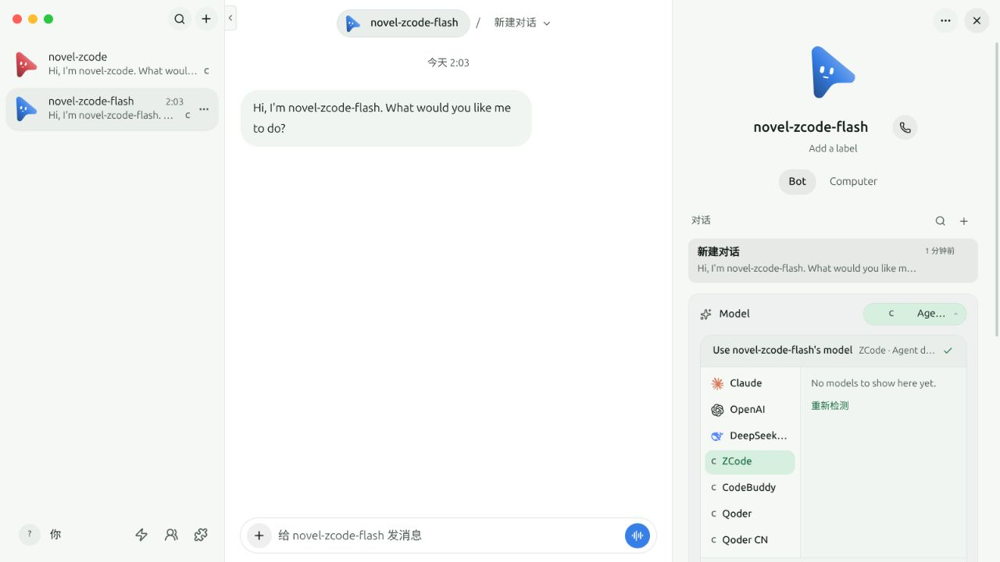
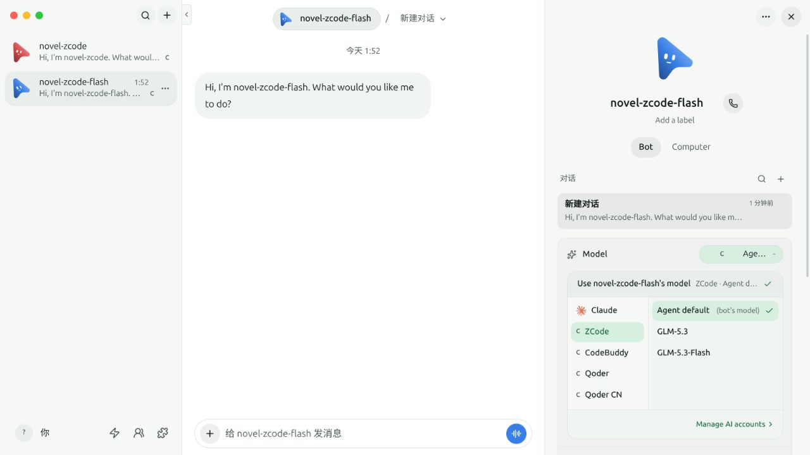

# Custom ACP model and thinking choices

```sh
pnpm exec vitest run server/custom-acp-models.e2e.test.ts
pnpm exec vitest run src/components/CustomAcpModelPicker.test.ts src/components/ModelPicker.test.ts src/components/ModelPicker.interaction.test.ts src/components/ModelPicker.simple.test.ts
```

The end-to-end test uses `launchVerificationServer` from the shared control
surface. It creates a disposable home, data directory and port pair, stops
only the child it owns, adds the repository's independent
`fake-custom-acp-models.ts` engine while stopped, then restarts the same
isolated server. Model calls use only that offline ACP fixture. No installed
ZCode, CodeBuddy or Qoder binary, real account, credential, or user data is used.

The fixture advertises two models using ACP `configOptions`: `glm-5.3` offers
`low` and `max`; `glm-5.3-flash` offers `medium` and `high`. These values are
synthetic protocol cases, not a statement of real provider capabilities.
Thought levels use the `thought_level` category and the deliberately
nonstandard config ID `thinking`, so a driver hardcoded to the ID `effort`
cannot pass.

The test requires catalog refresh to expose the model labels, model-specific
thinking options and capability without sending a prompt. It saves independent
defaults on two bots and an explicit override on a sibling thread, then sends
through `control-omb send`, `wait` and `messages` with the fixture URL explicitly
pinned. The fake ACP process records only model settings, session IDs and
synthetic request markers. Its reply includes the effective model and thought
level, so an auxiliary call or merely successful settings save cannot satisfy
the main-turn assertion.

After alternating both bots and the sibling, the test changes one bot's model
and thought level, checks the other bot and explicit sibling remain unchanged,
then restarts the real server and sends all three again. The settings are read
through the HTTP API after both the change and restart. A fresh instances read
after restart must retain the complete cached catalog and per-model variants
without another discovery call. Native session receipts
must show that each saved thought level was applied using
`session/set_config_option` before its prompt.

Evidence is retained alongside the server log as
`*.custom-acp-models.json`, including control command outcomes, read-back
selections, the discovered catalog and sanitized ACP receipts. The test prints
both paths. Cleanup stops the exact owned child and removes only the fixture
home. The persistent evidence does not contain bearer tokens, full prompts,
provider credentials or real account identifiers.

The renderer tests use the production catalog resolver against the offline ACP
fixture, then pass its unmodified catalog into the complete ModelPicker with
synthetic ZCode, CodeBuddy, Qoder and QoderCN instance identities. They open the
picker, require the advertised model names to be visible, invoke its model
button, reopen it on the saved model, choose a supported thinking option and
verify the saved choice survives a fresh render. They also verify
model-specific options, preserving the selected bot/thread scope when saving,
discarding an incompatible choice after a model switch, ignoring runtime
options belonging to another instance, and hiding unsupported thinking
controls. The existing ModelPicker suites also run to cover common selection
behavior.

For the before screenshot, the unmodified base commit `9596671` was exported
into a separate directory and launched with its own isolated server and the
same synthetic bot/provider setup. Its custom engines advertised only
`agent-default`, with no variant capability; the picker displayed "No models
to show here yet." No feature code was used for this baseline.



The real renderer was also opened in an isolated browser preview backed by the
same disposable server and fake ACP engine. The operator opened the synthetic
`novel-zcode-flash` bot profile, opened its model picker, selected
`GLM-5.3-Flash`, selected `high`, and reloaded the page. An API read-back after
reload retained that bot's model and thinking choice while the second synthetic
bot still used `agent-default`. All four synthetic provider identities were
visible in the picker. These screenshots show the implemented feature against
the offline fixture; they are not screenshots of installed provider accounts.




These checks do not establish a packaged desktop launch. The isolated E2E establishes OMB persistence
and actual ACP transport against a fake agent; acceptance by an installed
provider must be reported separately, with the exact model ID and supported
options advertised by that provider. A failing or skipped provider check is
not evidence of a successful model switch.
