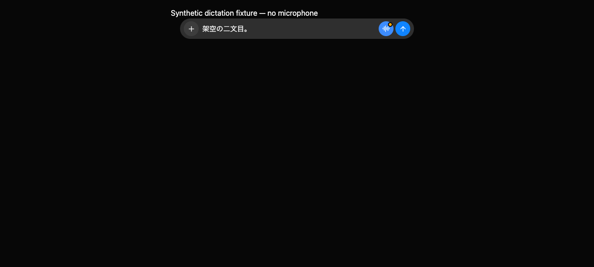
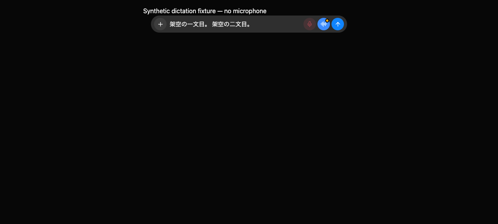

# Native dictation

The same two synthetic utterances in the isolated browser fixture:

| Before: the first sentence is lost | After: both sentences and the stop control remain |
| --- | --- |
|  |  |

Run the regression tests with synthetic Japanese text:

```sh
node --test electron/speech-transcript.node-test.mjs
pnpm exec vitest run electron/speech.test.mjs src/components/Composer.dictation.test.ts src/components/Composer.ime.test.ts src/components/CallView.composer.test.ts src/components/CallView.voiceSetup.test.ts src/components/ChatView.voice.test.ts --maxWorkers=1
pnpm exec vitest run scripts/testing/dictation.e2e.test.ts --maxWorkers=1
```

Launch the isolated fake-engine browser fixture:

```sh
node --experimental-strip-types scripts/control-omb.ts ui launch --entry dictation
```

Use its printed `ui` handle for every command. Click `Start dictation` with
`control-omb ui click --ui HANDLE --name ...`. This fixture never opens a microphone.
With `control-omb ui eval --ui HANDLE --js ...`, call:

```js
window.dictationFixture.hear({ text: "架空の一文目。", partial: true, utteranceFinal: true, speechStart: 0 });
// Wait for a renderer update before the next simulated callback.
window.dictationFixture.hear({ text: "架空の二文目。", partial: true, utteranceFinal: true, speechStart: 5 });
window.dictationFixture.hear({ text: "", partial: true });
```

The textarea must contain `架空の一文目。 架空の二文目。`. Both the stop-microphone
and send-arrow buttons must remain available. Click `Send message`, then inject:

```js
window.dictationFixture.late("架空の一文目。 架空の二文目。");
window.dictationFixture.hear({ text: "送信後の独り言。", partial: true });
window.dictationFixture.stats();
```

The textarea must stay empty and `capturing` must be false. Fetch `messages`
using the fixture's printed URL and bot ID. It must contain one user message
with both sentences, followed by the fake engine's answer. Stop only the
fixture launcher with Ctrl-C to remove its temporary data.

## Scope

Apple's on-device Speech implementation can return a completed utterance's
metadata with `isFinal == false`, then reset the transcript on the next
utterance. The native helper forwards that boundary and its audio start time;
Electron accumulates utterances before forwarding a cumulative transcript to
the composer and call views. `partial: false` still means session completion,
so call-mode utterance boundaries do not submit extra turns.

The accumulator accepts cumulative recognizers, repeated boundary callbacks,
empty callbacks, partial corrections and distinct utterances with identical
words. The composer cancels capture on send, explicit stop, manual editing or
thread changes, and rejects late callbacks even before React removes listeners.
Rebuild the native Speech helper with `pnpm build:speech` as well as the
renderer; copying only the renderer does not deliver this fix.

The boundary workaround follows observations in the
[Apple Developer Forums](https://developer.apple.com/forums/thread/762952).
These observations are not a guarantee about every macOS Speech version.
If an OS returns truncated text without boundary metadata or distinguishable
audio timing, it cannot always be distinguished from a legitimate partial
correction. The synthetic fixture does not establish real microphone accuracy,
audio-device behavior, or unlimited native recognition duration. Verify those
manually on the target Mac without sending sensitive speech. Recognition
keeps the existing on-device setting; this fix adds no cloud transcription.

## Local verification record (2026-10-18)

The synthetic browser fixture retained both sentences, ignored an empty
callback, sent one combined message to the fake engine, and kept the textarea
empty after both an old callback and additional speech. Capture was false
after the send arrow. The unit suite also exercises 200 utterance boundaries,
Enter-to-send, manual corrections, thread switching, and recognition failure.
The native microphone itself was not used for this automated check.

A separate local file-only check streamed synthetic Japanese speech with
three-second silent gaps into the native on-device recognizer. It retained
all three utterances through the production Electron transport, preload and
Composer. Sending during recognition stopped capture, and the textarea stayed
empty for twenty seconds afterward. The native callback was unchanged; only
the test helper's microphone input was replaced by real-time file buffers.
This checks actual recognition boundaries, but not physical microphone quality.
