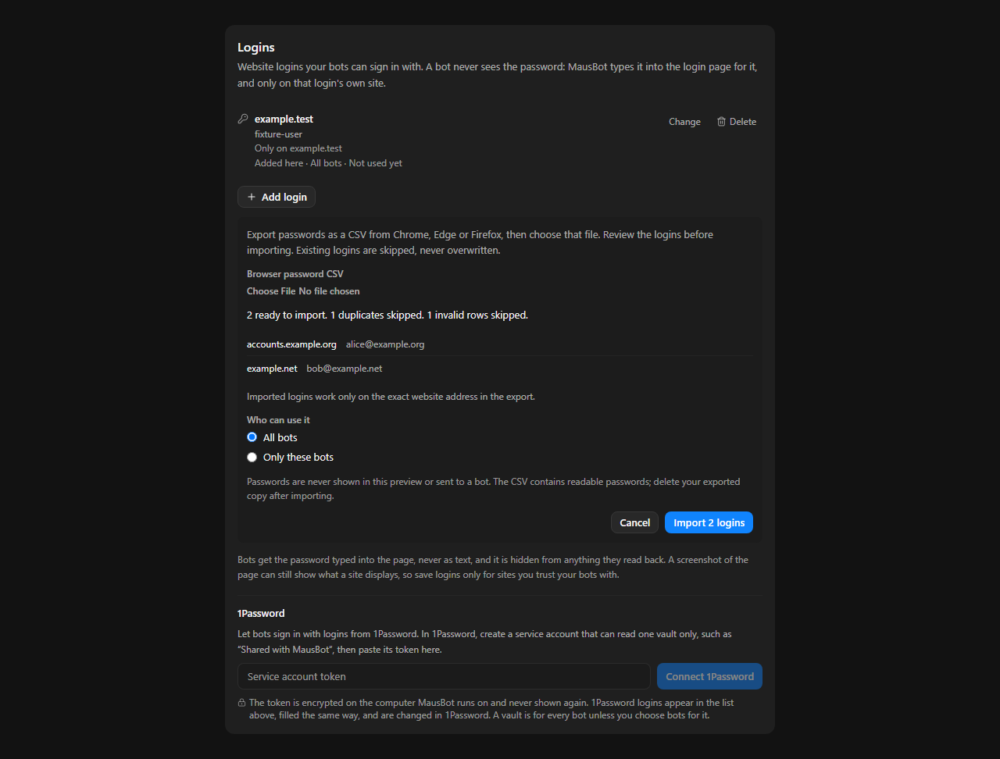

# Bulk browser login import

Run `node --experimental-strip-types scripts/verify-login-import.ts`. This starts a disposable server and exercises a batch import, duplicate retry, exact-host scope and responses without passwords. Open the printed preview URL.

In the preview choose **Import from browser** and select `docs/verification/assets/login-import/browser-export.csv`. This file contains synthetic credentials only. Expect two new logins, one existing duplicate and one invalid row. Confirm the import: two accounts appear and the original account remains. Reimporting the same CSV must leave no new accounts ready to import. Cancel must save nothing. Select only one bot to exercise the batch access choice.

The first version supports UTF-8 CSV exports with URL, username and password columns, including Chrome, Edge and Firefox exports. Files are read in the renderer only after explicit file selection. Passwords remain in memory until confirmation and are never rendered. Only validated records reach the existing encrypted login store, through an admin-only route. Invalid rows are excluded from preview; server validation rejects an invalid submitted batch before writing. Duplicates are skipped without changing passwords, authenticator keys or bot grants. Imports use exact-host scope.

Limits: 5 MiB per CSV and 5,000 logins per batch. Browser profiles are not read directly. Passkeys, authenticator setup secrets, browser notes and non-web credentials are not imported. Retained CSV exports contain readable passwords; the person deletes them after import.

Verified on Windows, 2026-11-03:
- 44 focused parser, login-store, HTTP-route and component tests passed after rebasing onto upstream `94844cb`.
- The isolated full server verified import, duplicate retry and password-free responses.
- The mounted browser preview showed 2 ready, 1 duplicate, 1 invalid; confirmation created the two accounts.

