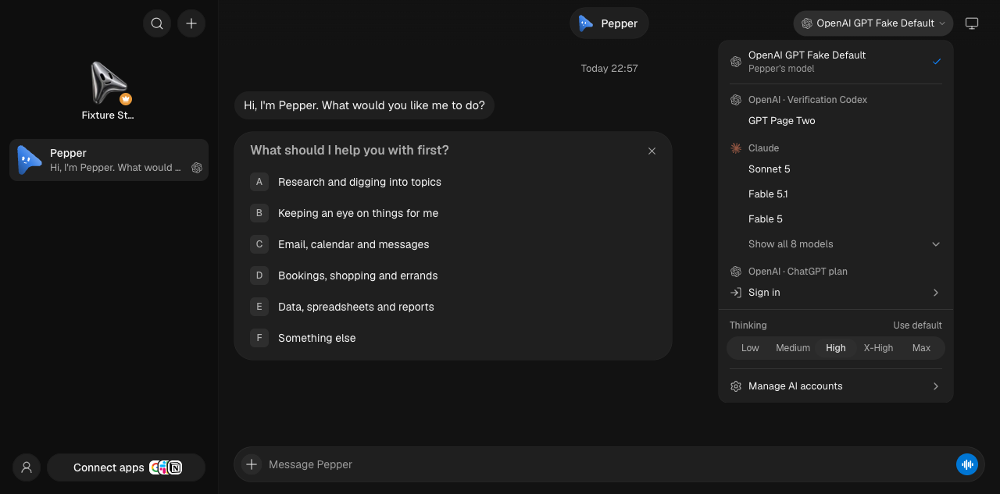
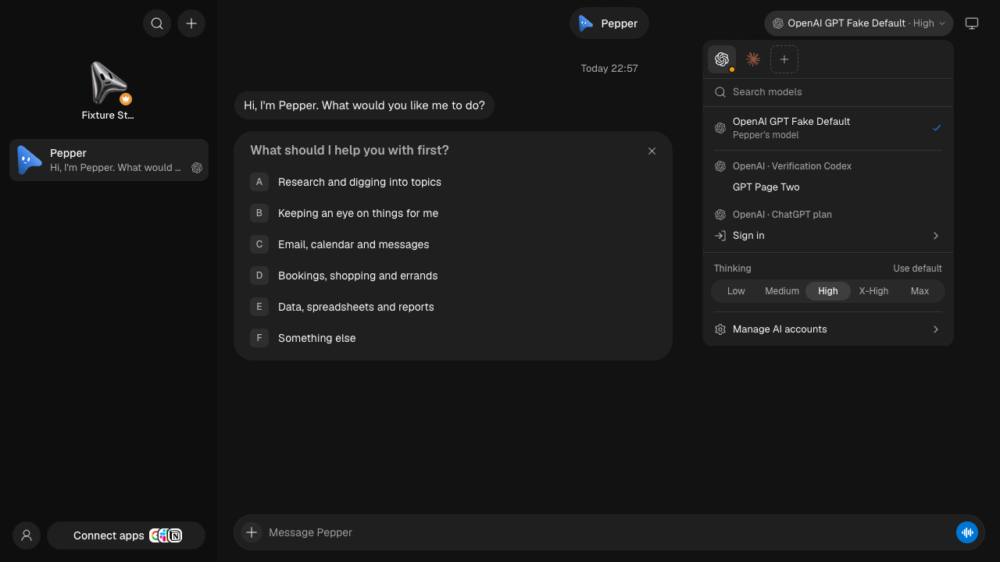

# Model picker

The model picker has a horizontal provider strip, catalog search, a scrolling model list, and reasoning controls outside the catalog's scroll area. The compact chip includes the selected reasoning level. Browsing a provider does not change the selected model; choosing a model does. Sign-in accounts remain grouped by provider, while API-key routes have their own labeled controls.

Search is available for small catalogs as well as large ones, and the full catalog is available without a Show all step. The shared backup-AI menu also keeps search and its full eligible catalog available. Existing thread/default scope, Follow bot, setup, policy and native variant handling remain in place. Opening or browsing a provider that supports local models refreshes its local catalog.

The advanced catalog scrolls its scope controls, account details and model rows together, with search sticky inside that area. Reasoning and settings stay outside it, so a short window cannot collapse model rows behind fixed account details. Update availability remains a provider hint; updates are available through the existing Settings flow instead of an updater card among model choices.

## Isolated verification

Run the existing verification launcher with fake engines; never use the installed app or real user data. The permanent browser check covers both 1280 × 440 desktop and 390 × 440 phone viewports, scrolls the catalog to its last row, and checks that model rows and the footer remain reachable:

```sh
OMB_UI_E2E=1 pnpm exec vitest run scripts/testing/control-omb-ui.e2e.test.ts -t 'keeps advanced model choices'
```

The colocated ModelPicker DOM tests additionally cover provider-key navigation, search + Enter selection, reasoning choices, focus, dismissal, and the single-model cloud search label. The model/settings tests cover account grouping, API routes, setup, policy, opaque native variants and thread/default scope. BackupAis DOM tests cover the shared chooser.

## Screenshots

These are the real renderer using disposable fake Codex and Claude providers and synthetic account data.

| Before | After |
| --- | --- |
|  |  |

[Advanced picker](assets/model-selector/after-advanced.png) · [Phone picker](assets/model-selector/after-phone.png)
