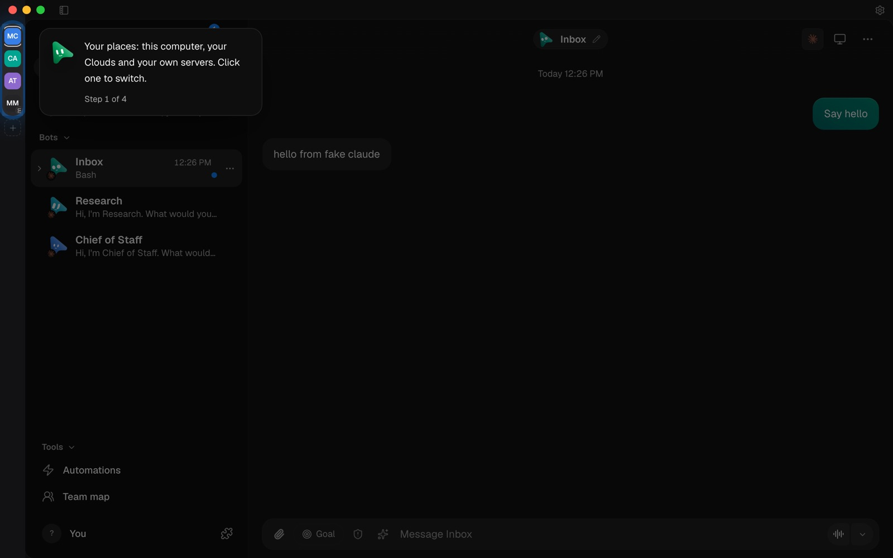
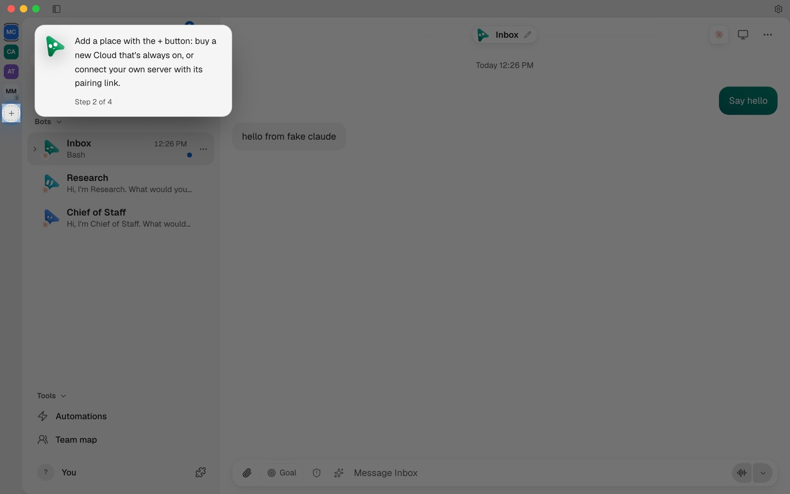
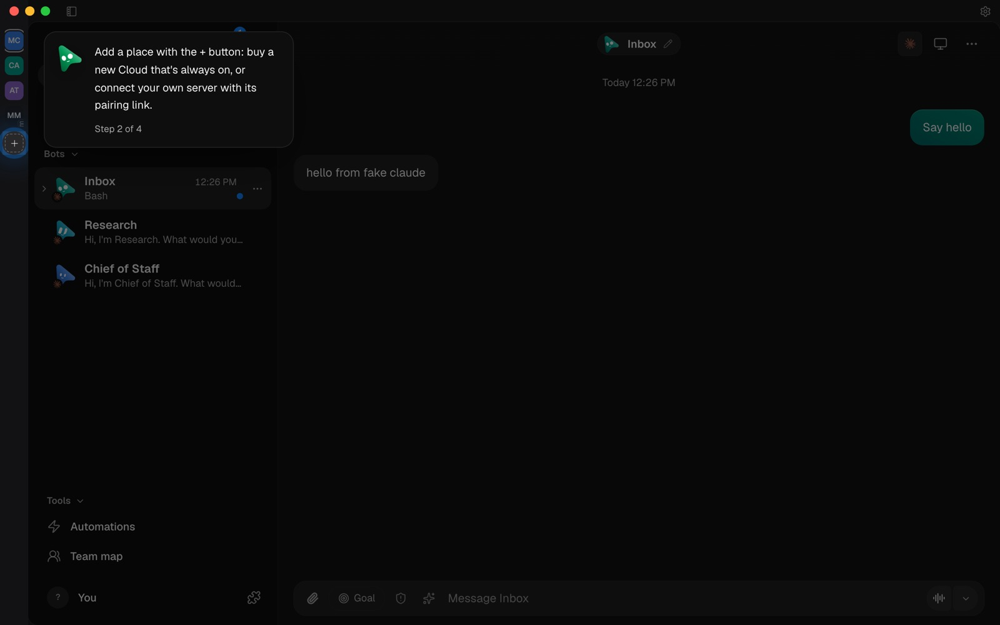
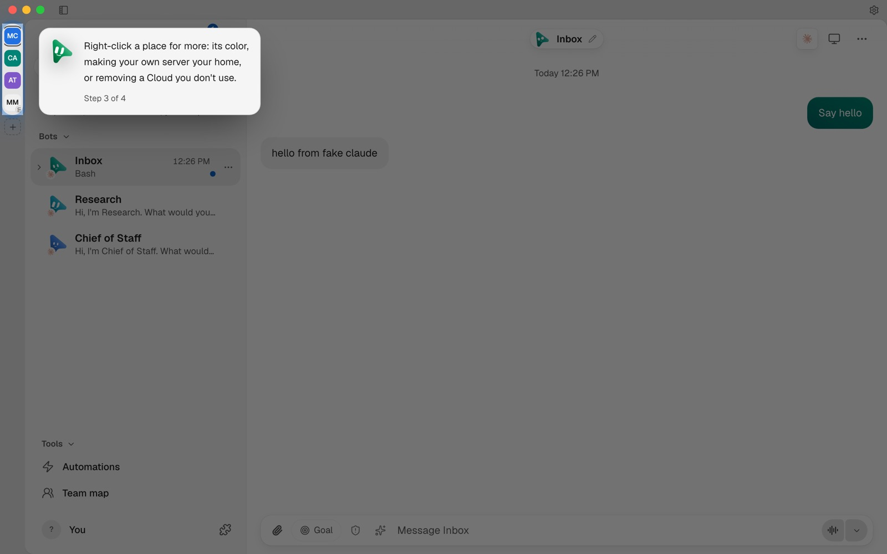
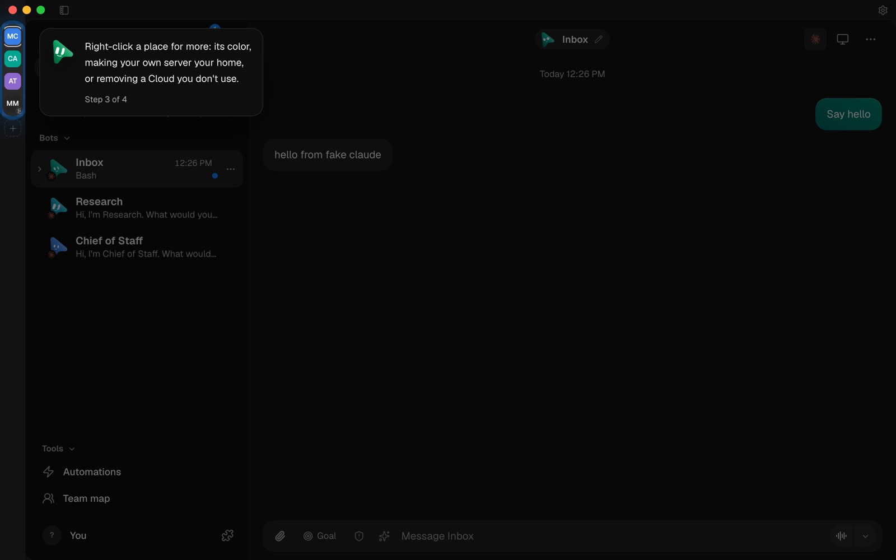
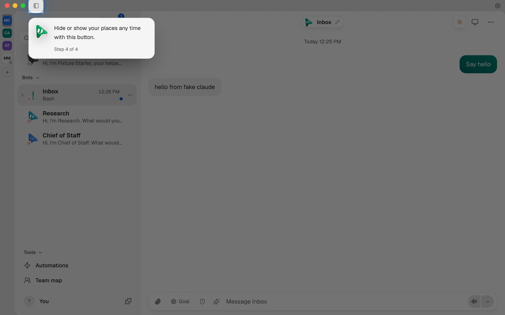
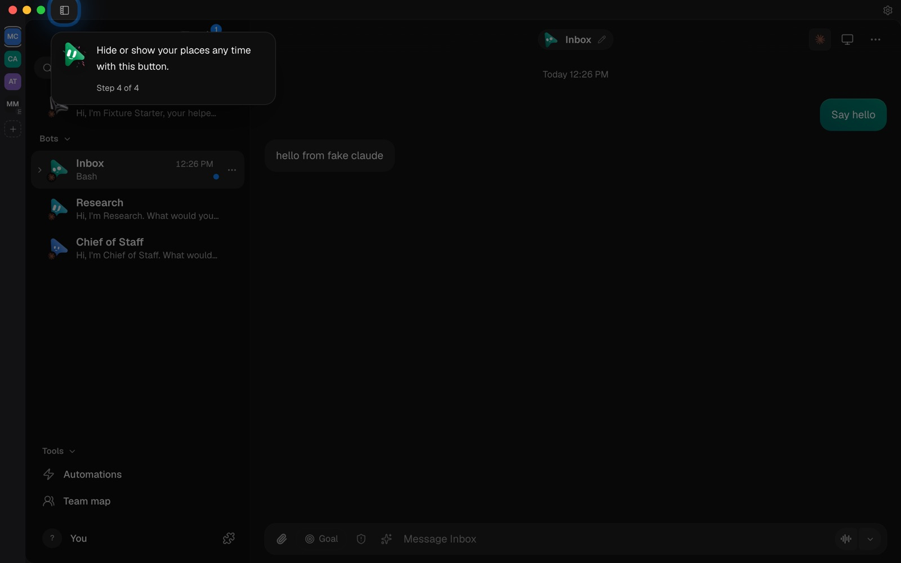

# Welcome flow and guided tour

The first run is two screens, then the chat (Oct 27 2026): "Meet OpenMausBot"
(a composer typing one sentence and Next; with no AI working, the same pill
signs one in, with "Other ways to connect · Set up later" under it), then
"Introducing your Chief of Staff" over an empty app (Create Chief of Staff, and
Choose an existing bot where the person has bots). The Chief step shows only
for a MausBot not yet introduced where no other bot is the Chief. It lands in
the Chief's chat, where MausBot's three lines, its follow-up (written once by
the server, `POST /api/bots/:id/helper-followup`) and chips offer only what is
still missing. The app tour starts only from Settings → Replay app tour.

Launch the isolated full-app fixture following [Chat UI](chat-ui.md):

```sh
node --experimental-strip-types scripts/control-omb.ts ui launch
```

In a second terminal, pass its exact printed handle:

```sh
node --experimental-strip-types scripts/verify-onboarding-ui.ts /tmp/openmausbot-verify-data-XXXXXX/ui.json
```

Use a fresh fixture. The recipe clears only its browser storage, then enables
first-run onboarding through the fixture-only `?onboarding=1` entry. It uses
the real renderer and fake-engine server. No provider login, real phone
pairing, native permissions or user workspace is involved.

Assertions cover the two screens: no field, step count, Back or Skip on the
first; a reload on the second coming back to it; Create landing in the Chief's
chat with its first messages and one saved follow-up even when the completion
save fails, and the next browser without this one's mark seeing the welcome
again, without the Chief step MausBot already had, and saving it (with
`met-chief-v1`); no app tour after the welcome or a reload; automatic
starter-model selection and a successful first composer message without opening
the model picker; every app tour step from Settings, persistence after reload,
Settings replay, skipping while Next is saving, closing a welcome replay while
its save is pending, and replay on legacy installs with a failed-save retry.
Screenshots are retained in `.omb-scratch/verify-evidence/onboarding/` with a
PASS line for each workflow. Actual provider authentication and native Electron
permissions remain covered by their separate platform recipes, not this browser
fixture.

Stop the launcher with Ctrl-C; it owns and removes only its disposable home.

The rules behind it run offline:

```sh
pnpm exec vitest run src/components/onboarding/WelcomeFlow.test.ts src/components/onboarding/ChiefIntro.test.ts src/components/onboarding/ConnectAi.test.ts src/components/HelperIntro.test.ts src/lib/default-bot.test.ts server/routes/helper-followup.test.ts electron/system-name.test.mjs src/components/CardHint.test.ts
```

They cover when the Chief step shows, its 300 ms input guard, the Cloud Pro
popup settled by a first run that could offer the Cloud, the chips' order and
cap, the follow-up written once and only by MausBot's own person, the default
profile name's guards, and the Advanced intro and spotlights kept as they were.

## Providers connected after first launch

```sh
pnpm exec vitest run server/onboarding-model-default.e2e.test.ts server/default-model-selection.test.ts src/components/NewBotDialog.test.ts
```

The server tests launch only disposable homes and repository-owned fake engines.
They cover a genuinely signed-out first install, a missing CLI connected later,
and first-send discovery without opening settings. They assert the selected model
in persisted bot records and fake-provider arguments, settled turns and bounded
transcripts. Existing bot choices and explicitly pinned thread models survive
both automatic repair and a restart. Disabled and signed-out engines stay unset.
Guarded messages recheck permissions after held provider discovery before starting.
Pure-picker tests cover API/custom engines, empty catalogs, fallback model options
and organization policy. Dialog tests cover blank saved new-bot templates without
replacing deliberate choices. Real provider authentication and packaged native
installation are not exercised by these offline fixtures.

## Organization row, hosted beats and member note (Sep 23 2026)

What each first-run surface depends on, and how it was checked:

| Who opens the app | What they get | Checked by |
|---|---|---|
| Desktop app, own server (full bridge, `remoteClient` present) | The two-screen first run, decided without a new request | `src/components/onboarding/WelcomeGate.test.ts`, `src/components/onboarding/WelcomeFlow.test.ts` |
| Hosted workspace opened inside the desktop app (reduced bridge, no `remoteClient`) | Treated like a browser: the server is asked | `src/components/onboarding/WelcomeGate.test.ts` |
| Packaged desktop with the organization bridge | An optional "Using OpenMausBot at work?" row under Other ways in Connect an AI; a signed-in Company engine counts as ready | `src/components/onboarding/beats/OrganisationRow.test.ts`, `src/components/onboarding/ConnectAi.test.ts` (fake bridge) |
| Browser, admin of a hosted workspace | The first screen only, with the shared-workspace line, then the chat | `src/components/onboarding/WelcomeGate.test.ts`, `src/components/onboarding/WelcomeFlow.test.ts`, `src/lib/onboarding.test.ts` |
| Browser, hosted member (no admin scope) | No welcome flow; one dismissible note kept in browser storage; no first-conversation spotlights | `src/components/onboarding/WelcomeGate.test.ts`, `src/components/onboarding/FirstConversationTour.test.ts` |
| Browser, client-scope session on a server that is not hosted | Nothing new: the flow does not open itself (it could not be saved); Settings replay and spotlights as before | `src/components/onboarding/WelcomeGate.test.ts`, `src/lib/onboarding.test.ts` |

`GET /api/auth/session` adds `hosted: true` for a session on a hosted
workspace and is otherwise unchanged (`server/hosted-access.test.ts`,
`server/email-signin.test.ts`).

On a fresh `ui launch` fixture, the recipe above still passed end to end
through the new session check. In the same fixture browser, a client-scope
paired session with the server's onboarding record reset got no welcome flow.
That run also showed the member note, which review then limited to hosted
workspaces (the fixture is not hosted). The hosted-only rule is covered by the
tests above, not by a rerun. In that run, "Got it" made no `/api/config`
write, and the note stayed away after a reload. Connect an AI was mounted from the Vite preview with a fake
`window.ogb.organization` injected before mount; it showed the row signed out,
then connecting with the code, then connected. `begin` ran once, with the
default Admin. Screenshots are in `.omb-scratch/verify-evidence/onboarding/`.

Not covered here: the real Electron preload bridge and a real Admin enrolment
(see [organization connection](organization-settings.md), not rerun for this
change), and a real hosted tenant's browser. The hosted beat set was rendered
from a temporary preview entry, not reached through a hosted sign-in. The
organization row now sits under Other ways on the first screen; its states are
covered by the tests in the table.

## A new Cloud's welcome

```sh
node --experimental-strip-types scripts/verify-cloud-welcome.ts
```

It launches the isolated fake-engine fixture and mounts the whole app
(`scripts/testing/cloud-welcome-preview.tsx`) in a Vite preview whose
session and config answer as a Cloud home's owner, with Claude signed out and
the trial's Claude credit in the engine list. Open the printed `previewUrl`:

- `?desktop=1` adds the reduced bridge a Cloud's page gets in the desktop app;
  `?move=copy` or `?move=done` shows the one-time move on its way or landed
  (6 bots, 142 chats, 4 routines).
- `?step=engine`, `?step=files` or `?step=done` opens the welcome on that step;
  `?skin=daylight` (or any skin) picks the skin.
- `POST /__fixture/engines?mode=signed-in` (or `signed-out`, `credit`) changes
  the engine list for the next load.

What was checked this way (Oct 16 2026): every step and the done state in
Midnight and Daylight at 1280×860, 1024×760 and 390×844, the bring and engine
steps in the other seven skins, and
the setup card in short beside Routines. Steps finished there are written to
the fixture's onboarding record; the record can be cleared with
`PUT /api/config` (`{"onboarding":{"hintsSeen":[]}}`). The real move and the
desktop's preload bridge are not exercised here; they are covered by
`server/one-home.e2e.test.ts` and
`src/components/cloud-welcome/CloudWelcome.test.ts`.

## Bring what you already use (Oct 16 2026)

Skills and MCP servers another AI tool keeps on this computer, brought in with
one button: in Settings → Import, and offered by MausBot's first messages as a
"Bring in your skills" chip when its look around finds some within two seconds.
Desktop app only.

```sh
pnpm exec vitest run server/setup-import.test.ts server/imported-skills.test.ts server/toml-lite.test.ts server/routes/setup-import.test.ts server/setup-import.e2e.test.ts src/components/ImportSettings.test.ts src/components/HelperIntro.test.ts src/lib/setup-import.test.ts
```

Every test builds its own temporary home; none reads the real `~/.claude`,
`~/.codex` or other dotfiles. The detector test plants credential, session,
history and transcript files holding a sentinel, records every path the step
touches, and checks that none of them was listed or opened and that the
sentinel reaches no answer, saved server or copied skill. The route test
refuses a paired device, a service loopback and a hosted or Cloud server; the
end-to-end test runs the real server from `launchVerificationServer` against a
planted home, as the desktop app runs it (`OMB_TEST_DESKTOP_OWNER_TOKEN`), checks
that a headless server (`openmausbot serve`) refuses the step, and checks that the starter bot and a bot made afterwards both
get the skills in their turn's index, task folder links and `/name`, that a
Claude turn with "Also use my Claude Code skills" on sees a Claude Code skill
once, and that a bot can switch one off for itself. The rows, working, failed
and with their result, are covered in Settings by
`src/components/ImportSettings.test.ts`; the chip by
`src/components/HelperIntro.test.ts`. Not covered here: the packaged Electron
window itself.

## Two screens, then the chat (Oct 27 2026)

```sh
pnpm exec vitest run src/lib/onboarding.test.ts src/lib/welcome-draft.test.ts src/lib/default-bot.test.ts src/lib/corner-popup.test.ts src/components/onboarding src/components/HelperIntro.test.ts src/components/AppNotices.test.ts src/components/MausBotWelcome.gate.test.ts
```

- `src/components/onboarding/WelcomeFlow.test.ts` renders the flow in
  happy-dom: two screens with an AI working (Next, then Create, landing in the
  Chief's chat with its first messages staged); with none, the first screen
  holding Connect an AI, Next held until one connects and Later moving on;
  Escape and Enter; a reload on the second screen; a hosted admin's one screen;
  a replay saving nothing about a first chat.
- `src/components/onboarding/ChiefIntro.test.ts` covers Create (MausBot made the
  Chief only where there is none, an existing Chief never replaced), Choose with
  its radio list and Confirm (a bot whose AI cannot lead held back), Escape
  leaving only the list, and the choice finishing in a window that runs no
  animation frames.
- `src/components/onboarding/ConnectAi.test.ts` covers the recommended sign-in,
  Other ways and the failed check.
- `src/components/HelperIntro.test.ts` covers MausBot's first messages: the
  three bubbles, the look around, chips for only what is missing, and the
  staged arrival.
- `src/lib/corner-popup.test.ts` and `src/components/AppNotices.test.ts` keep
  every corner notice out of the first conversation until a reply;
  `src/components/onboarding/FirstConversationTour.test.ts` keeps its
  spotlights off; `src/components/MausBotWelcome.gate.test.ts` keeps MausBot's
  first-launch card for older installs only.
- `src/components/onboarding/GuidedTour.test.ts` and
  `src/components/onboarding/WelcomeGate.test.ts` check the app tour never
  starts by itself, also after a reload.

`verify-onboarding-ui.ts` passed end to end on a fresh `ui launch` fixture (Oct
27 2026). That fixture's fake engine always reports a signed-in account, so the
no-AI first screen, the Chief screen with bots to choose and narrow windows were
checked in `onboarding-preview.html` (`?ai=0`, `?screen=chief&bots=3`,
`?w=840&h=620`) in Midnight and Daylight. Before and after screenshots are in
`evidence/onboarding/`.

## The tour of the rail of places (Nov 2026)

Once on each desktop with a rail at the window's left edge, after the update
that brings it, a short tour in the app tour's Spotlight look points at the
rail. Its campaign is `sidebar-tour-2026-11` (`SIDEBAR_TOUR_NOTICE` in
`src/lib/notices.ts`); a later release names a new one to show a new tour.

1. The places: "Your places: this computer, your Clouds and your own servers.
   Click one to switch."
2. The ＋: "Add a place with the + button: buy a new Cloud that's always on, or
   connect your own server with its pairing link."
3. A right-click on a place: "Right-click a place for more: its color, making
   your own server your home, or removing a Cloud you don't use."
4. The button that hides and shows the rail: "Hide or show your places any
   time with this button." With the rail hidden it is the only step: "Your
   places are hidden. Show them again with this button, then use + to add a new
   Cloud or your own server."

It has no buttons. Each step stays for its reading time (3 to 10 seconds, by its
words in the app's language), then the tour moves on; Escape leaves; a step
whose target isn't on screen gets 400 ms to appear and is passed over.

It is one entry in the notices queue, after the Cloud Pro popup and before
Boat's offer, so a launch shows one of the three at most (the product-updates
question may still follow it). It needs a rail it can point at: with none, there
is no tour, and it stays unseen until there is one. It never shows while a bot
or a room is working (it steps aside and comes back at the step it was on), nor
during the welcome, the app tour, Settings, another dialog or a call, nor on a
branded build, a desktop signed in with an organization or a remote client's
window, nor after MausBot's first-launch card in that card's launch. A new
install gets it once its first chat has had a reply. Run to its end or left
with Escape, it is kept in the workspace record, the page's storage and the
desktop's own record (`DESKTOP_NOTICES`), so no page of the window shows it
again. It is counted as `sidebar_tour` ([analytics](../analytics.md)).

The window's rail is a page of its own, in a view the page beside it can't
reach. The tour asks main to mark a part of it (`window.ogb.rail.mark`, on this
computer's page and on My Cloud's as home only): the rail's page rings that
part and shades the rest, in step with the page's own shade. A rail drawn on
the page itself (an older app's) is ringed by the page.

```sh
pnpm exec vitest run src/lib/sidebar-tour.test.ts src/components/onboarding/SidebarTour.test.ts src/components/AppNotices.test.ts src/lib/notices.test.ts src/components/ChromeRail.test.ts src/components/CloudProPopup.test.ts
node --test electron/chrome-rail.node-test.mjs electron/desktop-prefs.node-test.mjs
```

The rendered workflow:

```sh
node --experimental-strip-types scripts/verify-sidebar-tour.ts --shots .omb-scratch/verify-evidence/sidebar-tour
```

It starts a disposable fake-engine server whose bot has answered once, and the
real app in a Vite preview (`scripts/testing/sidebar-tour-preview.tsx`), beside
the real rail page in a frame at the left edge that stands in for the window's
rail view: the page's `rail.mark` reaches the frame as main's `rail:mark`
reaches the rail. A headless Chrome photographs every step as the tour moves on
by itself, in Advanced and Simple mode, on My Cloud's page and on this
computer's, with the rail hidden and in a narrow window, each in the Daylight
and Midnight skins. `--only advanced,simple` picks views; without `--shots` it
prints the preview's address and waits.

| Step | Daylight | Midnight |
| --- | --- | --- |
| The places |  |  |
| The ＋ |  |  |
| A right-click |  |  |
| The rail's button |  |  |

Simple mode's steps, the rail hidden, a narrow window and this computer's page
are in `evidence/sidebar-tour/` too. Not covered here: the real Electron window
and its rail view (the frame stands in for it), and real places.
