# Question cards

A bot doing work another bot handed it asks the person with a card: a decision with a few set answers through its
engine's question tool, the bot's own choices as buttons, and any other question as the same card with a reply field in
place of its `NEEDS INPUT:` line. On a Team Cloud the card's copy reaches the person's inbox with the same buttons, and
an answer from either place, by tap or in the person's own words, reaches the bot. Contract:
[`docs/runtime-contract.md`](../runtime-contract.md) §2 and §4; routing: [`docs/team-cloud.md`](../team-cloud.md).

## Server, end to end

```sh
pnpm exec vitest run server/question-cards.e2e.test.ts
```

It starts a Team Cloud on the two-server fixture (`scripts/testing/cloud-send-fixture.ts`) with the scripted fake engine
(`server/testing/room-handoff-agent.ts`): Philipp asks Luchs, his Chief, whose chat is his inbox, to have Biber fix
something, and Luchs hands it on with `coordinate_bots`. Expected:

- Biber's envelope offers its card tool for set answers (`ask it with ask_user`), and Biber's turn calls the real
  `ask_user` server with three German choices. The card is in Biber's work thread, and its copy is in Philipp's inbox
  with the same choices, listed under Needs you, with one notification and no chip beside it.
- A tap on the copy (`POST /api/threads/<inbox>/respond`) answers Biber's waiting tool call; Biber's reply quotes the
  choice, Luchs is resumed once with Biber's report, and both cards read as answered.
- A line Philipp types in Biber's thread while Biber waits answers the card the same way, and stays in the thread
  under it.
- Biber's `NEEDS INPUT:` question becomes a question card with no choices in place of its line, and a copy in the inbox.
  Luchs is resumed once with the question and told not to repeat it; Philipp's reply on the copy reaches Biber's next
  turn as `The person answered: "…"`.
- Stopping Biber's thread closes an open question as stopped, in the thread and in the inbox.

Unit tests: `server/host/ask-cards.test.ts` (the card a parked question becomes, its stopped and expired states, the
chip that stays out of the inbox, typed answers), `server/runtime/envelope.test.ts` (the ask line with and without a
card tool), `src/components/QuestionCard.test.ts`, `src/components/QuestionCard.answer.test.ts` and
`src/components/AskCard.test.ts` (the card family, its buttons and settled lines).

## The cards, side by side

```sh
pnpm exec vite --port 5287
```

`http://127.0.0.1:5287/question-cards-preview.html` mounts the real chat, inbox card and inbox panel over a fixed store
(`src/question-cards-preview.tsx`): `?state=question|approval|open|answered`, `surface=chat|inbox|panel`,
`skin=midnight|daylight`, `mode=simple|advanced`, `lang=de`; `state=others` shows the key, sign-in, connection and
first-run cards that share the card's shell. Captured at 1338×870 at 2x, before and after:

| | Before | After |
|---|---|---|
| Set answers, chat | 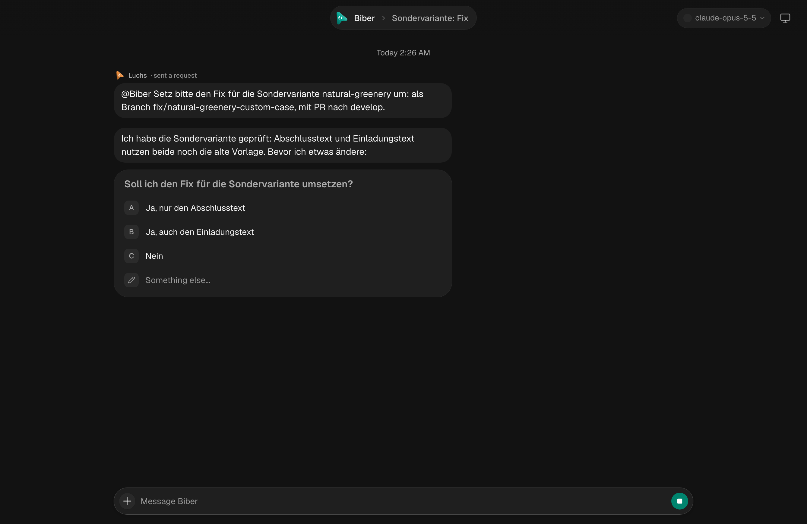 | 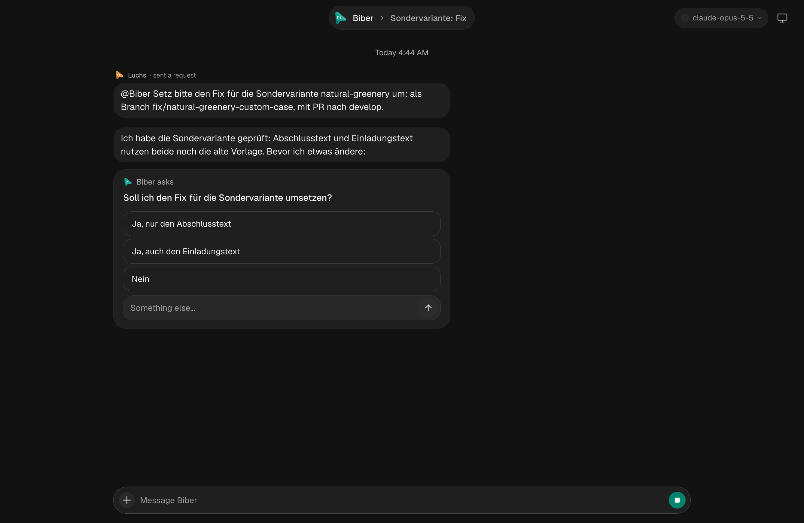 |
| Set answers, inbox | 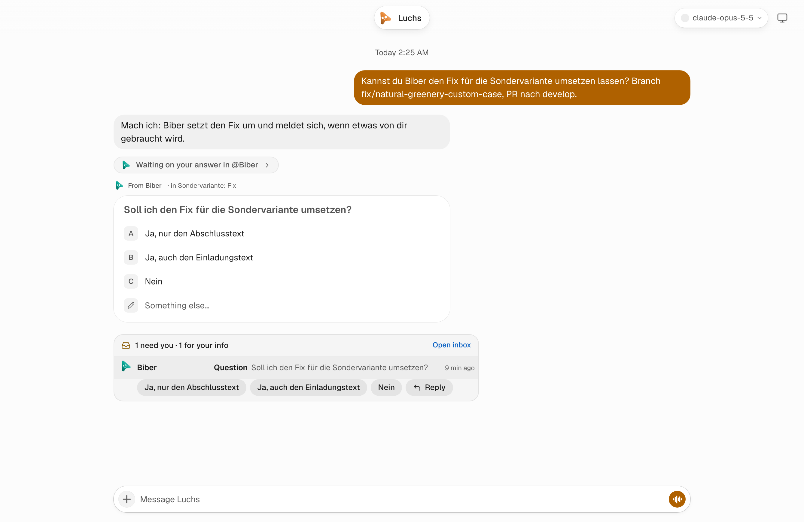 | 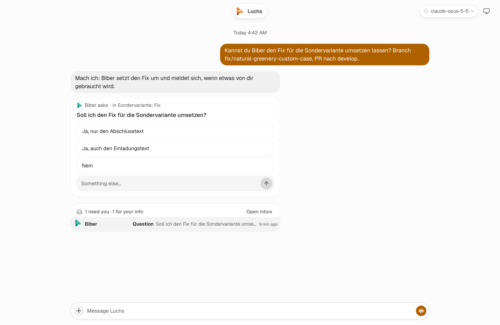 |
| Set answers, panel | 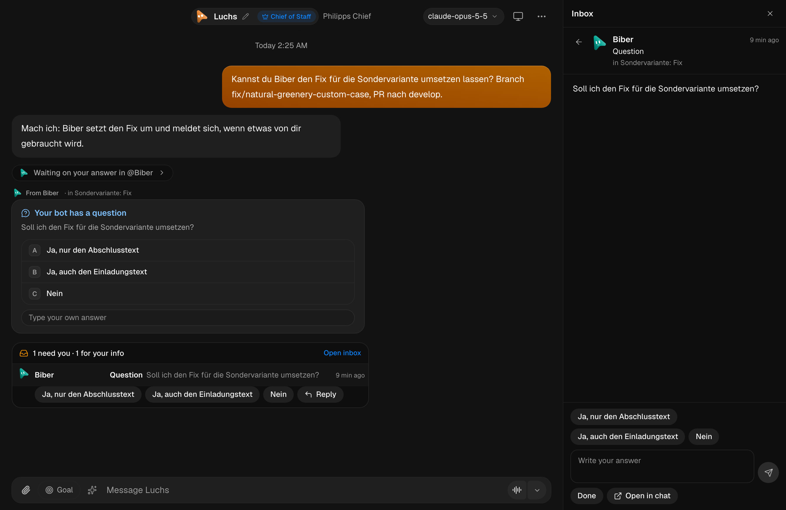 | 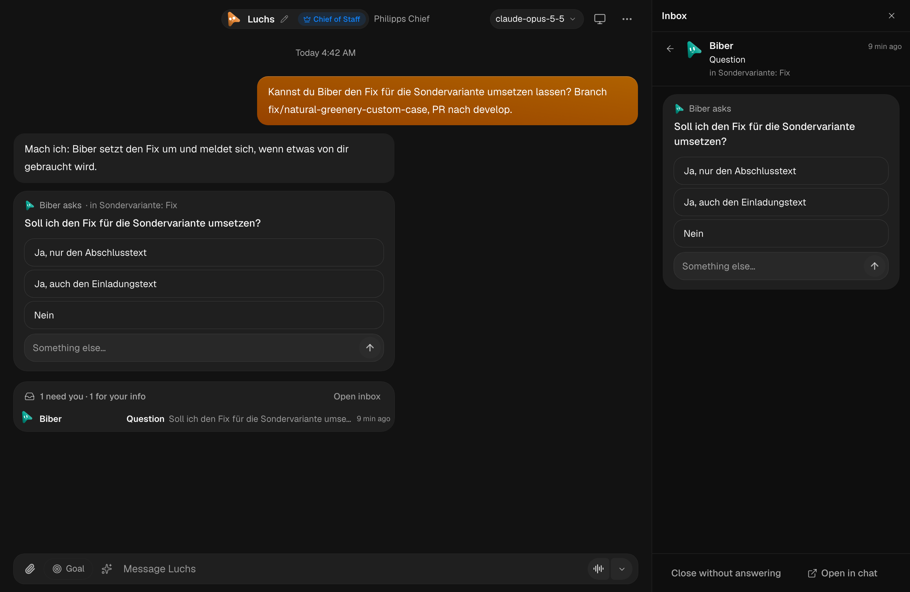 |
| Approval | 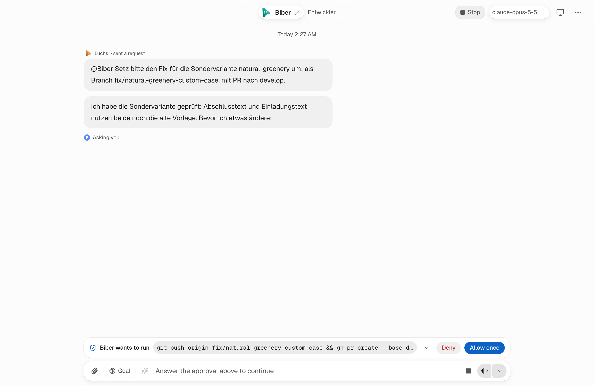 | 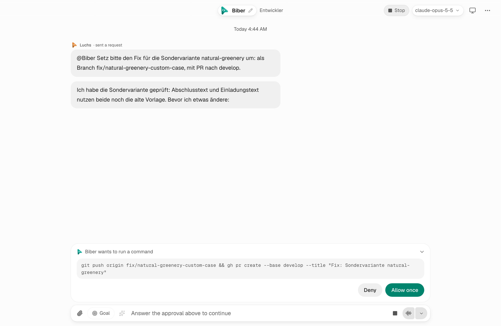 |
| Open question, inbox | 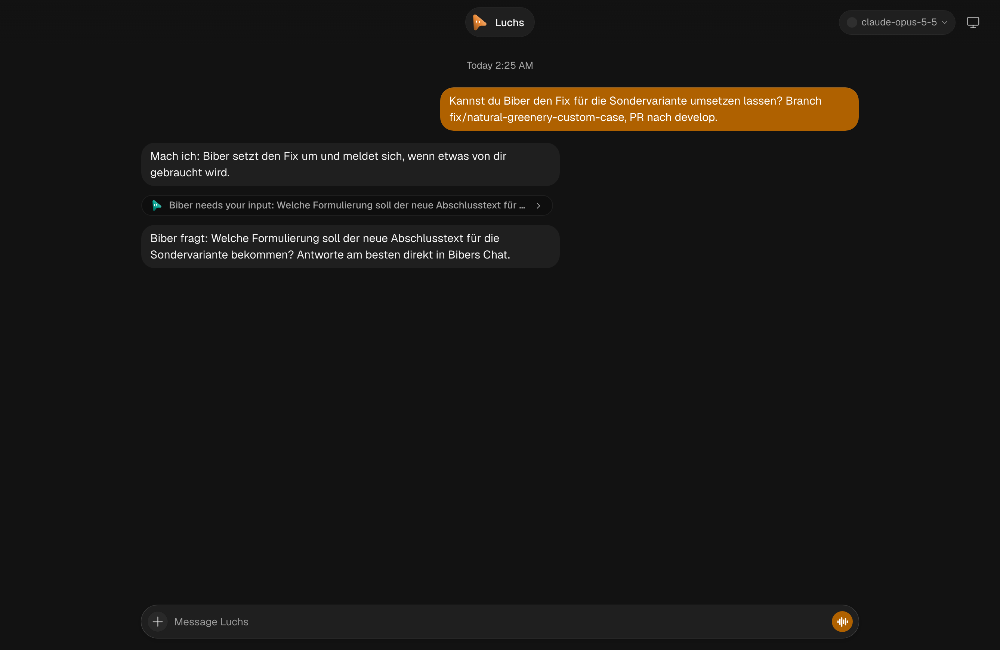 | 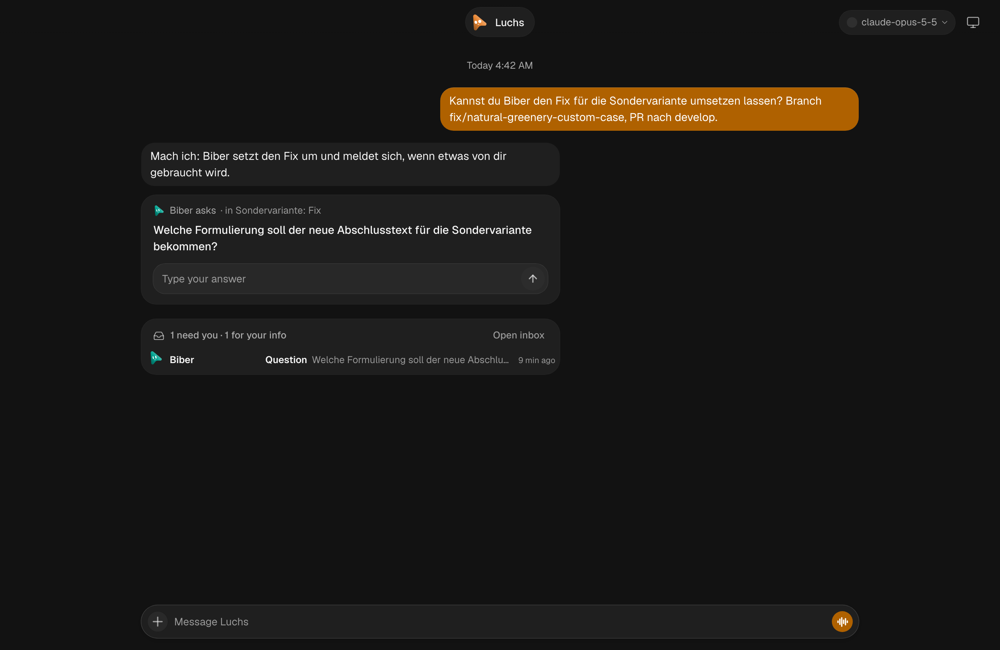 |
| Answered | 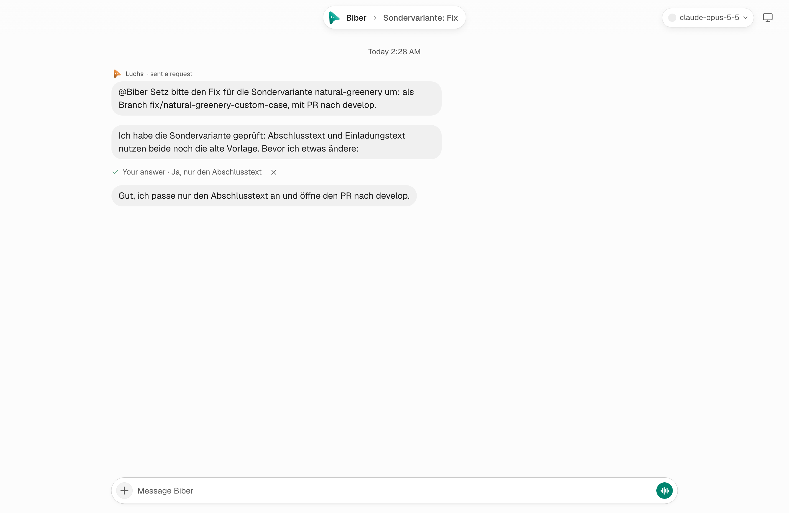 | 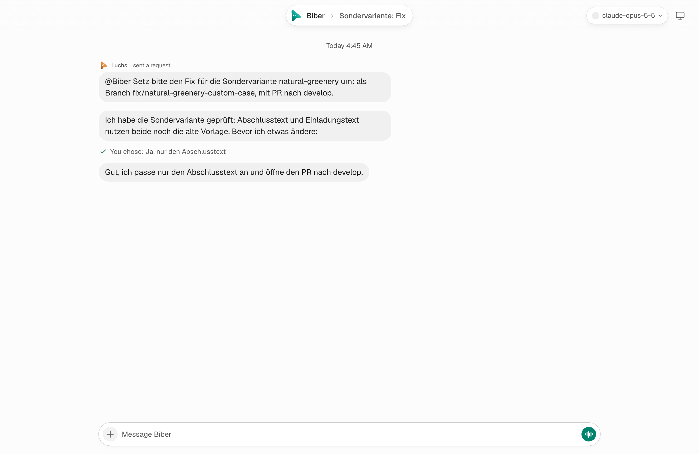 |
| Phone | 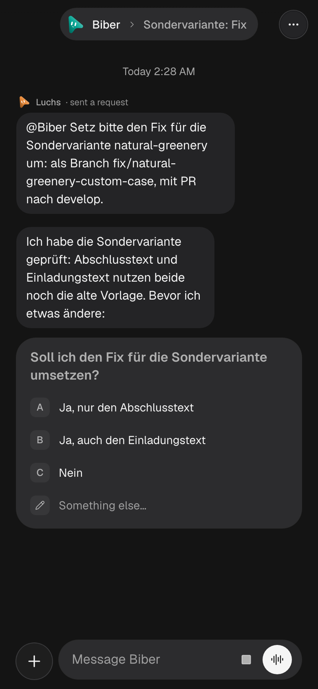 | 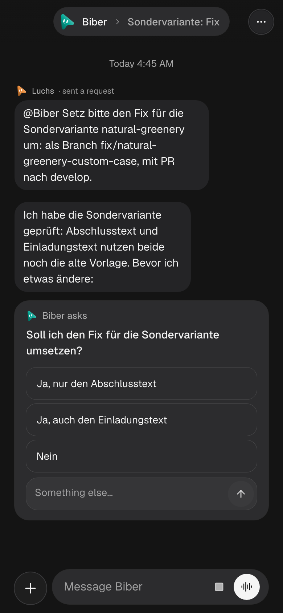 |
