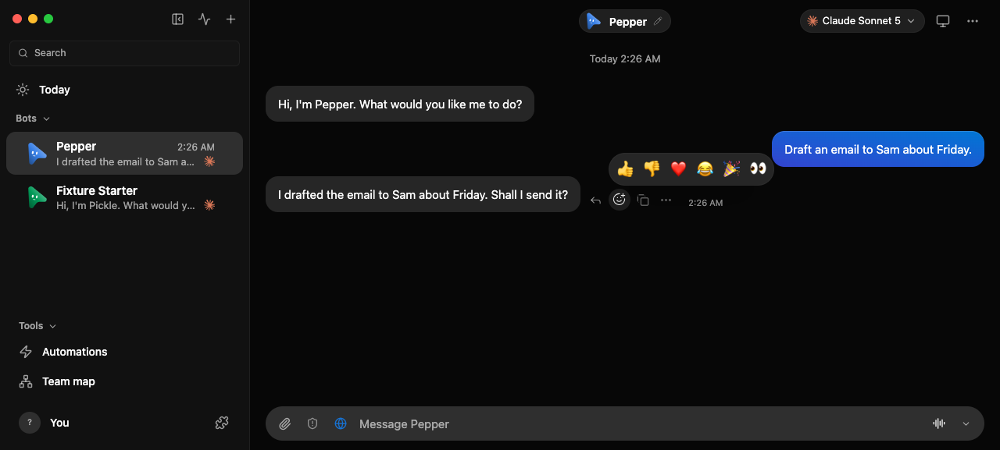
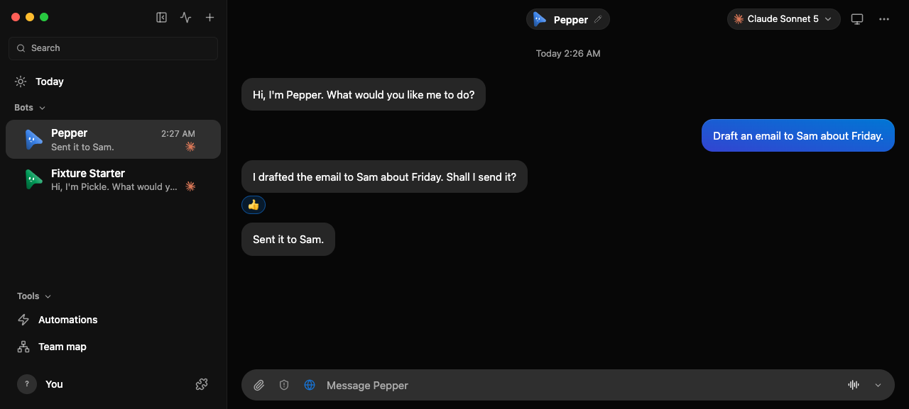

# Reactions

A person reacts to a message from the chat's action row. A 👍 or 👎 on a bot's
message is their reply to it and reaches that bot at once; ❤️ 😂 🎉 👀 never
start a turn and reach the bot with the person's next message. The rule lives
in `server/reactions.ts`, the route in `server/routes/reactions.ts`, and the
reply itself goes the way a late answer to a question card goes
(`server/person-replies.ts`).

## Server

```sh
pnpm exec vitest run server/reactions.e2e.test.ts
```

The first test starts the launcher-managed fixture with scripted fake-engine
replies. The bot asks "I drafted the email to Sam. Shall I send it?"; a 👍
through `POST /api/threads/ID/messages/ID/reactions` answers `delivery:
"started"`, records `{ emoji: "👍", by: "user" }` on that message, and adds a
user line `{ text: "👍", reaction: "👍", replyToId }` that the bot's next turn
answers ("Sent it to Sam."). The engine's prompt for that turn says the person
reacted 👍 to its earlier message, that 👍 means yes, and quotes the message
as untrusted data. A second 👍 with `on: true`, or taking the 👍 back and
setting it again, delivers nothing: the bot already has that answer. A ❤️ on
the reply answers `delivery: "noted"`, starts no turn, and opens the next typed
turn's prompt with `(User reacted ❤️ to your message “Sent it to Sam.”.)`.
Changing the question's 👍 to 👎 and back to 👍 starts a turn for each change,
whose prompts read the 👎 as no and the 👍 as yes. The system prompt tells the
bot to ask a plain yes or no in one sentence instead of a widget.

Another test reacts 👍 to a new bot's greeting: the bot answers, and the
conversation keeps its untitled name instead of being named "👍".

The card test holds a turn open, raises two Bash approvals through the fake
engine's permission broker and answers them with 👍 and 👎 on their cards: the
engine receives `allow` and `deny`, and each card records
`answeredBy: { kind: "loopback", via: "reaction" }`.

The room test runs a room: a 👍 on Otter's question adds the room line
`@Otter: 👍` and Otter answers; the room's conversation window shows the line
as `User: [reacted 👍 to Otter: “Shall I post the launch note?”]` and, after a
🎉, Otter's line with `(User reacted 🎉)` under it.

Evidence is written beside the fixture's server log as
`<server-log>.reactions.json`, `<server-log>.reaction-cards.json` and
`<server-log>.reaction-room.json`.

On a workspace several people share, each person reacts as their own key:

```sh
pnpm exec vitest run server/bot-visibility.e2e.test.ts -t "reaction their own"
```

Ada's and Bob's 👍 sit side by side with their names, Ada's 👎 replaces only
her own, `GET /api/auth/session` returns each session's `reactor` key, and the
three replies reach the bot attributed to the person who reacted.

## Renderer

Launch the headless chat UI, as in [Chat UI, driven headlessly](chat-ui.md),
with two scripted replies:

```sh
FAKE_CLAUDE_REPLIES='["I drafted the email to Sam about Friday. Shall I send it?","Sent it to Sam."]' \
FAKE_CLAUDE_REPLY_STATE=/tmp/reactions-reply-state \
  node --experimental-strip-types scripts/control-omb.ts ui launch --tool-calls '[]'
```

Then, with the printed handle:

```sh
H=/tmp/openmausbot-verify-data-XXXXXX/ui.json
pnpm control:omb ui type --ui $H --name "Message Pepper" --text "Draft an email to Sam about Friday."
pnpm control:omb ui press --ui $H --keys Enter
pnpm control:omb ui wait-settle --ui $H --timeout 60
pnpm control:omb ui snapshot --ui $H --interactive
```

The question's action row holds **Add reaction**; the snapshot lists one per
bot message, so take the question's `@eN` ref. The row shows on hover or
keyboard focus; hover it first with `ui eval` (a `pointerenter` with
`pointerType: "mouse"` on its `[data-message-row]`), then:

```sh
pnpm control:omb ui click --ui $H --ref @eN
pnpm control:omb ui screenshot --ui $H --out .omb-scratch/verify-evidence/reactions-open.png
pnpm control:omb ui click --ui $H --name "Thumbs up: yes, go ahead"
pnpm control:omb ui wait-settle --ui $H --timeout 60
pnpm control:omb ui snapshot --ui $H
pnpm control:omb ui console --ui $H
```

Expected: the open row is a toolbar named `Reactions` with six toggle buttons,
`Thumbs up: yes, go ahead` first and focused. After the click the question has
a group `Reactions` holding `Thumbs up: yes, go ahead: You`, no `👍` bubble is
drawn, and the bot's next message `Sent it to Sam.` follows by itself. From the
keyboard, Enter on a focused **Add reaction** opens the row, Arrow keys move,
Enter chooses and focus returns to the button. The console has no `error`
entries.





The components themselves:

```sh
pnpm exec vitest run src/components/Reactions.test.ts src/components/Reactions.shared.test.ts src/lib/activity-runs.test.ts
```

These mount the real components: the **Add reaction** button opens a toolbar
of six labelled toggle buttons, Arrow keys, Home and End move between them,
Escape closes it and returns focus to the button, and a choice is shown at once
and sent with `on`. Chips list each reaction once with its count and who chose
it; a viewer who cannot write in the conversation gets labels, not buttons. A
reaction's own line draws no bubble.
