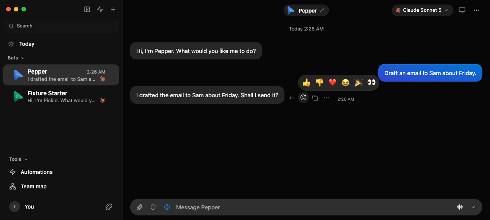
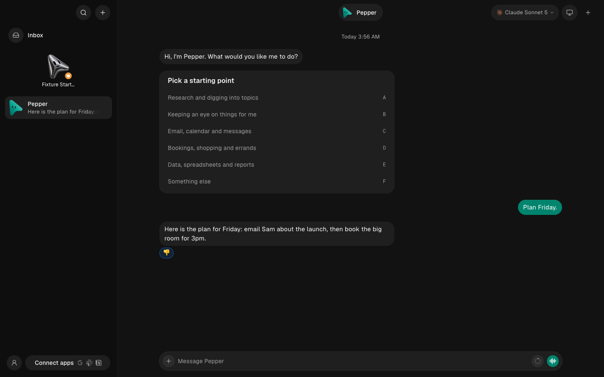

# Reactions

A person reacts to a message from the chat's action row. Every reaction on a
bot's message is quiet feedback: no line is posted and no turn starts. The bot
reads it once, in its next turn: in a 1:1 conversation ahead of the person's
next message, in a room in its next turn in any of the room's conversations.
A 👍 or 👎 still answers an open card (approve or deny, yes or no) and a line in
a person's inbox. The rule lives in `server/reactions.ts` and the route in
`server/routes/reactions.ts`.

## Server

```sh
pnpm exec vitest run server/reactions.e2e.test.ts server/reactions.test.ts
```

The first test starts the launcher-managed fixture with scripted fake-engine
replies. A 👍, taken back, then a 👎 on the bot's plan through
`POST /api/threads/ID/messages/ID/reactions` answer `delivery: "noted"` (the
take-back `"none"`), record `{ emoji: "👎", by: "user" }` on that message, add
no line and start no turn: the engine has still had one prompt. The person's
next message opens with `(User reacted 👎 to your message “Here is the plan for
Friday: …”.)` exactly once, and the turn after that does not repeat it. The
system prompt says a 👍/👎 reaches the bot as a note with the person's next
message.

Another test reacts 👍 to a new bot's greeting: nothing starts, and the
conversation keeps its untitled name.

The card test holds a turn open, raises two Bash approvals through the fake
engine's permission broker and answers them with 👍 and 👎 on their cards: the
engine receives `allow` and `deny`, and each card records
`answeredBy: { kind: "loopback", via: "reaction" }`.

The room test runs a room: a 👍 on Otter's question adds no line and starts no
turn; Otter's next turn opens with `(User reacted 👍 to your message “Shall I
post the launch note?”.)` once, and the room system prompt says such a note is
quiet feedback that starts no new work. Otter's own lines in the transcript
carry no reaction marks (other members still see `(User reacted 🎉)` under
them). A ❤️ on Otter's line in the room's main conversation reaches Otter's next
turn in another of the room's threads, once. These cross-thread notes are kept
in memory: a restart drops the ones not yet told.

Evidence is written beside the fixture's server log as
`<server-log>.reactions.json`, `<server-log>.reaction-cards.json` and
`<server-log>.reaction-room.json`.

On a workspace several people share, each person reacts as their own key:

```sh
pnpm exec vitest run server/bot-visibility.e2e.test.ts -t "reaction their own"
```

Ada's and Bob's 👍 sit side by side with their names, Ada's 👎 replaces only
her own, `GET /api/auth/session` returns each session's `reactor` key, nothing
is posted and the bot stays idle. The change streams to Bob, who sees the
conversation; a reaction in a conversation Bob cannot see streams to Ada and
never to him.

## Renderer

Launch the headless chat UI, as in [Chat UI, driven headlessly](chat-ui.md),
with two scripted replies:

```sh
FAKE_CLAUDE_REPLIES='["I drafted the email to Sam about Friday. Shall I send it?","Sent it to Sam."]' \
FAKE_CLAUDE_REPLY_STATE=/tmp/reactions-reply-state \
  node --experimental-strip-types scripts/control-omb.ts ui launch --tool-calls '[]'
```

Then, with the printed handle:

```sh
H=/tmp/openmausbot-verify-data-XXXXXX/ui.json
pnpm control:omb ui type --ui $H --name "Message Pepper" --text "Draft an email to Sam about Friday."
pnpm control:omb ui press --ui $H --keys Enter
pnpm control:omb ui wait-settle --ui $H --timeout 60
pnpm control:omb ui snapshot --ui $H --interactive
```

The question's action row holds **Add reaction**; the snapshot lists one per
bot message, so take the question's `@eN` ref. The row shows on hover or
keyboard focus; hover it first with `ui eval` (a `pointerenter` with
`pointerType: "mouse"` on its `[data-message-row]`), then:

```sh
pnpm control:omb ui click --ui $H --ref @eN
pnpm control:omb ui screenshot --ui $H --out .omb-scratch/verify-evidence/reactions-open.png
pnpm control:omb ui click --ui $H --name "Thumbs down"
pnpm control:omb ui wait-settle --ui $H --timeout 60
pnpm control:omb ui snapshot --ui $H
pnpm control:omb ui console --ui $H
```

Expected: the open row is a toolbar named `Reactions` with six toggle buttons,
`Thumbs up` first and focused. After the click the question has a group
`Reactions` holding `Thumbs down: You`, no bubble is drawn and the bot stays
idle until the person writes again. From the
keyboard, Enter on a focused **Add reaction** opens the row, Arrow keys move,
Enter chooses and focus returns to the button. The console has no `error`
entries.





The components themselves:

```sh
pnpm exec vitest run src/components/Reactions.test.ts src/components/Reactions.shared.test.ts src/lib/activity-runs.test.ts
```

These mount the real components: the **Add reaction** button opens a toolbar
of six labelled toggle buttons, Arrow keys, Home and End move between them,
Escape closes it and returns focus to the button, and a choice is shown at once
and sent with `on`. Chips list each reaction once with its count and who chose
it; a viewer who cannot write in the conversation gets labels, not buttons. A
reaction's own line draws no bubble.
