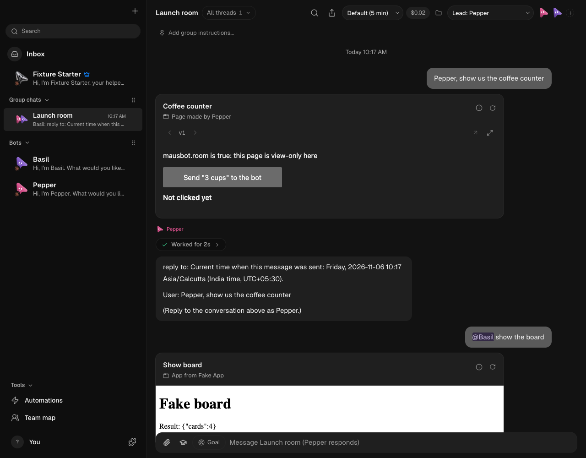
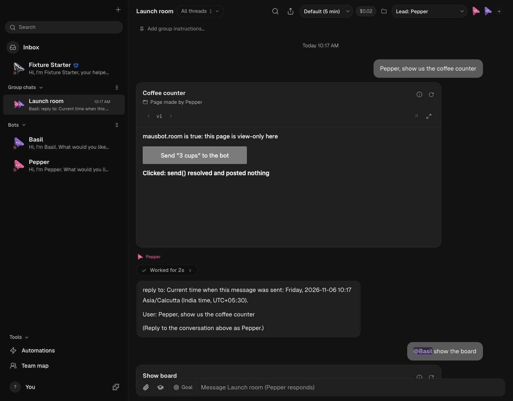
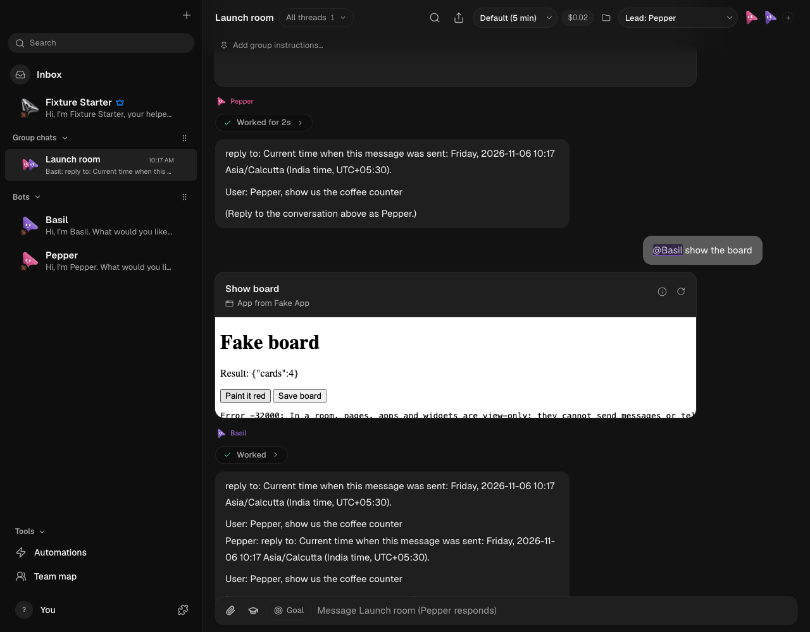

# Pages and apps in a room

A bot in a room can show a page (`show_html`), a widget (`show_widget`), an MCP server's app or a published page's
card there, and everyone who can see the room sees it, view-only. Inside a room's frame, `mausbot.room` is `true`,
and `mausbot.send` and `mausbot.setContext` resolve without doing anything; the host refuses `ui/message`,
`ui/update-model-context` and an MCP app's calls to its server; and the server refuses an app's message, its context,
its server calls and a widget press for a room's thread.

## Renderer and server, end to end

```sh
pnpm exec vitest run scripts/testing/room-pages-ui.e2e.test.ts
```

It runs when an agent-browser binary resolves, as in [Chat UI, driven headlessly](chat-ui.md), and is skipped
otherwise; `OMB_UI_E2E=1` forces the verified download. The launcher's fixture runs the fake engine in `slow` mode,
with the fake MCP app server (`server/testing/fake-stdio-app-server.ts`) added as the `board` server. Pepper and Basil
share a room whose lead is Pepper.

- A message typed in the room opens Pepper's room turn, and with that turn's token the page goes to
  `/api/internal/options-card` as `show_html`: the row is Pepper's (`from`).
- `@Basil show the board` opens Basil's room turn with the `board` server behind its gate; a `show_board` call through
  that gate reports the app, and its row is Basil's.
- `GET /api/threads/<room>/messages/<id>/app` answers both with `room: true` and `can` with `message`,
  `modelContext`, `serverTools` and `serverResources` off.
- Both rows are live in the room, the page with Full screen but without Point or Share.
- A real mouse click on the page's send button makes the page report that `send()` resolved (it grows to 300px; a
  refusal would leave it at 240px), and a click on the board's "Paint it red" is answered by the host with the room's
  refusal. The renderer makes no request but GETs meanwhile, the room gains no message and no app row gains context,
  and a direct `POST /api/bots/<id>/messages` with the page's `appMessage` is refused with 409.

Evidence (with `OMB_UI_EVIDENCE_DIR`): `room-pages-shown.png`, `room-pages-clicked-send.png`,
`room-pages-clicked-app.png` and `room-pages.json` (the rows, the page document's head, the requests and the console).

What it looks like when the recipe passes: both rows in the room, the page without Point or Share
(`evidence/room-pages/shown.png`); the page after a real click on its send button, which resolved and posted nothing
(`evidence/room-pages/clicked-send.png`); and the board after a click on "Paint it red", answered by the host with the
room's refusal (`evidence/room-pages/clicked-app.png`).







## Who may load a room's page

```sh
pnpm exec vitest run server/routes/chat-apps.test.ts server/page-files.test.ts server/routes/bot-messages-apps.test.ts
```

The document route answers 404 to a person who cannot see the room. A folder page's files load with that person's own
token, which answers only while they can still see the room and the page is still in it.
