# Who can see, chat with and change each team bot

A Team Cloud bot is shared like a document: what everyone in the team gets (No access, Can view, Can chat or Can edit)
and a level for each person added. Admins and the bot's owner always edit. The contract is in
[team-cloud.md](../team-cloud.md#who-can-use-a-bot).

## Driving it

```sh
pnpm exec vitest run server/cloud-team-bot-access.e2e.test.ts server/bot-access.test.ts \
  server/bot-visibility.test.ts src/components/bot-access/ShareBotDialog.dom.test.ts src/state/team-chats.test.ts
```

- `server/cloud-team-bot-access.e2e.test.ts` starts a real Team Cloud (`OMB_CLOUD_ROLE=team`) with the Owner (Olive),
  an Admin (Ada) and four Users paired with the Admin's signed claims, and the synthetic Claude CLI. Payroll is shared
  with Bob to view, Cara to chat and Dan to edit; Eve is not added. As each of them it tries every route a member
  reaches: the bot list (each copy's `yourAccess`, the sharing only on an editor's), its chat, export, a room with it,
  sending, a new conversation, stopping, compacting, editing a line, answering a card, Undo, a reaction, Always allow,
  Set me up, the browser, the bot's look and profile, its instructions, apps and admin-only fields, its sharing, a new
  routine for it or its room, someone else's routine and one's own, a new room with it, writing in, renaming and
  stopping its room. Bob gets 403 on every write and nothing behind it changes; Cara chats and keeps her own routine;
  Dan changes instructions, apps and sharing but not the approval level, folder, computer, department, Chief, peers or
  visibility; Eve gets 404. A message another app relays (the guarded route's `onBehalfOf`) goes through only for
  someone who can chat. Bob's live stream gets his new level with no sharing in it, then ends when he is removed; the
  owner always edits, keeps editing after handing the bot on, and each person's own MausBot stays theirs. Bots made
  before levels keep exactly what their visibility gave.
- `server/bot-access.test.ts` covers the level rules: the mapping from visibility and back, a member's level (owner,
  damaged sharing, `@domain` entries), each copy of a bot, what each route needs, each level's bot fields, a card that
  changes the bot, a relayed message, and who may be added.
- `src/components/bot-access/ShareBotDialog.dom.test.ts` drives the dialog: the owner first, each level, a change sent
  at once with Undo putting it back, adding a teammate, removing one, opening the bot to everyone, the read-only view
  of someone who can't edit, and no button off a team.

## The pictures

```sh
node --experimental-strip-types scripts/verify-team-bot-access.ts --shots <dir>
```

It starts the same kind of Team Cloud, sets Payroll up through the routes, and photographs the whole app
(`scripts/testing/team-access-preview.tsx`) in a headless Chrome with a throwaway profile, at 1280×800 at 2x, each page's
every request sent as that person through the preview's proxy. It fails if the app is refused anything naming a bot, a
room or a conversation while it is shown. `--before` takes the same setup through the older visibility route, for a
checkout of the code before levels.

| | Before | After |
|---|---|---|
| An admin's Share button (Simple) | 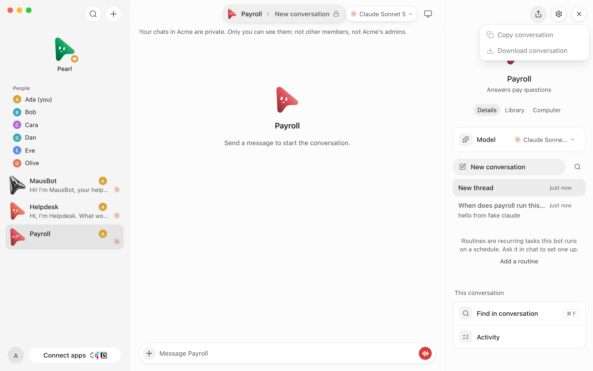 | 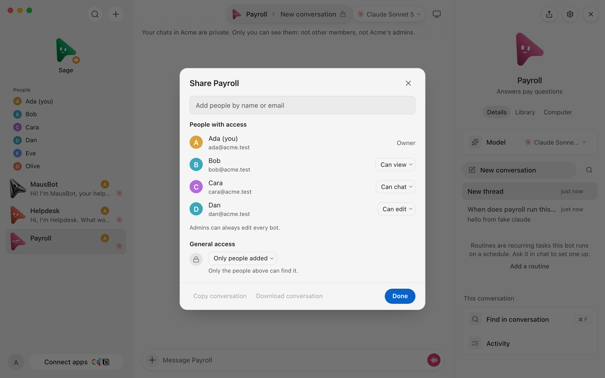 |
| Advanced settings | 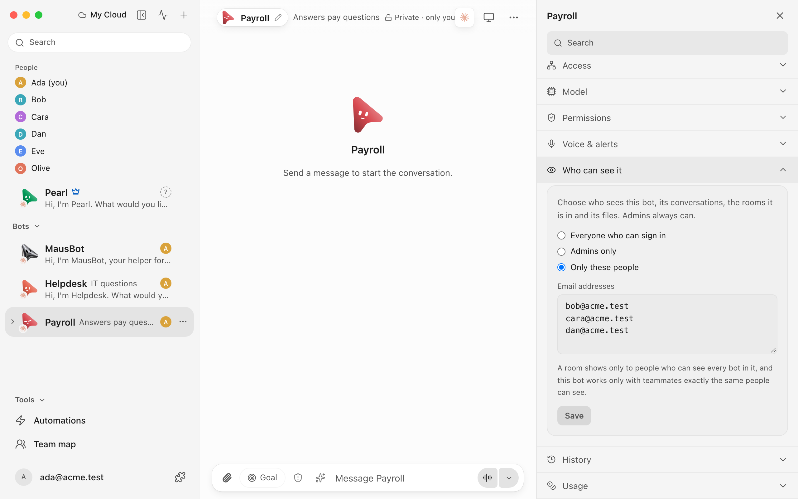 | 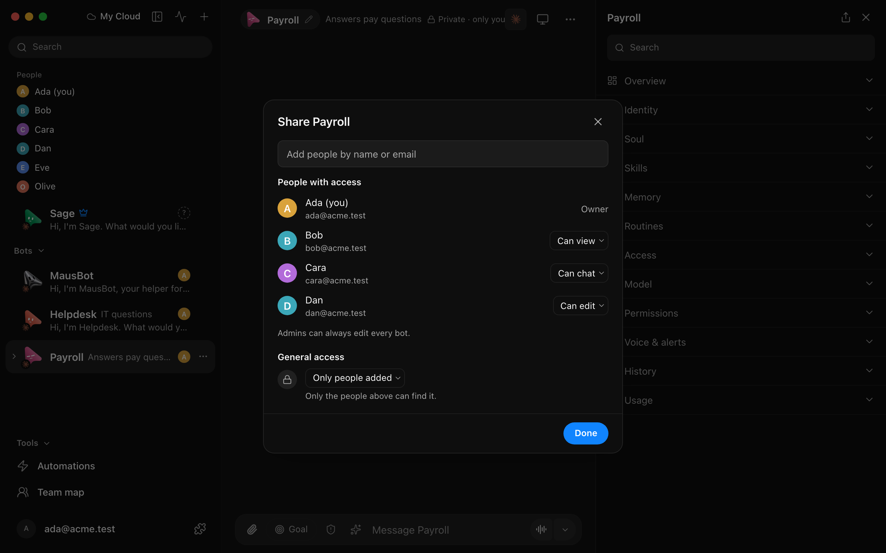 |
| A member who may only view | 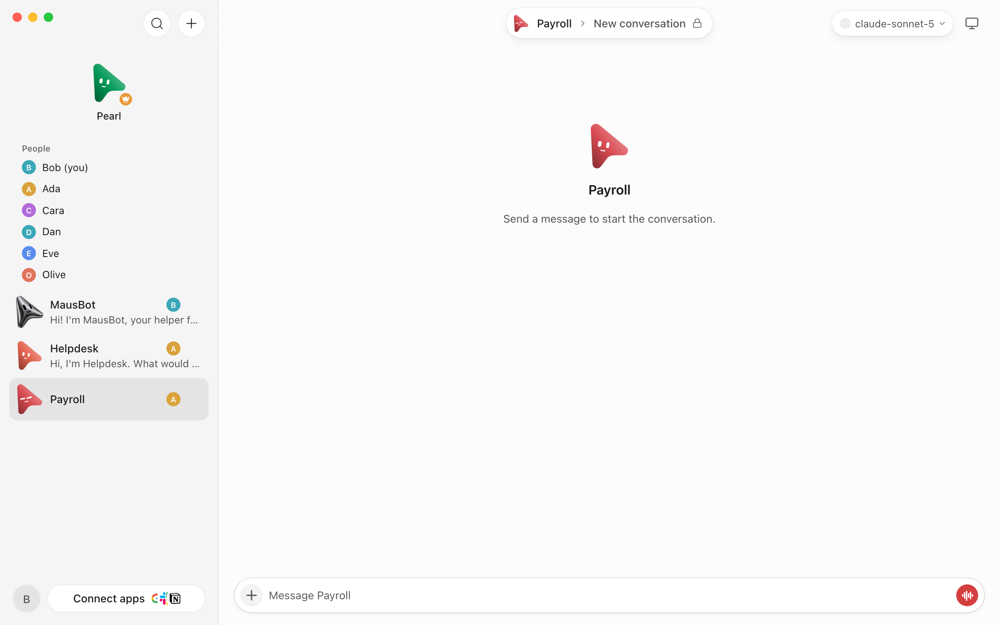 | 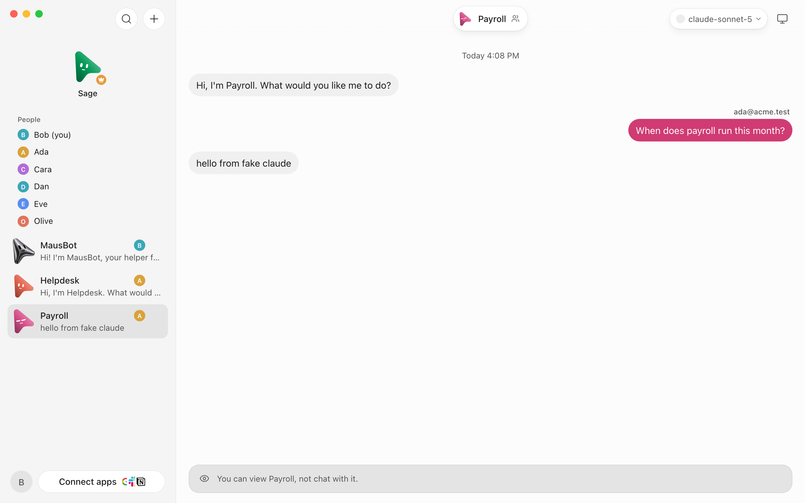 |

| After | |
|---|---|
| Adding a teammate | 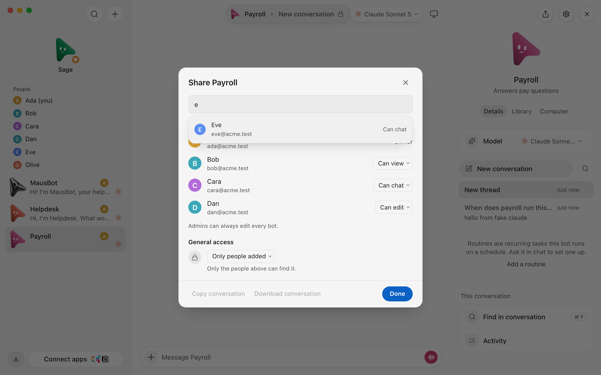 |
| A change, with Undo | 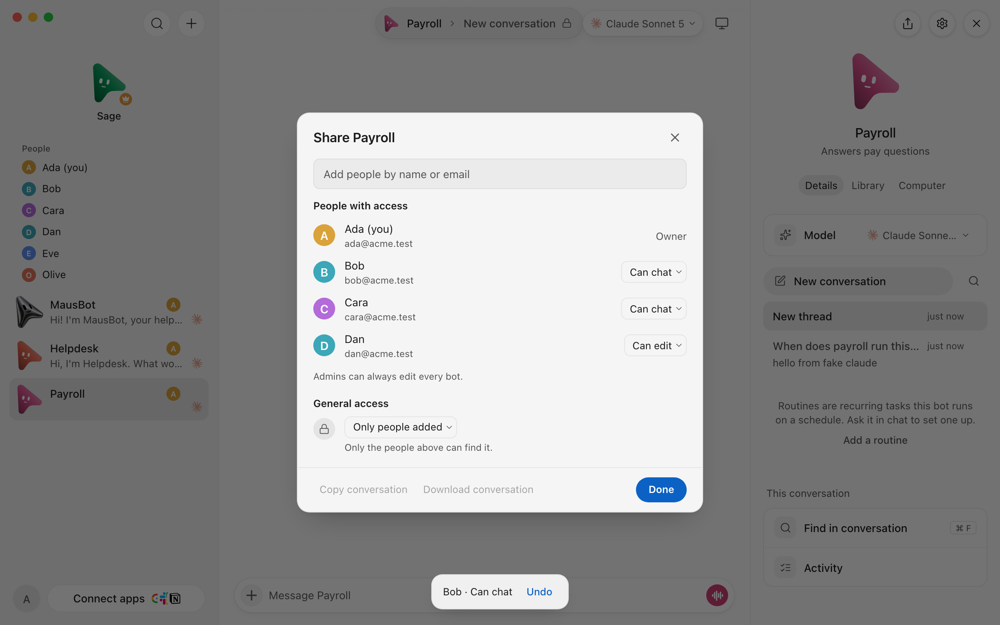 |
| Can view: the Share dialog | 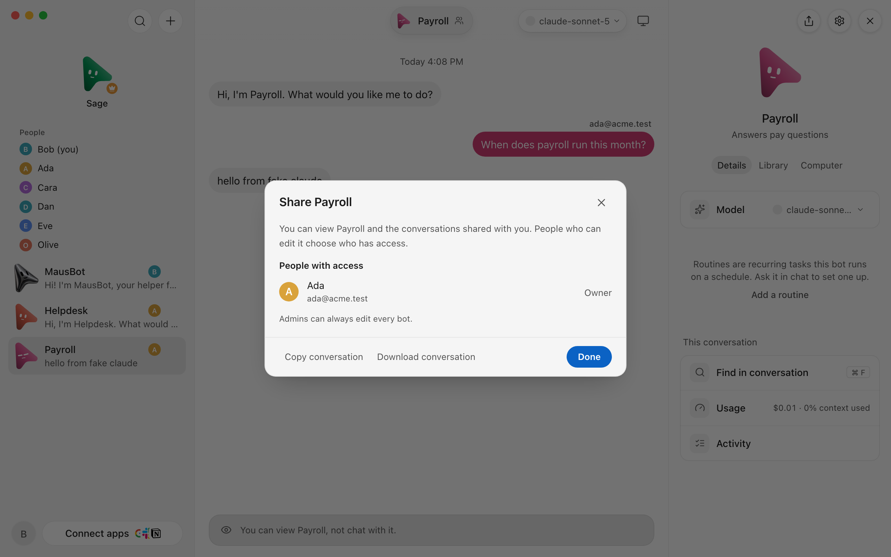 |
| Can chat | 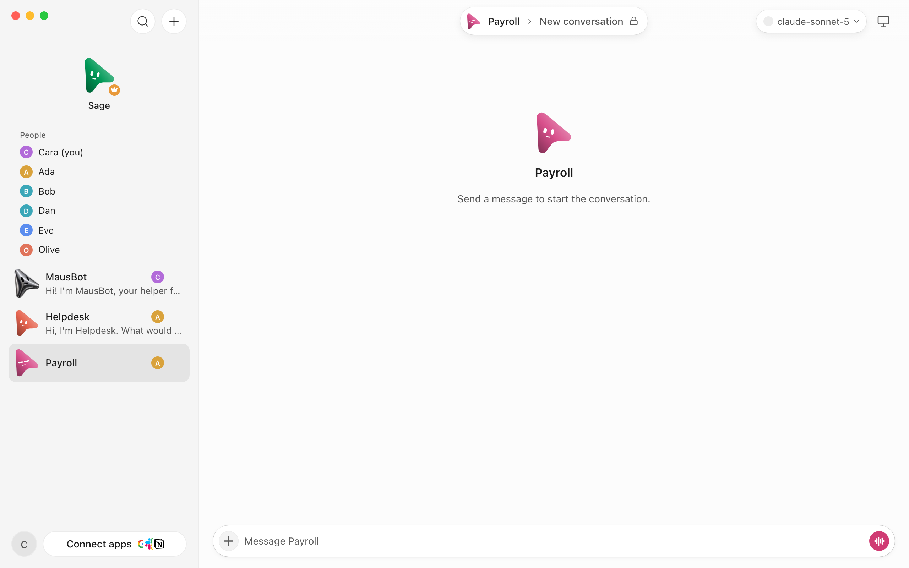 |
| Can edit: the Share dialog | 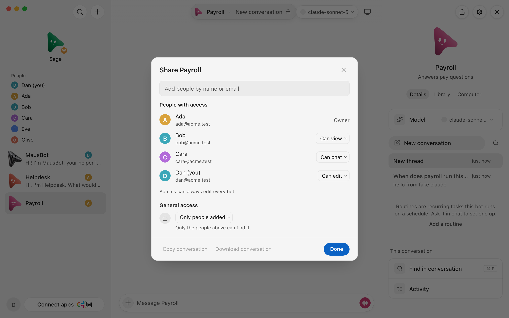 |
| No access: not in the list | 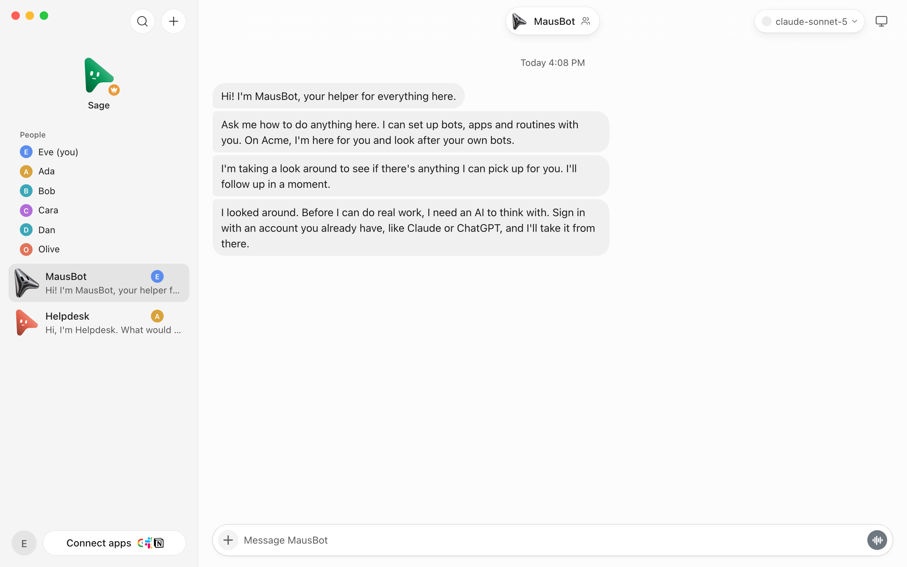 |

## Not proven here

- No real Admin, phone, Slack worker or model was involved: the Admin's pairing is signed by the fixture, a relayed
  message is the guarded route called on loopback, and the engine is the synthetic CLI.
- A routine a member wrote keeps its schedule when their level drops; its runs are the bot's (team-cloud.md "What a bot
  keeps per bot").
- A reply to a line in a person's inbox goes back to the bot that asked even if they can only view it: the bot asked
  them.
