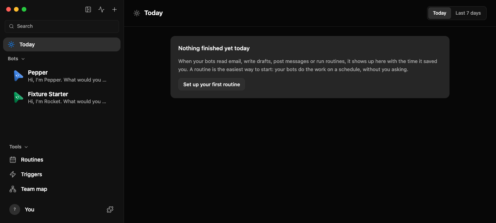
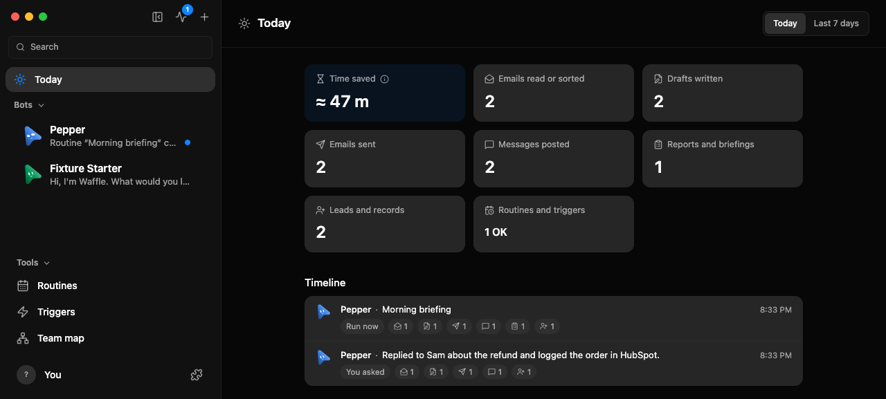
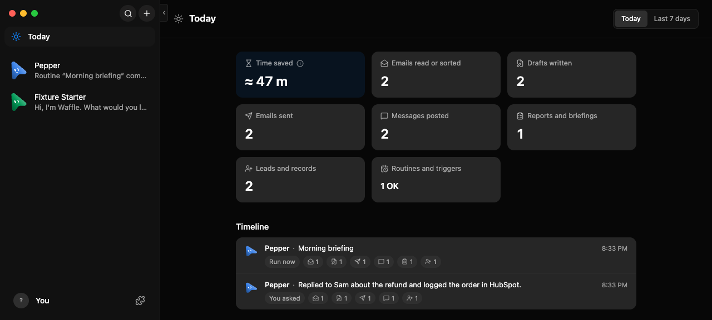

# The Today page

Today is the page under **Today** at the top of the sidebar. It reads
`GET /api/today?since=<epoch ms>` (the viewer's local midnight, or six days
before it for **Last 7 days**) and shows what the bots finished: outcome tiles,
routines OK and failed, an estimate of the time saved, what only the person can
fix, and one line per finished piece of work. Desktop and My Cloud run the same
route and the same page.

## Drive and evidence

```sh
pnpm exec vitest run shared/today-outcomes.test.ts server/today.test.ts server/routes/today.test.ts src/components/TodayPage.test.ts src/components/SidebarFooterNav.today.test.ts
OMB_UI_E2E=1 OMB_TODAY_SCREENSHOT=.omb-scratch/verify-evidence/today.png pnpm exec vitest run scripts/testing/today-ui.e2e.test.ts
pnpm bench:today
```

The UI test launches the [headless chat UI](chat-ui.md) fixture with scripted
fake-engine tool calls (Gmail fetch, draft and send, a multi-execute call that
posts to Slack and creates a HubSpot contact, and a `Bash` call that must not
count). It opens Today on the new install and expects the empty state with
**Set up your first routine**, sends one message, runs a routine named
"Morning briefing", then expects the tiles in order (emails read, drafts,
emails sent, messages, reports, leads, routines), the time saved, both lines,
that a line opens its conversation, and that Simple mode keeps Today at the
top of its sidebar. The screenshots land where `OMB_TODAY_SCREENSHOT` points
(`-simple.png` beside it for Simple mode).

What the screenshots look like when the recipe passes:







`pnpm bench:today` seeds a throwaway `messages.db` (default 50,000 messages over
30 days) in a temporary home and prints the median read time for today and the
last seven days.

## Boundaries

- Outcomes come from the tool calls the server recorded, classified by name in
  `shared/today-outcomes.ts`. A call counts once however many items it touched:
  one inbox fetch is one email action. Failed and unfinished calls count nothing.
- A multi-execute call counts each app tool its recorded input names; an input
  that names none counts once as another app action.
- Reports are finished runs of routines whose name says report, briefing,
  summary, digest, recap and the like.
- Time saved is minutes per outcome from the same file. It is an estimate,
  shown with "≈" and its method in a tooltip.
- Needs you lists engine sign-in, trial credit, usage limits, broken app
  connections and place settings to an admin, and open questions to everyone.
  It never lists an approval. A failure leaves once the bot finishes a turn
  after it, the engine reports it is signed in again, or the app works again.
- Replies a bot sends through the app's own Slack integration are not tool
  calls and are not counted as messages posted.
