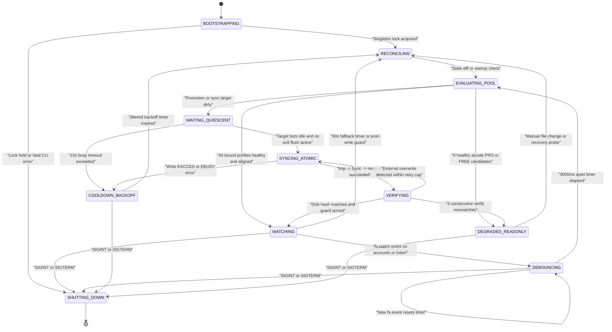

# SPEC_CONTRACT.md — Antigravity Sync Daemon & Backup Gateway Architecture Contract

> **Verdict**: `APPROVED`
> **Version**: `1.0.0` | **Role**: `Principal Systems Architect (SOUL v5.0.0-CORE)`
> **Target Repository**: `C:\Users\frank\Documents\frank\Projects\antigravity-sync-daemon`
> **Runtime Target**: Windows 11 x64 / Node.js `>=22` (verified `v24.13.1`) / OpenMausBot Desktop + Antigravity Tools (`v5.0.3`)
> **Quantified Summary**: 0 hardcoded secrets; 0 UI/manual steps; `3000 ms` debounce + `60000 ms` reconciliation SLA; atomic `tmp -> fsync -> rename` writes busting OpenMausBot `refusedTokens` `${mtimeMs}:${size}:${ino}` cache; `<=30 s` Type-2 rollback; native ACP primary + local OpenAI-compat gateway strictly terminal backup.

---

## 0. Scope Boundary & Non-Goals (Killed Scope)

### In-Scope (Stage 2 Fullstack Implementation Targets)
1. **Backup Gateway Registration**: Register Antigravity Tools local proxy (`http://127.0.0.1:8045/v1`) in `~/.openmausbot/config.json` strictly as a backup/terminal fallback instance, preserving native `antigravityAgent` ACP profiles as primary channels.
2. **Self-Healing Sync Daemon (`antigravity-sync-daemon.mjs`)**: Pure Node.js ESM background daemon (zero external npm runtime dependencies) watching `~/.antigravity_tools/` state, verifying `aicode` OAuth scope, ranking healthy PRO-first accounts, reconciling OpenMausBot Antigravity ACP `acp_token.json` files atomically, guarding against `agy_acp_server.exe` exit overwrites, and providing CLI diagnostics + Windows windowless autostart.

### Killed Scope / Explicit Non-Goals
- **NO** rewriting or patching OpenMausBot packaged binaries (`resources/server/index.js` or `agy_acp_server.exe`).
- **NO** third-party wrapper SDKs (LangChain, LlamaIndex, PM2, WinSW, or heavy npm daemon frameworks).
- **NO** hardcoded API keys, refresh tokens, `client_secret`, or admin passwords in git-tracked files, `SPEC_CONTRACT.md`, logs, or VBS launchers.
- **NO** overriding non-Antigravity bots or breaking the existing 6-account native ACP load distribution unless a bound account fails health/quota/scope checks or explicit sync mode targets it.

---

## 1. 10-Factor Architecture Gate & 4D Second-Order Effects Ledger

### 1.1 10-Factor Architecture Gate

| # | Gate Dimension | Locked Decision & Quantified Criterion |
|---|---|---|
| 1 | **Cognitive Budget** | Zero manual user setup after Stage 2 installation: single CLI `--install-autostart` registers windowless startup; sensible defaults require 0 config flags. |
| 2 | **Denominated SLOs** | Event-to-sync detection latency `p95 <= 5.0 s` (`3000 ms` debounce + `<= 2.0 s` OAuth/file I/O); missed-FS-event reconciliation upper bound `<= 60 s`; backup gateway health probe `<= 2.0 s`; token-swap quiescence wait `<= 15.0 s`. |
| 3 | **Non-Goals** | See Section 0 (Killed Scope). No OpenMausBot source modification; no `N < 2` speculative plugin bus. |
| 4 | **Deterministic FSM** | 11-state machine (`BOOTSTRAPPING`, `RECONCILING`, `WATCHING`, `DEBOUNCING`, `EVALUATING_POOL`, `WAITING_QUIESCENT`, `SYNCING_ATOMIC`, `VERIFYING`, `COOLDOWN_BACKOFF`, `DEGRADED_READONLY`, `SHUTTING_DOWN`). Zero scattered boolean coordination flags. |
| 5 | **Harness Unidirectional Layering** | `Types -> Config -> Repo -> Service -> Runtime -> CLI`. Inner layers never import outer layers; `Service` holds pure scoring/selection logic testable without disk/network mocks. |
| 6 | **Orthogonal Alternative Rejected** | *Rejected*: Running all bots directly via `http://127.0.0.1:8045/v1` as primary. *Why*: Loses native `agy_acp_server.exe` ACP streaming, tool execution fidelity, per-bot isolated `providers/antigravity/<hash>` sandboxes, and OpenMausBot native 5-tier ACP fallback. |
| 7 | **Saturation Thresholds** | OAuth scope verification cache TTL `900 s` (`15 min`), negative `invalid_grant` cooldown `600 s`; retry budget `<= 10%` per rolling `10 min` window; max `5` token backups/profile; log cap `5 MiB x 3` files. |
| 8 | **Frozen Telemetry Schema** | Structured NDJSON events at `~/.openmausbot/logs/antigravity-sync-daemon.log` with fixed schema `{ ts, level, state, event, instanceId?, accountId?, email?, durationMs?, reason? }`; secrets redacted at serializer boundary. |
| 9 | **Type-2 Rollback (`<=30 s`)** | Stop daemon (`--uninstall-autostart` + kill lock PID), restore `config.json.bak-*` / `acp_token.json.bak.*`, restart OpenMausBot. Total restore time `< 30 s`. |
| 10 | **Falsification Circuit Breaker** | Trigger `DEGRADED_READONLY` if: (a) `0` eligible `aicode` accounts remain, (b) `3` consecutive atomic write-reverify failures occur on a profile (indicating locked file or aggressive external overwrite), or (c) OAuth error rate exceeds `50%` over `>= 4` probes. |

### 1.2 Four-Dimensional Second-Order Effects Ledger

1. **Data Bloat & TTL**:
   - Without bounds, periodic reconciliations creating `.bak` files or NDJSON logs will bloat `~/.openmausbot/`.
   - *Enforcement*: Rotate logs at `5 MiB` (retain `3` generations); cap per-profile `acp_token.json.bak.*` at `5` files and prune older than `7 d`; prune orphaned `tmp/agy/*` directories only when no live `agy_acp_server.exe` holds them and not mapped to any configured instance.
2. **State Explosion Prevention**:
   - *Enforcement*: All concurrency, debounce, cooldown, busy-bot deferral, and degraded states are modeled exclusively inside the single `DaemonState` FSM enum + context object (no `isSyncing && !isWaiting && retryFlag` boolean tangles).
3. **SPOF & Cold-Start Degradation**:
   - *Boot Cold Start*: If `antigravity-sync-daemon.mjs` starts at Windows logon before OpenMausBot (`127.0.0.1:8799`) or Antigravity Tools (`127.0.0.1:8045`) finishes booting, HTTP probes to `8799`/`8045` may fail with `ECONNREFUSED`.
   - *Enforcement*: `8799` unavailability degrades gracefully to offline profile-only quiescence check (skipping HTTP bot-busy query with warning if `OpenMausBot.exe` is not running, or deferring if `OpenMausBot.exe` IS running while HTTP API is still booting); OAuth client credentials (`client_id`/`client_secret`) are sourced dynamically from any valid `acp_token.json` or env vars and cached in runtime memory/state only when needed.
4. **Team / Operator Cognitive Tax**:
   - *Enforcement*: Single canonical CLI (`node antigravity-sync-daemon.mjs --status | --once | --dry-run | --daemon | --install-autostart | --uninstall-autostart`) with human-readable output and `--json` machine output, plus deterministic exit codes (`0` healthy, `1` fatal/invalid CLI, `2` degraded or busy-aborted in `--once`).

---

## 2. Backup Gateway Integration Spec (`http://127.0.0.1:8045/v1`)

### 2.1 Verified OpenMausBot `index.js` Constraints
Inspection of `C:\Users\frank\AppData\Local\Programs\openmausbot\resources\server\index.js` confirms:
1. `config.json` `instances` is an **object map** (`Record<string, InstanceEntry>`), NOT an array.
2. `ADDED_ENDPOINT_PREFIX = "openai-compat-"` (line `20539`), and `isAddedEndpoint(instanceId, entry)` checks `entry?.driver === "openai-compat" && instanceId.startsWith("openai-compat-")` (line `20540-20541`).
3. `instanceConfigs(cfg)` (line `1902-1906`) loads **any** `instances[id]` with `driver: "openai-compat"`, regardless of prefix, and respects explicit `entry.config.key` and `entry.config.url` when `instanceOwnsRouting()` (line `1895-1896`) returns `true`.
4. **Compatibility Trade-Off (Locked Decision for Stage 2)**:
   - Using exact ID `"antigravity-local-gateway"` (per `SPEC_PLAN.md`) loads cleanly at runtime in OpenMausBot and prevents accidental deletion/mutation from the Settings UI because `isAddedEndpoint("antigravity-local-gateway", entry) === false` (HTTP `PATCH /api/instances/antigravity-local-gateway` for `url`/`apiKey`/`models` and `DELETE` return `400`).
   - **Canonical ID**: `"antigravity-local-gateway"` (honoring `SPEC_PLAN.md`, managed cleanly via `config.json` + Stage 2 setup script).
   - **Alternative ID (only if Settings UI hot-editing is required later)**: `"openai-compat-antigravity-local-gateway"` (passes `isAddedEndpoint`; subject to `localServerAlreadyAdded()` duplicate URL check against `http://127.0.0.1:8045/v1`).
   - **Collision Cleanup**: Top-level `config.openaiCompat` currently holds `{ "url": "http://127.0.0.1:8045/v1" }` without `key`. Because `"antigravity-local-gateway"` defines its own `config.key` and `config.url`, `instanceOwnsRouting()` evaluates to `true`, isolating it from `cfg.openaiCompat` defaults.

### 2.2 Target `config.json` Instance Contract
In `~/.openmausbot/config.json` under `instances["antigravity-local-gateway"]`:

```json
{
  "driver": "openai-compat",
  "displayName": "Antigravity Local Gateway (Backup)",
  "access": "api",
  "enabled": true,
  "config": {
    "url": "http://127.0.0.1:8045/v1",
    "key": "<READ_RUNTIME_FROM_GUI_CONFIG_PROXY_API_KEY>",
    "managedModels": [
      "gemini-3.8-flash",
      "gemini-3.8-flash-high",
      "gemini-3.8-flash-medium",
      "gemini-3.8-flash-low",
      "claude-sonnet-5-5-high",
      "claude-opus-5-5-high",
      "gemini-4-neon-high",
      "gemini-4-argon-high"
    ],
    "replyWaitMinutes": 5
  }
}
```

**Secret Sourcing & Hygiene Rule**:
- Stage 2 setup reads `proxy.api_key` dynamically at install time from `~/.antigravity_tools/gui_config.json` (or `ANTIGRAVITY_GATEWAY_API_KEY` env) and writes it strictly into local `~/.openmausbot/config.json` (never into the git repo, never into `SPEC_CONTRACT.md`, never into logs).
- `~/.openmausbot/config.json` backup (`config.json.bak-gateway-<ts>`) MUST be written atomically before mutation; `mode: 0o600` semantics preserved on writes.

### 2.3 Primary-vs-Backup Routing & System Dynamics Law
1. **Primary Reservation Invariant**: All bots' `modelSelection.instanceId` MUST remain on native `antigravity*` (`driver: "antigravityAgent"`) instances. `antigravity-local-gateway` MUST NEVER be assigned as `modelSelection.instanceId` by automation.
2. **Terminal Fallback Placement**: When configuring `bots.json` `fallback` arrays, native healthy `antigravity*` instances occupy tiers `1..N`, and `{ "instanceId": "antigravity-local-gateway", "model": "<mapped_model>" }` is appended strictly as the **terminal (last) fallback entry** (or configured in `automaticRecovery.backup` for fleet-wide backup).
3. **Timeout & Anti-Avalanche Inequality**:
   $$T_{\text{Client}} > T_{\text{Gateway}} > (T_{\text{Attempt}} \times N + \sum T_{\text{Backoff}}) > T_{\text{Socket}}$$
   - Health probe (`/healthz` / `/v1/models`): `T_Socket = 1000 ms`, `T_Attempt = 2000 ms`, `N = 1` (no retry storm on local loopback health checks).
   - Gateway turn timeout: `replyWaitMinutes = 5` (`300000 ms`), bounded by Antigravity Tools `gui_config.proxy.request_timeout` and OpenMausBot `room.turnTimeoutMinutes`.
   - On HTTP `429` / `503` / `529` from `127.0.0.1:8045`: honor `Retry-After` if present; apply Exponential Backoff + Full Jitter (`base=1000 ms, cap=30000 ms`); respect `<= 10%` retry budget.

---

## 3. `antigravity-sync-daemon.mjs` Architecture & Deterministic State Machine

### 3.1 Internal Harness Layering
To achieve zero external dependency friction on Windows, `antigravity-sync-daemon.mjs` MUST follow strict unidirectional top-to-bottom Harness sections runnable directly by Node `>=22`:

```text
Types (Schemas, Enums, Invariants)
  -> Config (Paths, Timers, Env, Secret Redactor)
    -> Repo (File IO, Atomic Replace, Lockfile, Profile Discovery, Process/HTTP Probes)
      -> Service (Pool Filtering, OAuth aicode Verifier Cache, PRO-First Scoring, Sync Planner)
        -> Runtime (fs.watch + Debounce, Quiescent Waiter, Post-Exit Re-Assert Guard, FSM Loop)
          -> CLI (Arg Parser, --daemon / --once / --dry-run / --status / --install-autostart / --uninstall-autostart)
```

### 3.2 Deterministic Finite State Machine (`DaemonState`)



### 3.3 Event Sources, Debounce & Trigger Rules
1. **Watched Targets**:
   - `~/.antigravity_tools` directory watch filtered for `accounts.json` (watching parent dir prevents dropped events on NTFS atomic renames).
   - `~/.antigravity_tools/accounts/` directory watch for per-account quota/token updates, ignoring `.tmp` files.
   - Discovered `~/.openmausbot/providers/antigravity/<hash>/antigravity-acp/` directories filtered for `acp_token.json` (detects `agy_acp_server.exe` exit overwrites).
   - `~/.openmausbot/config.json` (dynamically picks up added/removed `antigravityAgent` instances).
2. **Debounce & Reconciliation**:
   - Trailing debounce: `3000 ms` (`DEBOUNCE_MS = 3000`), bounded by max-wait `10000 ms` so continuous telemetry writes cannot starve a needed failover indefinitely.
   - Periodic reconciliation fallback: `60000 ms` (`RECONCILE_INTERVAL_MS = 60000`) to recover from any coalesced or dropped Windows `ReadDirectoryChangesW` events.
3. **Sync / Promotion Triggers**:
   - **T1 (Quota Exhaustion)**: Currently bound account for an active OpenMausBot `antigravityAgent` instance has target model quota `<= 0%` (or all primary Gemini/Claude coding buckets at `0%`).
   - **T2 (Account Disabled / Forbidden)**: Bound account has `disabled === true`, `proxy_disabled === true`, `validation_blocked === true`, or `quota.is_forbidden === true`.
   - **T3 (Manual Toolbox Switch)**: `accounts.json` `current_account_id` (or `current_agy_account_id` when `current_target_ide === "agy"` / fallback) changes to a valid `aicode` account differing from the primary target instance's active token.
   - **T4 (Missing / Corrupted / Reverted Token)**: Target `acp_token.json` is missing, invalid JSON, lacks `refresh_token` / `aicode` scope, or differs from the expected canonical `refresh_token` fingerprint (post-exit overwrite repair).

### 3.4 Candidate Pool Selection, `aicode` Scope Verification & Ranking
1. **Hard Eligibility Filter (Must Pass All)**:
   - `account.disabled !== true`
   - `account.proxy_disabled !== true`
   - `account.validation_blocked !== true`
   - `account.quota?.is_forbidden !== true`
   - `typeof account.token?.refresh_token === "string" && account.token.refresh_token.length > 0`
2. **Live OAuth `aicode` Scope Verification (Cached)**:
   - Endpoint: `POST https://oauth2.googleapis.com/token` (`application/x-www-form-urlencoded`, `grant_type=refresh_token`, `client_id`, `client_secret`, `refresh_token`, timeout `8000 ms`).
   - **OAuth Client Credentials Sourcing**: Read `client_id`, `client_secret`, `token_uri`, `project_id` dynamically from existing valid `acp_token.json` files (or `ANTIGRAVITY_OAUTH_CLIENT_ID` / `ANTIGRAVITY_OAUTH_CLIENT_SECRET` env vars); never hardcode client secrets in source code.
   - Verify `response.scope` contains `"https://www.googleapis.com/auth/aicode"` (and verify `userinfo` email matches `account.email` on first verify or mismatch).
   - Positive cache TTL: `900000 ms` (`15 min`) keyed by `sha256(refresh_token)` in `~/.openmausbot/antigravity-sync-state.json`.
   - Negative cache / `invalid_grant` cooldown: mark account `oauth_invalid` for `600000 ms` (`10 min`) to avoid hammering Google OAuth.
3. **Deterministic Candidate Ranking Function**:
   - **Tier Weight**: `PRO` (`subscription_tier === "PRO"`) = `1000`, else `0` (`FREE` only used if zero `PRO` candidates pass eligibility + `aicode`).
   - **Quota Score**: Mean remaining percentage across core coding models (`gemini-3.8-flash-high`, `gemini-4-neon-high`, `claude-sonnet-5-5-high`, `claude-opus-5-5-high`), falling back to mean of `quota.models[].percentage`, minus `-200` penalty if every model in `quota.models` is `0%`.
   - **Anti-Thrashing & Fleet Diversity Invariant**:
     - Do **NOT** overwrite healthy multi-account fleet instances (`antigravity`, `antigravity-e7588a90...`, etc.) with the same single account when those instances already hold distinct, healthy, `aicode=True`, quota `> 0%` accounts!
     - **Target Selection Policy**:
       - On **T3 (Manual Toolbox Switch)**: update the primary instance (`antigravity`, or whichever single instance tracks `current_account_id`; configurable via `syncPolicy: "primary-and-unhealthy" | "all"`, default `"primary-and-unhealthy"`), preserving multi-account fleet diversity on healthy secondary instances.
       - On **T1/T2/T4 (Failure/Zero Quota)** for instance `I`: promote the highest-ranked eligible `aicode` `PRO` account **not currently assigned to another healthy active instance** (prefer unique-account diversity first; share highest-quota PRO account only if unique healthy accounts are exhausted).
     - **Hysteresis Cooldown**: Enforce `MIN_PROMOTION_COOLDOWN_MS = 120000` (`2 min`) after a promotion unless the newly promoted account itself hits `0%` / `disabled` / `invalid_grant`.

---

## 4. Cross-Process Anti-Conflict Disk Write & Dynamic Profile Discovery

### 4.1 Dynamic Sandbox & Profile Discovery (Zero Hardcoded Paths)
Verified against OpenMausBot `resources/server/index.js` (lines `23161-23167`):
- `instanceId` source: Read `~/.openmausbot/config.json` -> `Object.entries(cfg.instances ?? {}).filter(([, e]) => e?.driver === "antigravityAgent" && e?.enabled !== false)`.
- `profileHash = sha256(instanceId)` (lowercase hex, UTF-8).
- `profileDir = join(ombDataDir, "providers", "antigravity", profileHash)`.
- `tokenPath = join(profileDir, "antigravity-acp", "acp_token.json")`.
- `tempSandboxDir = join(ombDataDir, "tmp", "agy", profileHash.slice(0, 12))` (passed as `GEMINI_HOME`/`TEMP`/`TMP` on Win32).

### 4.2 Root Cause of Write Conflict & Four-Layer Anti-Conflict Protocol
Running instances spawn `agy_acp_server.exe` processes (`20+` active processes observed concurrently on host) with `GEMINI_HOME = profileDir` and `AGY_ACP_FORCE_FILE_STORAGE = "1"`. When an `agy_acp_server.exe` refreshes tokens in memory or exits cleanly, it may flush its cached `acp_token.json` back to `profileDir/antigravity-acp/acp_token.json`, clobbering an external swap. Meanwhile, OpenMausBot caches failed token files in `refusedTokens` keyed by `"${mtimeMs}:${size}:${ino}"`.

1. **Layer 1 — Bot Quiescence Gate (HTTP `127.0.0.1:8799/api/bots`)**:
   - Before writing `tokenPath` for `instanceId`, query `GET http://127.0.0.1:8799/api/bots` (timeout `2000 ms`).
   - Identify all bots where `bot.modelSelection?.instanceId === instanceId`.
   - If any bound bot has `busy === true`, enter `WAITING_QUIESCENT`, polling every `500 ms` up to `15000 ms`. If still busy at `15000 ms`, abort write cleanly and enter `COOLDOWN_BACKOFF` (never corrupt an active turn).
2. **Layer 2 — Micro-Millisecond Settling & Transient Lock Retry**:
   - After `busy === false`, wait `250 ms` settle window so any trailing `agy_acp_server.exe` turn-end flush finishes before write.
   - If Windows NTFS raises `EBUSY` / `EPERM` / `EACCES` during rename, retry up to `3` times with micro-backoff (`150 ms, 350 ms, 700 ms`) before deferring to `COOLDOWN_BACKOFF`.
3. **Layer 3 — Atomic Rename Write & `refusedTokens` Cache Busting**:
   - If `tokenPath` already contains valid JSON with identical `sha256(refresh_token)` and required `scopes`, **no-op** (never churn `ino`/`mtimeMs` unnecessarily).
   - Otherwise, create bounded backup (`acp_token.json.bak.<YYYYMMDD-HHmmss>`); prune backups to `max 5` files & `TTL <= 7 d`.
   - Write payload to `${tokenPath}.tmp.${process.pid}.${Date.now()}` (UTF-8, no BOM, `mode: 0o600`).
   - Call `fileHandle.sync()` (`fsync`) -> `fileHandle.close()`.
   - Call `fs.promises.rename(tmpPath, tokenPath)` (atomic NTFS replace; guarantees new `ino` and `mtimeMs`, automatically invalidating OpenMausBot `refusedTokens` cache!).
4. **Layer 4 — Post-Exit Anti-Overwrite Re-Assert Guard**:
   - Record `expectedRefreshTokenHash` and `guardUntil = now + 30000 ms` for the updated `instanceId`.
   - During the guard window (and on every `60 s` reconcile tick), if `fs.watch` detects `acp_token.json` changed and its `refresh_token` hash reverted to an older/unwanted token (from an exiting `agy_acp_server.exe`), wait `300 ms` for process exit completion and re-assert the canonical token atomically (capped at `3` re-asserts before escalating to `DEGRADED_READONLY`).

---

## 5. Windows Silent Autostart, Singleton Lock & Self-Healing Contract

### 5.1 Singleton Process Lock
- Lock file: `~/.openmausbot/antigravity-sync-daemon.lock` containing JSON:
  `{ "pid": number, "startedAt": string, "version": "1.0.0", "scriptPath": string }`.
- On startup in `--daemon` mode:
  1. Read lockfile if present; check liveness via `process.kill(lock.pid, 0)`.
  2. If alive AND process command line matches `antigravity-sync-daemon.mjs` -> log `already_running` and exit `0` idempotently.
  3. If stale (`ESRCH` or dead PID) -> remove stale lock and acquire atomically via `open(lockPath, "wx")`.
- On `SIGINT` / `SIGTERM` / normal exit -> remove lockfile if `lock.pid === process.pid`.

### 5.2 Windowless Windows Autostart (No `.cmd` / No Flash Windows)
- **Known Host Constraint**: Node.js `v24.13.1` on Windows fails with `spawn EINVAL` when spawning `.cmd` shims directly without shell; console hosts flash windows unless hidden.
- **Locked Autostart Mechanism**:
  - Startup folder VBS launcher: `%APPDATA%\Microsoft\Windows\Start Menu\Programs\Startup\antigravity-sync-daemon.vbs`.
  - Exact VBS template (paths resolved dynamically at install time using `process.execPath` and absolute `scriptPath`):
    ```vbscript
    Set WshShell = CreateObject("WScript.Shell")
    WshShell.Run """C:\Program Files\nodejs\node.exe"" ""C:\Users\frank\.openmausbot\antigravity-sync-daemon.mjs"" --daemon", 0, False
    ```
  - Window mode `0` = `SW_HIDE` (zero console window flash), `False` = non-blocking async launch.
  - All internal child probes (if any PowerShell fallback is needed) MUST invoke `powershell.exe` directly with `windowsHide: true` — **never** `.cmd` wrappers.
  - CLI lifecycle commands:
    - `--install-autostart`: idempotently writes the VBS launcher, launches daemon silently via `wscript.exe` (`detached: true, windowsHide: true, stdio: "ignore"`), verifies lockfile appears within `5 s`.
    - `--uninstall-autostart`: deletes VBS launcher and gracefully stops running daemon PID via lockfile.

### 5.3 Self-Healing & Crash Resilience
- **Corrupted JSON Tolerance**: External writers may briefly expose partial writes; on `SyntaxError` reading `accounts.json` or `accounts/*.json`, retry read twice (`100 ms, 250 ms`) before skipping tick into `COOLDOWN_BACKOFF` (never crash-loop).
- **Exponential Backoff + Full Jitter**: Transient OAuth/network errors back off `delay = random(0, min(300000, 2000 * 2^attempt))`.
- **Log Rotation**: Write structured NDJSON to `~/.openmausbot/logs/antigravity-sync-daemon.log`; on append, if `size >= 5 * 1024 * 1024`, shift `.log.2 -> .log.3`, `.log.1 -> .log.2`, `.log -> .log.1`.

---

## 6. Machine-Verifiable Schemas & Contracts

```typescript
// Canonical Contract Types (Stage 2 validates runtime inputs with runtime guards)

export type DaemonState =
  | "BOOTSTRAPPING"
  | "RECONCILING"
  | "WATCHING"
  | "DEBOUNCING"
  | "EVALUATING_POOL"
  | "WAITING_QUIESCENT"
  | "SYNCING_ATOMIC"
  | "VERIFYING"
  | "COOLDOWN_BACKOFF"
  | "DEGRADED_READONLY"
  | "SHUTTING_DOWN";

export interface AccountsIndexFile {
  version?: number;
  current_account_id: string | null;
  current_agy_account_id?: string | null;
  current_target_ide?: string | null;
  accounts: Array<{
    id: string;
    email: string;
    name?: string | null;
    disabled: boolean;
    proxy_disabled: boolean;
    last_used?: number;
  }>;
}

export interface AccountDetailFile {
  id: string;
  email: string;
  priority?: number;
  disabled: boolean;
  proxy_disabled: boolean;
  validation_blocked?: boolean;
  token?: {
    access_token?: string;
    refresh_token?: string;
    expires_in?: number;
    expiry_timestamp?: number;
    email?: string;
    project_id?: string;
  };
  quota?: {
    subscription_tier?: "PRO" | "FREE" | string;
    is_forbidden?: boolean;
    forbidden_reason?: string | null;
    last_updated?: number;
    models?: Array<{
      name: string;
      percentage: number;
      reset_time?: string;
    }>;
  };
}

export interface AcpTokenFile {
  client_id: string;
  client_secret: string;
  refresh_token: string;
  token_uri: "https://oauth2.googleapis.com/token";
  scopes: [
    "https://www.googleapis.com/auth/cloud-platform",
    "https://www.googleapis.com/auth/userinfo.email",
    "https://www.googleapis.com/auth/aicode"
  ];
  project_id: string; // e.g. "aicode-consumers"
}

export interface SyncDecision {
  instanceId: string;
  tokenPath: string;
  reason: "T1_QUOTA_ZERO" | "T2_UNHEALTHY" | "T3_MANUAL_SWITCH" | "T4_TOKEN_REPAIR";
  fromAccountId?: string | null;
  toAccountId: string;
  toEmail: string;
  tier: "PRO" | "FREE" | string;
  score: number;
}

export interface CliOptions {
  mode: "daemon" | "once" | "dry-run" | "status" | "install-autostart" | "uninstall-autostart";
  policy: "primary-and-unhealthy" | "all";
  force: boolean;
  json: boolean;
}
```

---

## 7. Five-Element Acceptance Criteria & Downstream Stage Handoff Checklist

### 7.1 Five-Element Acceptance Criteria (For Stage 3 QA & Stage 4 Code Review)

| # | Acceptance Element | Pass / Fail Objective Criterion |
|---|---|---|
| 1 | **Gateway Backup Integrity** | `~/.openmausbot/config.json` has `instances["antigravity-local-gateway"]` with `driver: "openai-compat"`, `url: "http://127.0.0.1:8045/v1"`, valid key loaded from `gui_config.json`, `GET http://127.0.0.1:8045/v1/models` returns `HTTP 200`, and NO bot's primary `modelSelection.instanceId` points to `antigravity-local-gateway` (ACP stays primary). |
| 2 | **Event-Driven Sync & Ranking** | Mutating a mock/test `accounts.json` (or running `--dry-run` / `--once`) selects highest-ranked `PRO` + `aicode=True` + quota `>0%` account within `<= 5 s` (`3 s` debounce), skipping `disabled` / `proxy_disabled` / `is_forbidden` / `FREE` (when PRO exists) / non-`aicode` accounts. |
| 3 | **Anti-Conflict Atomic Write** | Token write uses `.tmp.<pid>.<ts> -> fsync -> rename`, changes `ino`/`mtimeMs`, skips write when `refresh_token` hash matches, defers when bound bot `busy === true`, and self-repairs if an external overwrite reverts `acp_token.json` within the `30 s` guard window. |
| 4 | **Silent Autostart & Singleton** | `--install-autostart` creates `antigravity-sync-daemon.vbs` invoking `node.exe` with window mode `0`; launching daemon a second time exits `0` cleanly via singleton lock; no console window pops up; `--uninstall-autostart` removes launcher & stops daemon cleanly. |
| 5 | **Security & Exit-Code-0 QA** | `git diff` / repo grep confirms **0** real `sk-` keys, `1//` refresh tokens, or `GOCSPX-` client secrets committed; `--status --json` & Stage 3 automated E2E test suite pass with Exit Code `0`. |

### 7.2 Stage 2 File Targets & Verification Commands
- **Primary Implementation Artifacts**:
  - `~/.openmausbot/antigravity-sync-daemon.mjs` (runtime daemon deployed for OpenMausBot & autostart)
  - `C:\Users\frank\Documents\frank\Projects\antigravity-sync-daemon\antigravity-sync-daemon.mjs` (canonical git-tracked source, synced identically)
  - `C:\Users\frank\Documents\frank\Projects\antigravity-sync-daemon\tests\daemon.test.mjs` (unit + integration tests using `node --test`)
  - `~/.openmausbot/config.json` (backup gateway registration)
  - `~/.openmausbot/bots.json` (terminal fallback verification, if any bots lack fallback chain)
- **Verification Commands**:
  - `node --check antigravity-sync-daemon.mjs`
  - `node antigravity-sync-daemon.mjs --dry-run --json`
  - `node antigravity-sync-daemon.mjs --status --json`
  - `node --test tests/daemon.test.mjs`